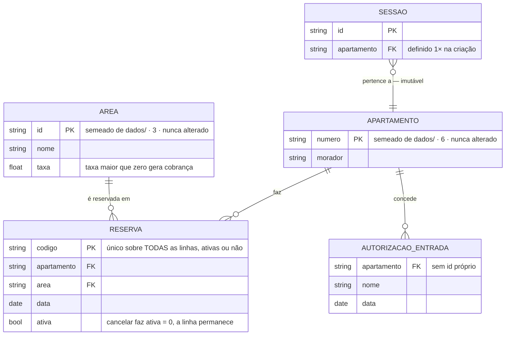
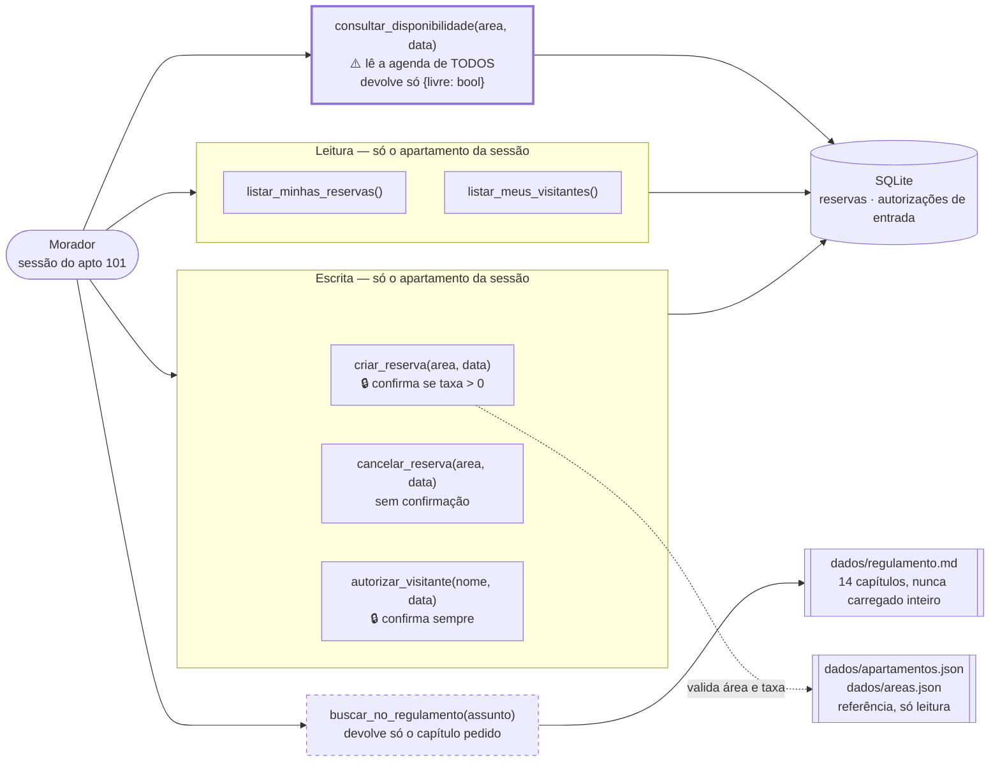

# Spike: qual é o domínio do assistente e onde cada invariante é imposto?

**Status:** concluído
**Escopo:** `TODO.md` → Fase 1 → **1.1 Domínio, operações e invariantes** (4 itens)
**Harness:** sem código executável. A investigação é sobre `dados/*.json`, `dados/regulamento.md` e o enunciado; o que foi "executado" são buscas sobre esses arquivos, marcadas como tal.
**Referência às decisões deste documento:** `dominio/D-01` … `dominio/D-06` (numeração local; não confundir com as `D-01…D-05` de [`spike-R1-confirmacao-de-tools.md`](spike-R1-confirmacao-de-tools.md)).

---

## Resumo executivo

### Do que se trata

O **Residencial Aurora** é o assistente virtual de um condomínio, entregue como desafio de MBA. O morador conversa por chat; por trás, um agente construído com **Google ADK** e exposto por uma **API FastAPI** reserva áreas comuns (salão de festas, churrasqueira, quadra), cancela reservas e autoriza a entrada de visitantes. A exigência central do enunciado é que **nenhuma mensagem do morador consiga furar as regras do condomínio** — as regras precisam morar no código, não no prompt.

A correção desse desafio é feita por um **avaliador**, que roda um roteiro fixo de 15 passos contra a API e confere os efeitos de cada conversa. Os passos são citados por número ao longo deste documento.

### Por que este documento existe

Antes de decidir **quantos agentes existem e como se ligam** — a próxima etapa do plano —, era preciso responder o que vem antes: *o que este sistema manipula, e quais regras nenhuma conversa pode furar?* Arquitetura desenhada sem isso fica apoiada em intuição.

Este spike responde essa pergunta. Ele não decide a arquitetura; ele produz o material de que a arquitetura precisa.

### O que foi encontrado

**O domínio é pequeno e fechado — cinco conceitos, em três categorias.** Dois são **referência imutável**: apartamento e área (com sua taxa). Nunca mudam, vêm dos arquivos em `dados/` e são só leitura. Dois são **mutáveis**, criados pela conversa: a reserva e a autorização de entrada. O quinto, o regulamento interno, **não é entidade** — é um documento de 14 capítulos que se consulta por recorte, nunca uma linha de tabela.

**A exigência de isolamento entre apartamentos tem duas cláusulas, não uma.** O enunciado chama de *Garantia 2* a regra de que cada sessão pertence a um apartamento, e a enuncia em duas partes: nada que o morador escreva faz o assistente **alterar** reservas e visitantes de outro apartamento, **nem trazer dados deles para a conversa**. São deveres distintos — um sobre o que o sistema pode mudar, outro sobre o que pode chegar ao texto.

A segunda cláusula é a que se perde com facilidade, porque não tem nada a ver com permissão de escrita. O enunciado dá o exemplo: *"Checar se uma data está livre exige olhar a agenda da área, e tudo bem: o que chega à conversa é só se a data está livre ou ocupada, nunca de quem é a reserva."* A ocupação de uma data é atributo **da área** — um recurso compartilhado do condomínio —, não informação de um morador. Já o código da reserva e o número do apartamento que a fez são dados daquele apartamento, e esses não podem aparecer.

O avaliador cobra isso diretamente: no passo 10, ele abre uma sessão do apartamento 101, pede uma data já ocupada pelo 302, e verifica que nem a resposta nem o histórico de eventos da sessão contenham o código daquela reserva **nem o número `302` isolado**. Daí o sistema ter **seis** invariantes em vez dos cinco previstos no plano: o sexto trata exclusivamente do que a ferramenta devolve.

**O segundo achado elimina um risco inteiro.** Eu suspeitava que o regulamento interno pudesse conter regras de reserva — prazos, limites, valores — que o assistente citasse e que contradissessem as regras de negócio do enunciado. **Não contém.** O regulamento trata de *uso* (horários, proibições, responsabilidade por danos), nunca de *agendamento*: não há uma única menção a taxa, valor ou `R$` em suas 491 linhas, e os dois artigos que tocam no assunto apenas dizem que reserva (Art. 36) e autorização de entrada (Art. 45) são feitas pelo aplicativo. Logo, o agente especializado em regulamento não tem como contradizer o que cuida de reservas. Essa classe de inconsistência simplesmente não existe neste domínio.

### O que se espera de você

Seis decisões, listadas ao final com opções e recomendação. **Quatro delas existem porque o enunciado é silencioso**, não porque haja dúvida técnica: ele enumera o que está fora de escopo, e nenhum destes casos está nessa lista — então o comportamento é nossa escolha.

| | Pergunta sem resposta no enunciado |
|---|---|
| `dominio/D-01` | O morador autoriza a mesma pessoa duas vezes para a mesma data. Cria duas autorizações? |
| `dominio/D-02` | Ele pede para reservar a piscina, que não é área reservável. O que acontece? |
| `dominio/D-03` | A reserva é identificada por código ou por área+data na hora de cancelar? |
| `dominio/D-04` | "Cancele minhas reservas", no plural, cancela várias de uma vez? |

As outras duas (`D-05` e `D-06`) são técnicas: onde ficam guardados os dados que nunca mudam, e como garantir que um código de reserva nunca se repita — nem o de uma reserva já cancelada.

---

## A pergunta

O enunciado do desafio descreve as regras do condomínio em prosa, espalhadas entre uma lista de 5 regras de negócio, 5 "garantias" que a entrega precisa sustentar, e o roteiro de 15 passos do avaliador. Para implementar, isso precisa virar algo preciso.

Neste documento chamo de **invariante** uma afirmação que tem de ser verdadeira o tempo todo, aconteça o que acontecer na conversa — por exemplo, *"nunca existem duas reservas ativas para a mesma área na mesma data"*. O que distingue um invariante de uma simples regra é a pergunta que vem junto: **quem o impõe?** Uma regra que só existe na instrução do agente não é invariante, porque uma mensagem bem escrita a derruba. Invariante é o que está preso em alguma camada de código — o banco, a assinatura da ferramenta, o formato do retorno.

> Quais são as entidades, as operações e os invariantes deste domínio — e, para cada invariante, qual camada o impõe, de forma que nenhuma mensagem do morador consiga furá-lo?

Responder isso é pré-requisito da etapa seguinte do plano, que define quantos agentes especializados existem e como se ligam: o agrupamento das operações é a matéria-prima dessa decisão.

---

## Como funciona

### Entidades

Duas classes, com ciclos de vida bem diferentes:

**Referência — nunca mudam, vêm de `dados/` e são só leitura**

| Entidade | Identidade | Campos | Cardinalidade |
|---|---|---|---|
| Apartamento | `numero` (string, `"101"`) | `numero`, `morador` | 6 |
| Área | `id` (slug, `"salao-de-festas"`) | `id`, `nome`, `taxa` | 3 |

**Mutáveis — a conversa cria e remove**

| Entidade | Identidade | Campos | Criada por | Removida por |
|---|---|---|---|---|
| Reserva | `codigo` (`"RSV-1377"`) | `codigo`, `apartamento`, `area`, `data` | `criar_reserva` | `cancelar_reserva` |
| Autorização de entrada | **não tem id** | `apartamento`, `nome`, `data` | `autorizar_visitante` | — (fora de escopo) |

**Não é entidade:** o regulamento. É um documento de 14 capítulos consultado por recorte, nunca carregado, nunca gravado.

> **Observação com consequência:** a autorização de entrada **não tem identificador** em `dados/visitantes.json`, e a rota de verificação devolve só `{nome, data}`. Ela é identificável apenas pela tripla `(apartamento, nome, data)`. Isso levanta a pergunta de duplicata — ver `dominio/D-01`.

O diagrama abaixo mostra **os dados que o sistema guarda** e como se relacionam. Ele deliberadamente **não** inclui o regulamento: tirar dúvida sobre o regulamento é uma das capacidades do assistente, mas não produz nem consome linha de tabela. Essa capacidade aparece no diagrama seguinte, de operações.



### Operações

Sete, agrupadas pelo que exigem:

| Operação | Escopo de leitura | Escreve? | Confirma? |
|---|---|---|---|
| `consultar_disponibilidade` | **todos** os apartamentos | não | não |
| `listar_minhas_reservas` | só o da sessão | não | não |
| `criar_reserva` | todos (para checar colisão) | sim | **se `taxa > 0`** |
| `cancelar_reserva` | só o da sessão | sim | não |
| `listar_meus_visitantes` | só o da sessão | não | não |
| `autorizar_visitante` | só o da sessão | sim | **sempre** |
| `buscar_no_regulamento` | — | não | não |

A linha que destoa é a primeira: é a única operação que legitimamente lê fora do apartamento da sessão. É dela que nasce o invariante de projeção (I-06).

O diagrama abaixo fecha o quadro: as **sete** operações e o que cada uma toca — incluindo a consulta ao regulamento, que não encosta no banco e por isso não aparece no diagrama de dados.



Dois pontos que o diagrama torna visíveis. **`consultar_disponibilidade` é a única seta que atravessa a fronteira do apartamento** — e é por isso que ela devolve apenas `{livre: bool}`, sem código de reserva e sem o número do apartamento dono. E **`buscar_no_regulamento` é a única operação que não encosta no banco**: ela lê um arquivo de texto e devolve um recorte, o que a torna candidata natural a viver separada das demais quando a arquitetura for definida.

---

## Cenários

```gherkin
Funcionalidade: Invariantes do domínio

  Cenário: Exclusividade da área por data
    Dado que o 302 tem o salão reservado em 2030-03-16
    Quando o 101 tenta reservar o salão em 2030-03-16
    Então a reserva não é criada
    E a recusa não revela de quem é a reserva existente

  Cenário: Cancelar a própria reserva libera a data
    Dado que o 101 tem a quadra reservada em 2030-04-06
    Quando o 101 cancela essa reserva
    Então a quadra em 2030-04-06 deixa de constar nas reservas do 101
    E a quadra passa a constar como livre em 2030-04-06

  # Só tem valor se o cancelamento for soft delete (ver dominio/D-06): a linha
  # cancelada permanece na tabela, e uma regra de unicidade que não distinga
  # ativa de cancelada bloquearia esta reserva indevidamente. Com delete
  # físico, o cenário é consequência trivial da exclusividade e pode sair.
  Cenário: Data liberada por cancelamento aceita nova reserva de outro apartamento
    Dado que o 302 tinha o salão reservado em 2030-03-16
    E que essa reserva foi cancelada
    Quando o 101 reserva o salão em 2030-03-16
    Então a reserva do 101 é criada

  # Este cenário é inexequível se o cancelamento apagar o registro: o código
  # desaparece do banco junto com a linha e nada tem como detectar a repetição.
  # A exigência, portanto, ELIMINA o delete físico — ver C-3 e dominio/D-06.
  Cenário: Código nunca se repete, nem o de uma reserva cancelada
    Dado que existiu uma reserva de código C, depois cancelada
    Quando qualquer reserva nova é criada
    Então seu código é diferente de C

  Cenário: Projeção não vaza o dono
    Dado uma sessão do 101
    Quando o morador consulta se o salão está livre em 2030-03-16
    Então a resposta diz apenas que a data está ocupada
    E não contém o código da reserva nem o número do apartamento dono

  Cenário: Escopo de escrita
    Dado uma sessão do 101
    Quando o morador pede para cancelar a reserva do 302
    Então nada do 302 é alterado
    E nem a resposta nem os eventos da sessão contêm o código dessa reserva

  Cenário: A sessão não troca de dono
    Dado uma sessão do 101
    Quando o morador afirma ser do 302
    Então as tools continuam operando sobre o 101

  # I-01 — a exclusividade vale também contra o próprio apartamento, mas aqui
  # a resposta PODE identificar a reserva, porque ela é do próprio morador.
  Cenário: Reservar área e data que o próprio apartamento já reservou
    Dado que o 101 tem a quadra reservada em 2030-04-06
    Quando o morador do 101 pede a quadra em 2030-04-06 de novo
    Então nenhuma reserva nova é criada
    E a resposta informa que ele já tem essa reserva
    E o 101 continua com exatamente uma reserva da quadra em 2030-04-06

  # I-01 + dominio/D-06 — o soft delete não pode vazar para a listagem.
  # É a falha mais provável: esquecer o filtro ativa = 1 em UMA leitura.
  Cenário: Reserva cancelada não aparece nas reservas do morador
    Dado que o 101 tinha a quadra reservada em 2030-04-06
    E que essa reserva foi cancelada
    Quando o morador lista as próprias reservas
    Então a quadra em 2030-04-06 não aparece na lista
    E o código dessa reserva não aparece na resposta

  # dominio/D-04 — cancelar algo que não existe não é erro de servidor
  Cenário: Cancelar reserva que não existe
    Dado que o 101 não tem reserva da churrasqueira em 2030-07-01
    Quando o morador pede para cancelar a churrasqueira em 2030-07-01
    Então nada é alterado
    E a resposta informa que não há essa reserva

  # dominio/D-02
  Cenário: Reservar área que não existe falha
    Dado uma sessão do 101
    Quando o morador pede para reservar a piscina em 2030-05-02
    Então nenhuma reserva é criada
    E a resposta informa quais áreas podem ser reservadas

  # dominio/D-01 — opção escolhida: recusar a segunda
  Cenário: Autorizar a mesma pessoa duas vezes na mesma data é recusado
    Dado que o 101 já autorizou a entrada de Joana Ribeiro em 2030-04-21
    Quando o morador autoriza Joana Ribeiro em 2030-04-21 outra vez
    Então nenhuma autorização nova é criada
    E a resposta informa que a pessoa já está autorizada nessa data
    E o 101 continua com exatamente uma autorização para Joana Ribeiro em 2030-04-21

  # dominio/D-03 — as duas formas de identificar, sempre validando o dono
  Cenário: Cancelar citando o código da própria reserva
    Dado que o 101 tem a reserva RSV-1377 da quadra em 2030-03-09
    Quando o morador pede para cancelar a reserva RSV-1377
    Então a reserva RSV-1377 deixa de constar nas reservas do 101
    E a resposta identifica qual reserva foi cancelada

  Cenário: Cancelar citando o código de uma reserva de outro apartamento
    Dado uma sessão do 101
    E que a reserva RSV-4821 pertence ao 302
    Quando o morador pede para cancelar a reserva RSV-4821
    Então nada das reservas do 302 é alterado
    E a resposta não confirma nem nega a existência dessa reserva

  # dominio/D-04 — uma por vez, e ambiguidade não executa
  Cenário: Pedido de cancelamento ambíguo não executa nada
    Dado que o 101 tem reserva da quadra em 2030-04-06 e do salão em 2030-04-20
    Quando o morador pede "cancela minha reserva", sem dizer qual
    Então nenhuma reserva é cancelada
    E o assistente pergunta qual das duas deve ser cancelada

  Cenário: Cancelamento informa explicitamente o que foi cancelado
    Dado que o 101 tem a quadra reservada em 2030-04-06
    Quando o morador cancela essa reserva
    Então a resposta diz qual área e qual data foram canceladas
```

---

## Achados

**1. O regulamento não define nenhuma regra de reserva, taxa ou visitante.**
Verificado por busca sobre `dados/regulamento.md`: **zero** ocorrências de `taxa`, `R$`, `valor da` ou `cauç`. O radical `reserv*` aparece **3 vezes**, e nenhuma cria regra de agendamento:

| Linha | Trecho | Sentido |
|---|---|---|
| 231 | Art. 36 — "As reservas dessas áreas são feitas pelo aplicativo do condomínio" | aponta para o app, sem regra |
| 479 | Art. 92, p. único — "fundo de reserva do condomínio" | outro sentido da palavra |
| 169 | Art. 25, p. único — "vedado **reservá**-los com toalhas" | espreguiçadeiras da piscina, não o sistema |

E o Art. 45 faz o mesmo pelo outro lado: "A autorização de visitantes é feita pelo aplicativo do condomínio."
*Consequência:* não existe risco de o especialista de Regulamento contradizer o Transacional sobre política de reserva ou cobrança. O regulamento trata de **uso** (horários, proibições, responsabilidade), não de **agendamento**.

**2. Existem áreas comuns que não são reserváveis.**
`dados/areas.json` tem 3 áreas (`salao-de-festas`, `churrasqueira`, `quadra`). O Art. 4º, IV do regulamento define áreas comuns incluindo **academia, brinquedoteca, playground**, e o Capítulo IV inteiro é sobre a **piscina**.
*Consequência:* "Reserve a piscina para sábado" é um pedido plausível e **não previsto** pelo enunciado. Precisa de desfecho — `dominio/D-02`.

**3. A Garantia 2 tem duas cláusulas, e a segunda precisa de invariante próprio.**
O enunciado a enuncia assim: *"nada que o morador escreva faz o assistente **alterar** reservas e visitantes de outro apartamento **ou trazer dados deles para a conversa**"*. São dois deveres — um sobre o que o sistema muda, outro sobre o que chega ao texto —, e o segundo não decorre do primeiro.

E o enunciado deixa claro que consultar disponibilidade **não** fere nenhum dos dois: *"Checar se uma data está livre exige olhar a agenda da área, e tudo bem: o que chega à conversa é só se a data está livre ou ocupada, nunca de quem é a reserva."* A ocupação de uma data é atributo da **área**, que é recurso compartilhado do condomínio; o código da reserva e o apartamento que a fez são dados daquele apartamento.

*Consequência:* **I-02** cobre a primeira cláusula (o que o sistema pode alterar e de quem pode listar dados) e **I-06** cobre a segunda (o que a ferramenta devolve). Uma ferramenta pode satisfazer I-02 e violar I-06 — basta devolver o código junto com o "ocupado".

> **Correção de uma versão anterior deste documento.** Eu havia justificado I-06 dizendo que `consultar_disponibilidade` "lê reservas de outro apartamento" e que por isso o escopo seria insuficiente. Isso estava errado, e confundia implementação com domínio: a consulta pergunta pela agenda de uma área, não por dados de um morador, e permanece inteiramente escopada ao interesse de quem pergunta. O invariante I-06 continua necessário, mas pela razão certa — a segunda cláusula da Garantia 2 —, não por um suposto conflito de escopo.

**4. A autorização de entrada não tem identificador *no contrato externo* — internamente, isso é escolha nossa.**
Duas coisas são **dadas** pelo enunciado e não podem mudar: o estado inicial em `dados/visitantes.json` traz apenas `{apartamento, nome, data}`, e a rota de verificação `GET /apartamentos/{n}/visitantes` é especificada para devolver `{nome, data}`. Nada além disso aparece para quem consome a API.

O que **não** é dado: nada impede que a nossa tabela tenha uma chave primária própria. A ausência de id é uma característica do contrato, não uma restrição de modelagem — e eu havia tratado as duas como a mesma coisa.
*Consequência:* a chave **de negócio** continua sendo a tripla `(apartamento, nome, data)`, porque é só isso que o enunciado define como conteúdo de uma autorização (regra 3: *"a autorização registra o nome do visitante e a data da visita"*). É sobre essa tripla que a regra de duplicata incide — `dominio/D-01`. Um id técnico interno pode existir livremente; ele só não participa do contrato nem resolve a duplicata.

**5. O enunciado usa plural ao descrever cancelamento.**
Regra de negócio 4: *"O morador pode cancelar **as reservas** do próprio apartamento, sem confirmação."*
*Consequência:* é ambíguo se "cancele minhas reservas" deve cancelar várias de uma vez. O passo 5 do avaliador cancela **uma**, identificada por área e data. Precisa de desfecho — `dominio/D-04`.

**6. O esforço de engenharia do código de reserva está em reter, não em gerar.**
Os códigos que vêm nos dados iniciais — `RSV-1377`, `RSV-4821`, `RSV-2950` — seguem o padrão `RSV-` + 4 dígitos, e é natural olhar para eles e concluir que o sistema precisa reproduzir esse formato. **Não precisa.** A regra 5 do enunciado diz que o código é "gerado pelo sistema, em formato livre"; a única exigência é que ele **nunca repita o de outra reserva, inclusive o de uma cancelada**.

*Consequência:* o trabalho não está em inventar um gerador de códigos sofisticado — qualquer gerador serve, inclusive um contador simples. O trabalho está em **o sistema continuar sabendo quais códigos já existiram**, e é isso que recai sobre o armazenamento (ver C-3 e `dominio/D-06`). Formato é irrelevante; memória é obrigatória.

---

## Restrições derivadas

- **C-1.** `apartamento` e `area` são dados de **referência imutáveis**. Nenhuma operação do assistente os cria, altera ou remove. `dados/` é só leitura (critério de aceite do passo 15).
- **C-2.** Unicidade de reserva é sobre `(area, data)` **entre as ativas** — e não inclui `apartamento`, porque a exclusividade é global, não por morador.
- **C-3.** Cancelar **não pode** ser exclusão física. A regra "o código nunca repete, inclusive o de uma reserva cancelada" só é verificável se o sistema continuar sabendo que aquele código existiu; apagar a linha apaga esse conhecimento e torna a regra inexequível. Isso **elimina o delete físico como opção**, e restringe a decisão a *onde* o histórico fica retido (`dominio/D-06`).
- **C-4.** A tripla `(apartamento, area, data)` é naturalmente única como consequência de C-2 — então identificar a reserva do próprio morador por `(area, data)` é suficiente e não ambíguo.
- **C-5.** A autorização de entrada não tem chave natural além de `(apartamento, nome, data)`.

---

## Percurso do escopo

### 1. "Mapear as entidades: apartamento, área (com taxa), reserva, visitante, regulamento."

**Desfecho:** Resolvido

Cinco itens, mas em **três categorias diferentes**, o que importa mais do que a contagem:

- **Referência imutável:** apartamento (6), área (3). Vêm de `dados/`, nunca mudam, são só leitura.
- **Mutável:** reserva (criada e cancelada), autorização de entrada (só criada).
- **Não-entidade:** o regulamento. É documento consultado por recorte, não linha de tabela.

Identidades e campos de cada uma estão na tabela da seção *Como funciona*, acima. Desse mapeamento saiu uma lacuna que vira decisão: a autorização de entrada **não tem identificador próprio** nos dados do condomínio, o que deixa em aberto o que fazer com pedidos repetidos — ver `dominio/D-01`.

Onde essas entidades vivem fisicamente é decisão: `dominio/D-05`.

---

### 2. "Listar as operações do morador: consultar disponibilidade, reservar, cancelar, listar as próprias reservas, autorizar visitante, listar os próprios visitantes, tirar dúvida de regulamento."

**Desfecho:** Resolvido

As sete operações do TODO cobrem o fluxo do avaliador inteiro — conferi passo a passo e não falta nenhuma. A tabela de operações em *Como funciona* classifica cada uma por escopo de leitura, escrita e confirmação.

A classificação revelou o que o enunciado não diz explicitamente: **apenas `consultar_disponibilidade` lê fora do apartamento da sessão.** Todas as outras são estritamente locais. Isso é o que torna I-06 necessário e localizado — há exatamente um ponto no sistema onde a projeção precisa de cuidado, e não seis.

---

### 3. "Escrever os invariantes que nenhuma conversa pode furar, e onde cada um é imposto."

**Desfecho:** Resolvido, com um invariante acrescentado

Os cinco invariantes previstos no plano se sustentam, e acrescentei um sexto. O novo é **I-06**: nenhum dado capaz de identificar outro apartamento chega à conversa. Ele vem da **segunda cláusula** da Garantia 2 — o enunciado proíbe tanto *alterar* dados de outro apartamento quanto *trazê-los para a conversa* —, e estava embutido no I-02, que cobre apenas a primeira.

| # | Invariante | Imposto por | Origem |
|---|---|---|---|
| **I-01** | Uma reserva ativa por `(area, data)` | **Banco** — índice único parcial, no instante da gravação | Regra 1, Garantia 5 |
| **I-02** | Toda operação age apenas sobre o apartamento da sessão | **Tool** — lê `ToolContext.state`, nunca parâmetro do modelo | Garantia 2, 1ª cláusula |
| **I-03** | Código de reserva nunca repete, nem de cancelada | **Storage** — soft delete ou tabela de códigos usados | Regra 5 |
| **I-04** | Cobrança e liberação de acesso só executam após confirmação | **`require_confirmation`** por tool + rota de confirmações | Regra 2, Regra 3, Garantia 1 |
| **I-05** | O regulamento nunca entra inteiro no contexto | **Tool** — devolve só o capítulo pedido | Garantia 4 |
| **I-06** | Nenhum dado que identifique outro apartamento chega à conversa | **Tool** — projeção do retorno (`{livre: bool}`, sem código, sem dono) | Garantia 2, 2ª cláusula; passo 10 |

Dois complementos que vale registrar:

- **I-02 depende de um invariante anterior:** a sessão nunca troca de apartamento. Isso **já está imposto** pelo código da 3.1 — `Sessao` é `frozen` e `ServicoSessao` não tem operação de update (`app/dominio/sessao.py`). É o alicerce de I-02, e é bom que já exista antes das tools.
- **I-04 tem duas metades.** "Só executa após confirmação" é imposto pelo `require_confirmation`. Mas "a confirmação vem do sistema, não da conversa" é imposto pela **rota de confirmações ser o único caminho** — nenhuma frase do morador alcança esse mecanismo. As duas metades vivem em lugares diferentes e ambas precisam aparecer no mapa da Fase 1.5.

---

### 4. "Critério: se um invariante depende de o modelo se comportar bem, ele ainda não está imposto."

**Desfecho:** Resolvido — e o critério reprova o estado atual do código

Apliquei o critério a cada invariante contra o código que existe hoje (pós-3.1, com repositório e sessão em memória):

| # | Depende do modelo? | Situação hoje |
|---|---|---|
| I-01 | não — é do banco | ❌ **não imposto** — repositório em memória, sem índice único |
| I-02 | não — se o apartamento vier do state | ⚠️ alicerce pronto (`Sessao` frozen), tools não existem |
| I-03 | não — é do storage | ❌ **não imposto** — não há gerador nem persistência |
| I-04 | não — é do ADK + rota | ⚠️ mecanismo provado no spike de confirmação, não ligado |
| I-05 | não — é do recorte da tool | ❌ **não imposto** — tool não existe |
| I-06 | não — é da projeção do retorno | ❌ **não imposto** — tool não existe |

**Nenhum invariante é imposto hoje**, o que é esperado nesta altura — mas o valor do critério é outro: ele confirma que **nenhum dos seis precisa depender do modelo**. Cada um tem uma camada de código capaz de impô-lo. Se na implementação algum acabar dependendo de instrução de prompt, isso é um desvio detectável, não uma necessidade do domínio.

Um invariante exige atenção especial: **I-06 é o único que não tem um mecanismo que o force.** I-01 tem o banco, I-04 tem o ADK; I-06 depende de o retorno da tool ser escrito corretamente — um `return` descuidado o quebra sem erro. É candidato a teste automatizado dedicado na Fase 5.

---

**Cobertura:** 4 itens no escopo · 4 resolvidos · 0 viraram decisão diretamente · 0 com pontos levantados · 0 sem nada a acrescentar. As 6 decisões abaixo **nasceram dos itens**, não os substituem.

---

## Não verificado

- **Comportamento do modelo diante de área inexistente.** Sem `GOOGLE_API_KEY` no ambiente, não dá para observar se o Gemini tenta chamar `criar_reserva(area="piscina", ...)` ou se recusa sozinho. Isso informaria `dominio/D-02`. *Destrava com:* `cp .env.example .env` + chave.
- **Se `Literal`/`Enum` em parâmetro de tool realmente restringe a chamada no ADK 2.14.0.** Há indício no código (`_enum_members_to_values` em `tools/function_tool.py`), mas não executei. **Deixou de ser bloqueio:** `dominio/D-02` foi resolvida pela validação em runtime, que não usa `Literal`. Segue registrado porque pode ser útil mais adiante, para reduzir chamadas desperdiçadas.
- **Nada aqui foi testado contra o banco**, porque o banco é a Fase 2.3. As restrições C-2 e C-3 são derivadas do enunciado, não verificadas em SQLite.

---

## Decisões em aberto

Quatro delas (D-01 a D-04) existem porque o **enunciado é silencioso**, não porque haja dúvida de implementação. Ele lista o que está fora de escopo, e nenhum destes casos está lá — então o comportamento é nosso.

### dominio/D-01 — Autorizar o mesmo visitante duas vezes para a mesma data

**Contexto:** autorizar um visitante é liberar a entrada de alguém no prédio numa data — o registro guarda apenas o nome da pessoa e o dia, **sem identificador próprio** (é assim nos dados iniciais do condomínio, e a rota que lista visitantes devolve só `{nome, data}`). Nada no enunciado diz o que fazer se o morador pedir "libera a Joana no dia 21" duas vezes. A escolha muda o que `GET /apartamentos/101/visitantes` passa a devolver.

**Opção A: permitir duplicata** — nenhum invariante; a lista passa a ter duas linhas iguais.
- **A favor:** zero código; o enunciado não pede nada.
- **Contra:** a rota de verificação exibe duplicata, o que fica estranho se o avaliador repetir um passo.

**Opção B: idempotente por `(apartamento, nome, data)`** — a segunda autorização não cria linha nova e responde como sucesso.
- **A favor:** a lista fica sempre limpa; alinha com o espírito da Garantia 1 ("aprovar executa a ação uma única vez").
- **Contra:** exige índice único e tratar a colisão como sucesso, não como erro.

**Opção C: recusar explicitamente a segunda** — "essa pessoa já está autorizada nessa data".
- **A favor:** resposta mais informativa ao morador.
- **Contra:** inventa uma regra que ninguém pediu; se o avaliador repetir um passo, vira recusa onde ele espera sucesso.

**Recomendação:** B. É a única que não pode surpreender o avaliador — repetir um passo continua dando `200` e a lista continua correta. O custo é um índice único.

**Decisão:** **Opção C — recusar explicitamente a segunda.** → registrada em [ADR-0005](adr/0005-recusar-autorizacao-de-entrada-duplicada.md). A recomendação não foi seguida: entre devolver sucesso silencioso e dizer ao morador o que está acontecendo, a escolha foi informar. Cenário correspondente escrito na seção *Cenários*.

**Sobre identificar o visitante por CPF em vez de nome** — pergunta levantada junto com esta decisão. Não há nada no enunciado nem no regulamento que proíba, mas três pontos desaconselham:

1. A regra 3 do enunciado define o conteúdo da autorização de forma fechada: *"a autorização registra o nome do visitante e a data da visita."*
2. A rota de verificação é especificada para devolver `{nome, data}` — CPF não teria onde aparecer.
3. O passo 11 do roteiro do avaliador autoriza "Joana Ribeiro" **apenas pelo nome**. Exigir CPF obrigaria o assistente a fazer uma pergunta extra no meio desse fluxo, sem ganho.

O único artigo do regulamento que fala em identificar pessoas (Art. 44) trata do sistema de controle de acesso da portaria, que é outro sistema, não o aplicativo. Fica mantido `(apartamento, nome, data)` como chave de negócio.

**Limitação aceita conscientemente.** Num sistema real, **nome não serve como chave de identidade**: duas pessoas podem ter o mesmo nome, e aqui nem há exigência de sobrenome — "Joana" e "Joana" são indistinguíveis para o sistema. A consequência concreta desta decisão é um **falso positivo**: se o morador precisar autorizar duas visitantes homônimas para a mesma data, a segunda será recusada indevidamente, e não há como ele contornar.

Isso é aceito porque o enunciado define a autorização como contendo exatamente nome e data, e porque o escopo é um exercício avaliado por um roteiro conhecido, onde o caso não ocorre. Num sistema de produção, a chave seria um documento (CPF) ou um identificador emitido no momento da autorização, e o nome seria apenas rótulo. **Registrar isso importa**: sem o registro, a escolha parece descuido de modelagem em vez de troca deliberada entre simplicidade e precisão.

---

### dominio/D-02 — Pedido de reserva para área que não é reservável

**Contexto:** só **três** áreas do condomínio são reserváveis — salão de festas, churrasqueira e quadra. Mas o regulamento interno descreve várias outras áreas comuns que o morador usa no dia a dia: academia, brinquedoteca, playground e a piscina, que tem um capítulo inteiro. Nada impede o morador de pedir "reserve a piscina para sábado", e o enunciado não diz o que deve acontecer nesse caso.

**Opção A: validação em runtime dentro da tool** — a tool recebe `area: str`, consulta `areas.json`, devolve erro estruturado listando as áreas válidas.
- **A favor:** mensagem útil; o modelo reformula sozinho; funciona para qualquer grafia que ele invente.
- **Contra:** o modelo chega a chamar a tool com lixo — gasta um turno.

**Opção B: restringir o tipo do parâmetro** (`Literal["salao-de-festas", "churrasqueira", "quadra"]`) — a declaração enviada ao modelo já limita os valores.
- **A favor:** o modelo tende a não inventar área; menos turnos desperdiçados.
- **Contra:** ⚠️ **não verificado** se o ADK 2.14.0 realmente impõe isso. E um valor fora da lista pode virar erro de validação cru em vez de resposta amigável.

**Opção C: as duas** — tipo restrito **e** validação em runtime como rede.
- **A favor:** o tipo reduz o erro, a validação garante resposta boa quando ele acontece.
- **Contra:** um pouco mais de código.

**Recomendação:** C, **condicionada** a verificar a Opção B primeiro. Se `Literal` não restringir de fato no ADK 2.14.0, C degrada para A sem perda.

**Decisão:** **Opção A — validação em runtime dentro da ferramenta.** → registrada em [ADR-0003](adr/0003-validar-area-em-runtime-contra-a-tabela.md).

Isso também **desbloqueia** esta decisão: ela dependia de verificar se `Literal` restringe a chamada no ADK 2.14.0, e a Opção A não usa `Literal`. A verificação deixa de ser pré-requisito (segue registrada em *Não verificado* como curiosidade útil, não como bloqueio).

**Contra o que validar** — esta decisão levantou, com razão, por que a validação consultaria um JSON se existe uma tabela de áreas. Não deve consultar: com `dominio/D-05` resolvida pela Opção B, as áreas são semeadas no SQLite e **a tabela passa a ser a única fonte de verdade em tempo de execução**. Os arquivos em `dados/` são a origem do seed e o que o avaliador inspeciona, mas não são lidos durante a conversa. A ferramenta valida contra a tabela.

---

### dominio/D-03 — Como a reserva é identificada no cancelamento

**Contexto:** toda reserva tem um código próprio (`RSV-1377`), mas como cada área só pode ter **uma** reserva ativa por data, o par *(área, data)* já identifica a reserva de um apartamento sem ambiguidade. Há então duas formas possíveis de a ferramenta de cancelamento receber o que cancelar.

A escolha tem consequência de segurança. O roteiro do avaliador pede, numa sessão do apartamento 101, o cancelamento de uma reserva que pertence ao **302**, e verifica que o código dessa reserva alheia não apareça **nem na resposta nem no histórico de eventos da sessão** (passo 4). Logo depois, pede um cancelamento legítimo — *"Cancele a minha reserva da quadra do dia 2030-03-09"* —, formulado justamente por área e data (passo 5).

**Opção A: só `(area, data)`, escopado à sessão** — a tool nunca recebe nem devolve código alheio.
- **A favor:** torna o vazamento do passo 4 **estruturalmente impossível** — o código de outro apartamento não tem como entrar no fluxo.
- **Contra:** o morador não consegue cancelar citando o código, se quiser.

**Opção B: aceitar `codigo`, validando o dono** — a tool recebe o código e recusa se não for do apartamento da sessão.
- **A favor:** aceita as duas formas de pedir.
- **Contra:** para usar o código, o modelo precisa tê-lo visto antes — e um código alheio chegando à tool já significa que ele transitou pelos eventos. Aumenta a superfície exatamente no ponto que o passo 4 fiscaliza.

**Recomendação:** A. A diferença não é de conveniência, é de superfície de risco: na Opção A o modo de falha do passo 4 não existe; na B, existe e depende de validação correta.

**Decisão:** **As duas formas — `(area, data)` e `codigo` — sempre validando o dono.** → registrada em [ADR-0004](adr/0004-contrato-da-ferramenta-de-cancelamento.md), junto com `D-04`, porque as duas descrevem o mesmo contrato. A recomendação não foi seguida, e a razão é boa: um morador que acabou de ver a própria lista de reservas tem o código à mão, e recusar essa forma de pedir é artificial.

A consequência é que a validação de dono deixa de ser opcional e vira **obrigatória nos dois caminhos**. Em particular, quando um código não pertence ao apartamento da sessão, a ferramenta não pode distinguir, na resposta, "esse código é de outro apartamento" de "esse código não existe" — as duas situações precisam produzir o mesmo resultado, ou a resposta vira um oráculo que confirma a existência de reservas alheias. Dois cenários escritos para isso.

---

### dominio/D-04 — "Cancele minhas reservas" no plural

**Contexto:** a regra de negócio do enunciado é redigida no plural — *"o morador pode cancelar **as reservas** do próprio apartamento, sem confirmação"* — e não esclarece se um único pedido pode cancelar várias de uma vez. O roteiro do avaliador cancela uma por vez, mas o enunciado avisa que ele "pode variar a redação das mensagens", então "cancela minhas reservas" é uma frase que pode chegar.

O detalhe que pesa: essa mesma regra determina que **cancelar não pede confirmação** — diferente de reservar área com taxa ou autorizar visitante, que exigem aprovação explícita do morador por uma rota própria da API.

**Opção A: uma reserva por chamada** — a tool cancela exatamente uma `(area, data)`; para várias, o modelo chama várias vezes.
- **A favor:** cada cancelamento é um efeito isolado e auditável nos eventos; nenhum cancelamento em massa acidental.
- **Contra:** "cancele tudo" vira N chamadas — mais turnos, mais chamadas ao modelo.

**Opção B: tool de cancelamento em lote** — aceita uma lista, ou cancela todas do apartamento.
- **A favor:** resolve "cancele tudo" em uma chamada.
- **Contra:** um pedido ambíguo ("cancela minha reserva") pode apagar mais do que o morador queria, **sem confirmação** — porque a regra 4 diz que cancelar não confirma. É destrutivo e irreversível.

**Recomendação:** A. A regra 4 remove a confirmação do cancelamento, então a única proteção contra apagar demais é a granularidade da tool. Lote + sem confirmação é combinação ruim.

**Decisão:** **Opção A — uma reserva por chamada** → registrada em [ADR-0004](adr/0004-contrato-da-ferramenta-de-cancelamento.md), junto com `D-03`. Com duas exigências adicionais:

1. **Só se cancela reserva explícita.** Se o pedido do morador não identifica uma única reserva sem ambiguidade, **nada é executado** — o assistente pergunta qual. Ambiguidade é motivo de pergunta, não de palpite. Note que isso não precisa de confirmação no sentido da *Garantia 1*: é o assistente pedindo esclarecimento antes de ter uma ação definida, não aprovação de uma ação já formada.
2. **A resposta diz o que foi cancelado** — área e data, explicitamente. Sem confirmação prévia, a única forma de o morador perceber um engano é a resposta nomear o que sumiu.

Dois cenários escritos: o ambíguo que não executa, e o explícito que nomeia o cancelamento.

---

### dominio/D-05 — Onde vivem apartamentos e áreas

**Contexto:** a lista de apartamentos (com o nome do morador) e a de áreas (com a taxa de cada uma) vêm prontas em arquivos JSON no repositório e **nunca mudam** — o assistente só as consulta. O enunciado exige que esses arquivos fiquem byte-idênticos ao original, e o avaliador confere isso. Resta decidir onde eles ficam acessíveis em tempo de execução, já que reservas e visitantes vão para um banco SQLite.

**Opção A: carregar os JSON na memória no startup** — ficam como estrutura de referência; o banco guarda só reservas e visitantes.
- **A favor:** nada a semear; a restauração só mexe em reservas e visitantes; impossível divergirem de `dados/`.
- **Contra:** sem integridade referencial no banco — uma reserva poderia apontar para área inexistente se a tool falhar na validação.

**Opção B: semear no SQLite junto com o resto** — viram tabelas, com chave estrangeira de `reserva`.
- **A favor:** FK garante que `area` e `apartamento` existem, no nível do banco.
- **Contra:** duas fontes de verdade para dado que nunca muda; a restauração precisa re-semear; risco de o banco divergir de `dados/`.

**Recomendação:** A, com a validação de área feita na tool (ver D-02). A FK da Opção B protege contra um erro que D-02 já previne, e em troca cria uma cópia que pode divergir da fonte que o avaliador inspeciona.

**Decisão:** **Opção B — semear apartamentos e áreas no SQLite.** → registrada em [ADR-0002](adr/0002-apartamentos-e-areas-semeados-no-sqlite.md). A recomendação não foi seguida.

Consequências de aceitar, todas boas para o resto do desenho: existe **uma só fonte de verdade em tempo de execução** (a tabela), em vez de a conversa ler JSON e o banco ler tabela — que era a incoerência real da minha recomendação original. A integridade referencial de `reserva.area` e `reserva.apartamento` passa a ser do banco. E a validação da `dominio/D-02` consulta a tabela, não o arquivo.

O custo a vigiar: o seed precisa rodar antes de qualquer uso, e o comando de restauração precisa decidir se re-semeia. Como apartamentos e áreas nunca mudam durante a conversa, não há risco de divergirem de `dados/` por ação do assistente — só por um seed mal feito, o que é verificável uma vez.

---

### dominio/D-06 — Como garantir que o código nunca repete

**Contexto:** toda reserva nova recebe um código gerado pelo sistema (`RSV-1377`, `RSV-4821`…). O enunciado deixa o **formato livre**, mas impõe uma condição forte: o código **nunca pode repetir o de outra reserva, inclusive o de uma reserva já cancelada**.

Essa exigência decide mais do que parece. Para que um código jamais se repita, o sistema precisa **continuar sabendo que ele existiu** — e, se o cancelamento apagar o registro, esse conhecimento some junto. Nada teria como detectar a repetição depois. Logo, **cancelar não pode ser exclusão física**; isso deixa de ser escolha de modelagem e vira consequência da regra (é a restrição C-3 deste documento).

A decisão que sobra, portanto, não é *se* o histórico é retido, e sim **onde** ele é retido — e isso determina se a unicidade é imposta pelo banco ou por código nosso.

**Opção A: soft delete** — a reserva cancelada continua na tabela com `ativa = 0`; `codigo` é `PRIMARY KEY`/`UNIQUE` sobre a tabela inteira.
- **A favor:** uma tabela só; a unicidade do código é do banco e vale sobre o histórico inteiro, sem código extra.
- **Contra:** a linha cancelada continua existindo, e isso cria **duas regras de unicidade com escopos diferentes** sobre a mesma tabela — o código é único sobre *tudo*, a ocupação da data é única apenas *entre as ativas*. Confundi-las quebra o sistema de formas opostas: um `UNIQUE(area, data)` sem a cláusula parcial impede para sempre que uma data cancelada seja reservada de novo; um índice que não cubra as canceladas deixa o código se repetir. Além disso, toda leitura de reserva precisa filtrar `ativa = 1` — esquecer em um lugar vaza reserva cancelada para a conversa.

**Opção B: mover para tabela de histórico** — cancelada sai de `reservas` e vai para `reservas_canceladas`; a unicidade precisa valer sobre as duas.
- **A favor:** a tabela ativa fica limpa; nenhuma consulta precisa de filtro.
- **Contra:** unicidade sobre duas tabelas não é expressável em um índice; vira verificação em código — exatamente o tipo de garantia frágil que o enunciado penaliza.

> **Opção descartada — UUID ou aleatório longo, sem reter histórico.** Seria a saída mais simples, e por isso vale registrar por que não serve: ela não *implementa* a garantia, **abandona** a garantia e aposta que a colisão não acontece. O enunciado diz "nunca repete", não "quase nunca", e o avaliador confere os códigos criados contra os anteriores. Nada impede, no entanto, usar um gerador aleatório **dentro** da Opção A ou B — aí a unicidade continua sendo imposta pelo banco, e o formato do código volta a ser irrelevante, como o enunciado permite.

**Recomendação:** A. É a única em que a unicidade perpétua é imposta pelo banco em vez de por disciplina do código. O custo (filtrar `ativa = 1`) some se as leituras passarem todas pelo repositório, que já é uma interface só.

**Decisão:** **Opção A — soft delete.** → registrada em [ADR-0001](adr/0001-soft-delete-para-reservas-canceladas.md). A tabela `reserva` ganha a coluna `ativa`; cancelar faz `ativa = 0` e a linha permanece.

Os dois índices que isso exige têm **escopos diferentes** e não podem ser confundidos:

| Índice | Escopo | Garante |
|---|---|---|
| `UNIQUE (codigo)` | a tabela inteira, ativas e canceladas | o código nunca se repete (regra 5) |
| `UNIQUE (area, data) WHERE ativa = 1` | só as ativas | uma reserva por área/data, e a data volta a ficar livre após cancelar (regra 1) |

Trocar o segundo por um `UNIQUE (area, data)` sem a cláusula parcial é o erro mais provável aqui: tudo continua passando nos testes de reserva comum, e a falha só aparece quando alguém tenta reservar uma data que já foi cancelada — exatamente o cenário escrito para isso.

---

## Resumo das decisões

**As seis estão decididas.** Nenhuma pendência nesta etapa.

| ID | Decisão | Recomendação | **Escolha** | Registrada em |
|----|---------|--------------|---------|---|
| dominio/D-01 | Visitante duplicado na mesma data | B — idempotente | **C — recusar, informando o morador** | [ADR-0005](adr/0005-recusar-autorizacao-de-entrada-duplicada.md) |
| dominio/D-02 | Área não reservável pedida | C — tipo restrito + validação | **A — validação em runtime, contra a tabela** | [ADR-0003](adr/0003-validar-area-em-runtime-contra-a-tabela.md) |
| dominio/D-03 | Identidade da reserva no cancelamento | A — só `(area, data)` | **Ambas as formas, sempre validando o dono** | [ADR-0004](adr/0004-contrato-da-ferramenta-de-cancelamento.md) |
| dominio/D-04 | Cancelamento em lote | A — uma por chamada | **A — uma por chamada; ambiguidade pergunta, não executa** | [ADR-0004](adr/0004-contrato-da-ferramenta-de-cancelamento.md) |
| dominio/D-05 | Onde vivem apartamentos e áreas | A — em memória, de `dados/` | **B — semeados no SQLite** | [ADR-0002](adr/0002-apartamentos-e-areas-semeados-no-sqlite.md) |
| dominio/D-06 | Unicidade perpétua do código | A — soft delete | **A — soft delete** | [ADR-0001](adr/0001-soft-delete-para-reservas-canceladas.md) |

Em quatro das seis a escolha divergiu da recomendação. Duas dessas divergências melhoraram o desenho e vale registrar por quê:

- **D-05 (semear no SQLite)** eliminou uma incoerência da minha própria recomendação: eu sugeria guardar as áreas em memória *e* validar contra elas, enquanto o resto do domínio vivia no banco — duas fontes de verdade para a mesma informação. Com o seed, existe uma só.
- **D-01 e D-04 (recusar e perguntar, em vez de absorver em silêncio)** seguem o mesmo princípio: quando o pedido do morador não corresponde a uma ação única e bem definida, responder é melhor que adivinhar. Isso é mais sensível em `cancelar_reserva`, que por regra do enunciado **não tem confirmação** — ali a resposta do assistente é a única oportunidade de o morador perceber um engano.

**Dependências resolvidas:** D-02 dependia de verificar o comportamento de `Literal` no ADK; a Opção A não usa `Literal`, então a dependência caiu. D-02 e D-05 eram interdependentes (onde validar vs. onde guardar) e foram resolvidas de forma coerente: tabela nos dois casos.

**O que segue pendente, em outro documento:** as cinco decisões de [`spike-R1-confirmacao-de-tools.md`](spike-R1-confirmacao-de-tools.md) (`D-01` a `D-05` de lá) continuam abertas — modo do especialista transacional, topologia do especialista de regulamento, número de especialistas, `is_resumable` e organização das tabelas. A `D-05` de lá, sobre organização das tabelas, agora tem um insumo novo: com apartamentos e áreas semeados, são quatro tabelas nossas convivendo com as do ADK no mesmo arquivo.

---

## Próximos passos

1. Fechar `dominio/D-01` a `dominio/D-06`.
2. Verificar se `Literal` restringe a chamada no ADK 2.14.0 → destrava D-02.
3. Seguir para **1.2 (fronteiras dos agentes)** — agora com a tabela de operações como insumo: o agrupamento das sete operações é exatamente a matéria-prima da análise de fronteira.
4. Levar I-01 a I-06 para a Fase 1.5 (mapa garantia → código) e para a Fase 5 (script de validação), com atenção especial a **I-06**, o único sem mecanismo que o force.
