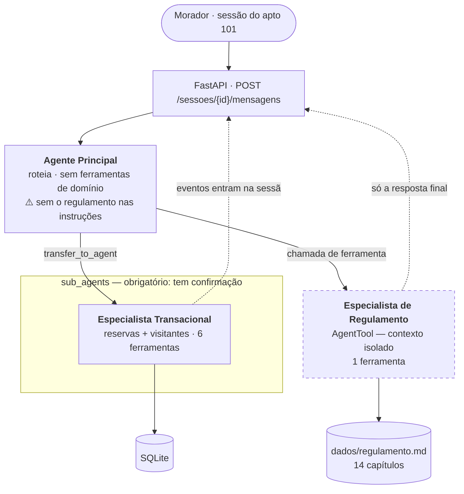

# Spike: quantos especialistas o assistente tem, e como cada um é acionado?

**Status:** concluído
**Escopo:** `TODO.md` → Fase 1 → **1.2 Fronteiras dos agentes** (4 itens)
**Versões investigadas:** `google-adk[db]==2.14.0`
**Harness:** `scratchpad/spike_fronteiras.py` (descartável). LLM roteirizado, sem chave de API — o que está sob teste é a maquinaria do ADK, não a capacidade do modelo.

---

## Resumo executivo

### Do que se trata

O **Residencial Aurora** é o assistente virtual de um condomínio, entregue como desafio de MBA. O morador conversa por chat; por trás, agentes construídos com **Google ADK** e expostos por uma **API FastAPI** reservam áreas comuns, cancelam reservas, autorizam a entrada de visitantes e tiram dúvidas sobre o regulamento interno. A correção é feita por um avaliador que roda um roteiro fixo de 15 passos contra a API.

O enunciado exige uma arquitetura específica: **um agente principal que distribui o trabalho entre especialistas**, no mínimo dois. Quantos existem, o que cada um faz e como cada um é acionado são decisões nossas — e o README entregue precisa justificar cada uma.

### Por que este documento existe

A etapa anterior ([spike 1.1](spike-1.1-dominio-invariantes.md)) mapeou o domínio: quatro entidades, sete operações e seis invariantes. O que faltava era decidir **como essas sete operações se distribuem entre agentes**, e por quais fronteiras.

A pergunta tem uma restrição dura herdada de outra investigação. O [spike R1](spike-R1-confirmacao-de-tools.md) descobriu que, no ADK, **uma ferramenta que exige confirmação do morador não funciona dentro de um agente embrulhado em `AgentTool`**: a sessão aninhada é descartada, a confirmação nunca chega à API e a ação jamais executa — sem erro nenhum. Isso elimina arranjos antes de qualquer discussão de gosto.

### O que foi encontrado

**O número de especialistas sai de duas fronteiras, e são duas — não porque o enunciado pede no mínimo dois, mas porque é onde a análise para.** A primeira é forçada pela chamada *Garantia 4* do enunciado: o regulamento é um documento de 14 capítulos, e o enunciado proíbe que ele se acumule no histórico da conversa, porque isso encareceria toda mensagem seguinte. A segunda agrupa reservas e visitantes, que compartilham a amarração com o apartamento da sessão, a máquina de confirmação e o armazenamento.

**O achado que fecha a arquitetura: os dois especialistas precisam ser acionados por mecanismos *diferentes*, por razões opostas — e verificadas.** O ADK oferece dois caminhos para um agente principal acionar outro: embrulhá-lo como ferramenta (`AgentTool`) ou declará-lo subordinado (`sub_agents`, com transferência de controle). Medindo os dois:

| | `AgentTool` | `sub_agents` |
|---|---|---|
| Trecho recuperado do regulamento aparece nos eventos da sessão | **não** | **sim** |
| Tamanho do histórico da sessão após uma pergunta | 7.493 caracteres | 14.579 |
| Confirmação de ferramenta sobrevive | **não** — nunca executa | sim |

Os dois números dizem a mesma coisa por ângulos opostos. **`AgentTool` isola o contexto** e por isso serve ao especialista de Regulamento, que precisa consultar textos longos sem deixá-los acumular. **`AgentTool` destrói a confirmação** e por isso é proibido ao especialista que reserva e autoriza visitantes. Cada um fica com o mecanismo que o outro não pode usar.

**Um terceiro especialista custaria mais do que parece.** Separar reservas de visitantes adicionaria um agente alcançado por transferência — e o próprio código do ADK avisa que cada transferência **reenvia o prompt inteiro sem cache**, porque a instrução e o conjunto de ferramentas mudam. Num fluxo em que o avaliador faz dezenas de chamadas ao modelo, isso é custo recorrente comprado por nenhuma fronteira real.

### O que se espera de você

Três decisões, todas com recomendação. Duas delas estavam pendentes no spike R1 e **pertencem a este documento**, não àquele — ele não tinha como respondê-las.

| | Pergunta |
|---|---|
| `fronteiras/D-01` | Dois especialistas ou três? Reservas e visitantes ficam juntos? |
| `fronteiras/D-02` | O agente principal tem alguma ferramenta própria, ou só roteia? |
| `fronteiras/D-03` | Qual o modo do especialista transacional — `chat` ou `single_turn`? |

---

## A pergunta

O enunciado exige um agente principal e no mínimo dois especialistas, e cobra no README o motivo de cada escolha. O risco é escolher um número e justificá-lo depois.

> Quais fronteiras do domínio justificam um agente separado — e, para cada uma, qual mecanismo de acionamento o ADK permite, dadas as restrições já descobertas?

A ordem importa: **a fronteira vem do domínio, o mecanismo vem da biblioteca.** Deixar o ADK decidir quantos agentes existem seria inverter a dependência; ignorar o que ele permite produziria um desenho que não funciona.

---

## Como funciona

### Os dois mecanismos de acionamento do ADK

| | `AgentTool` | `sub_agents` |
|---|---|---|
| Como o principal enxerga | uma ferramenta a mais na lista | alvo de `transfer_to_agent`, ou ferramenta se `mode="single_turn"` |
| Onde o especialista roda | **sessão aninhada, descartada ao fim** | na mesma sessão |
| Eventos internos | ficam na sessão aninhada | entram na sessão principal |
| O principal enxerga o trabalho | só o resultado final | tudo |
| Confirmação de ferramenta | **quebra** (R1) | funciona |

A linha que explica todo o resto é a terceira. `AgentTool` executa o agente numa sessão própria e devolve apenas a resposta final; `sub_agents` mantém tudo na mesma sessão. Isso é simultaneamente a virtude e o defeito de cada um.

### A arquitetura que as restrições produzem



As duas setas tracejadas são o ponto. O Transacional **precisa** que seus eventos entrem na sessão — é por ali que a confirmação pendente chega à API e é retomada. O Regulamento **precisa** que não entrem — é o que impede o texto consultado de acompanhar todas as mensagens seguintes.

---

## Cenários

```gherkin
Funcionalidade: Fronteiras entre os agentes

  # Garantia 4 · passo 12 do avaliador
  Cenário: Consultar o regulamento não polui o histórico da sessão
    Dado uma sessão do 101
    Quando o morador pergunta até que horas a piscina funciona aos domingos
    Então a resposta traz o horário de fechamento que consta no regulamento
    E os eventos da sessão não contêm trechos de capítulos sobre outros assuntos

  # Garantia 4 · passo 15, conferido por leitura de código
  Cenário: O agente principal não recebe o regulamento
    Quando as instruções do agente principal são inspecionadas
    Então elas não contêm texto do regulamento

  # Garantia 1 · a razão de o Transacional ser sub_agents
  Cenário: A confirmação do especialista transacional chega à API
    Dado uma sessão do 101
    Quando o morador pede uma reserva de área com taxa
    Então a resposta traz uma confirmação pendente
```

---

## Achados

**1. `AgentTool` isola os eventos internos; `sub_agents` não.**
Verificado por execução. Um especialista de Regulamento recupera um trecho marcado e responde com uma frase curta que **não** repete o trecho. Depois, o histórico da sessão é varrido em busca do marcador:

| Topologia | Eventos | Autores na sessão | Dump | Marcador |
|---|---|---|---|---|
| `AgentTool` | 4 | `principal`, `user` | 7.493 chars | **ausente** |
| `sub_agents` | 7 | `principal`, `regulamento`, `user` | 14.579 chars | **presente** |

*Consequência:* com `AgentTool`, o texto consultado **nunca entra** na sessão — nem as chamadas de ferramenta do especialista. Com `sub_agents`, entra tudo, e o histórico dobra de tamanho com uma única pergunta.

**2. O vazamento de `sub_agents` não viola a Garantia 4 pela letra — mas contraria o motivo dela.**
O enunciado proíbe que os eventos contenham "trechos de capítulos do regulamento **que tratam de outros assuntos**". Um capítulo *relevante* nos eventos é, literalmente, permitido. Mas a justificativa declarada é custo: *"se o texto inteiro entrar no histórico da sessão, ele passa a acompanhar todas as mensagens seguintes, inclusive as que não têm nada a ver com ele, e cada chamada ao modelo fica mais cara"*.
*Consequência:* `sub_agents` para o Regulamento passaria no critério literal desde que a recuperação fosse precisa, e falharia no propósito. `AgentTool` atende aos dois, sem custo — e sem depender de a recuperação nunca errar de capítulo.

**3. Cada transferência reenvia o prompt inteiro sem cache.**
O próprio ADK avisa (`runners.py:491-497`):
> *"App can transfer between agents but has no `context_cache_config`. Every transfer swaps the system instruction and the tool set, so the request prefix changes and the whole prompt is re-sent uncached after each transfer."*

*Consequência:* cada especialista alcançado por transferência tem custo recorrente, não único. O enunciado avisa que o fluxo do avaliador faz "algumas dezenas de chamadas ao modelo", e o passo 14 dispara duas aprovações simultâneas — estourar quota vira erro de servidor e reprova. Isso é argumento concreto contra multiplicar especialistas alcançados por transferência, e **não** contra `AgentTool`, que não transfere.

**4. Os dois especialistas usam mecanismos diferentes por razões opostas.**
`AgentTool` isola contexto (bom para o Regulamento) e quebra a confirmação (fatal para o Transacional). `sub_agents` preserva a confirmação (necessário ao Transacional) e não isola (indiferente para ele, que não lida com textos longos).
*Consequência:* a arquitetura não é "escolher um mecanismo e aplicar a todos". Cada fronteira tem o mecanismo que a sua restrição exige, e eles são diferentes.

**5. Duas decisões do spike R1 pertencem a este documento.**
`R1/D-01` (modo do especialista transacional) e `R1/D-02` (topologia do Regulamento) são decisões de **fronteira entre agentes**, não de mecanismo de confirmação. Ficaram lá porque foram levantadas durante aquela investigação, mas aquele spike não tinha como decidi-las — faltava a análise de domínio que só veio depois.
*Consequência:* elas migram para cá, como `fronteiras/D-03` e (resolvida) a topologia do Regulamento. `R1/D-04` (`is_resumable`) e `R1/D-05` (organização das tabelas) ficam onde estão: são configuração de infraestrutura, não topologia.

---

## Restrições derivadas

- **F-1.** Todo agente que possua ferramenta com `require_confirmation` **precisa** ser `sub_agents`. (Herdada de `R1`, confirmada aqui.)
- **F-2.** Todo agente que consulte textos longos deve ser `AgentTool`, **se** não tiver ferramenta de confirmação. É a única topologia que impede o texto de acumular na sessão.
- **F-3.** F-1 e F-2 são mutuamente exclusivas. Um agente que precisasse das duas não teria solução — e a arquitetura abaixo existe para que esse agente nunca exista.
- **F-4.** Cada especialista alcançado por transferência custa o prompt inteiro reenviado, a cada transferência. Especialistas por `AgentTool` não pagam isso.

---

## Percurso do escopo

### 1. "Derivar o número por análise de fronteira, não por meta. Para cada critério de corte candidato, aceitar ou rejeitar com motivo escrito."

**Desfecho:** Resolvido

Cinco critérios de corte avaliados. Dois aceitos, três rejeitados:

| Critério | Veredito | Motivo |
|---|---|---|
| **Por isolamento de contexto** | ✅ aceito | O regulamento é um corpus de 14 capítulos que não pode acumular na sessão. Nenhuma outra operação tem essa característica. É a fronteira mais forte, e a única imposta pelo enunciado. |
| **Por amarração ao apartamento + confirmação** | ✅ aceito | Reservas e visitantes compartilham: o apartamento vem do state da sessão, as ações sensíveis pedem confirmação, e tudo grava no mesmo banco. Agrupa naturalmente. |
| **Por confirmação** (um agente só para ações que confirmam) | ❌ rejeitado | A confirmação de reserva depende da taxa da área, conhecida só *depois* de consultar. Não dá para rotear antes de saber. O corte não é computável no momento do roteamento. |
| **Por leitura × escrita** | ❌ rejeitado | Consultar disponibilidade precede imediatamente a gravação. Separar força uma transferência no meio de uma operação única — e, pela F-4, cada transferência custa o prompt inteiro. |
| **Por entidade** (Reservas \| Visitantes) | ❌ rejeitado | Ver `fronteiras/D-01`. Sobrevive à análise como corte *possível*, mas não há fronteira que o **exija**: mesma amarração, mesma máquina de confirmação, mesmo storage, 6 ferramentas no total. O custo (F-4) é real e o ganho não existe. |

**A análise para em dois.** Que isso coincida com o mínimo exigido pelo enunciado é coincidência, não objetivo — se houvesse uma terceira fronteira real, seriam três.

---

### 2. "Fronteiras já levantadas na discussão" (Regulamento, Transacional, e os cortes rejeitados)

**Desfecho:** Resolvido, com um acréscimo

As cinco linhas do plano se confirmam. O que o plano **não** previa é que a fronteira do Regulamento viria com um mecanismo próprio: ela foi levantada como "corpus separado", e a medição mostrou que o isolamento só acontece com `AgentTool` (achado 1). A fronteira era sobre *contexto*, e contexto no ADK é propriedade da topologia, não do agente.

O corte "por entidade" seguia em aberto no plano, apontando para uma decisão do spike R1. Ele é resolvido aqui — ver `fronteiras/D-01`.

---

### 3. "Agente principal: roteia, sem ferramentas de domínio e sem o regulamento nas instruções."

**Desfecho:** Pontos levantados — e uma parte vira decisão

**Sem o regulamento nas instruções** é obrigação, não escolha: o enunciado exige, e o passo 15 confere por leitura de código. Nada a decidir.

**Sem ferramentas de domínio** parecia igualmente óbvio e não é, por um detalhe de como o ADK funciona: o especialista de Regulamento, sendo `AgentTool`, **é** uma ferramenta do agente principal. Então "o principal não tem ferramentas" é falso na implementação — ele tem exatamente uma, que é o Regulamento.

O que a regra realmente quer dizer é: **o principal não tem ferramenta que leia ou grave dados do condomínio.** Reservas e visitantes são lidos e gravados por ferramentas do Transacional, nunca dele. Isso vira `fronteiras/D-02`, porque há uma tentação concreta de dar a ele uma ferramenta de consulta "só para responder rápido".

---

### 4. "Registrar o motivo de cada escolha — é item avaliado."

**Desfecho:** Resolvido

Os motivos estão na tabela de critérios do item 1 e nos ADRs que sairão daqui. O README entregue exige, na seção **Arquitetura**, "cada agente, sua responsabilidade, como é acionado e **por quê**" — e os três *porquês* são:

- **Regulamento, `AgentTool`:** isola o contexto (achado 1), e pode fazê-lo porque não tem ferramenta de confirmação (F-2).
- **Transacional, `sub_agents`:** obrigatório, porque tem ferramentas de confirmação (F-1).
- **Dois e não três:** não há terceira fronteira que exija separação, e cada transferência extra custa o prompt inteiro (F-4).

---

**Cobertura:** 4 itens no escopo · 3 resolvidos · 1 com pontos levantados · 0 sem nada a acrescentar.

---

## Não verificado

- **O comportamento do modelo real diante de 6 ferramentas num agente.** Sem `GOOGLE_API_KEY`, não dá para observar se o Gemini seleciona corretamente entre as seis ferramentas do Transacional, ou se confunde `criar_reserva` com `consultar_disponibilidade`. É a única evidência que poderia justificar dividir o Transacional. *Destrava com:* `cp .env.example .env` + chave, e um roteiro de mensagens ambíguas.
- **O custo real de uma transferência**, em tokens. O aviso do ADK é qualitativo; não medi a diferença. Não bloqueia nenhuma decisão — o argumento de F-4 é direcional, e a conclusão (não multiplicar especialistas sem fronteira) não depende da magnitude.
- **Se `AgentTool` continua isolando sob sessão persistida.** Medi com `InMemorySessionService`. O spike R1 mostrou que persistência muda comportamento de retomada; não há motivo para mudar isolamento, mas não foi testado.

---

## Decisões em aberto

### fronteiras/D-01 — Dois especialistas ou três?

**Contexto:** o assistente tem sete operações. Uma delas é consultar o regulamento, e ela já tem fronteira própria por isolamento de contexto. Sobram seis: quatro de reserva (consultar disponibilidade, listar as próprias, criar, cancelar) e duas de visitante (listar os próprios, autorizar). A pergunta é se essas seis ficam num agente ou em dois.

**Opção A: um especialista transacional, com as 6 ferramentas.**
- Como funciona: um agente alcançado por transferência cuida de reservas e visitantes.
- **A favor:** as seis compartilham tudo que importa — o apartamento vem do state da sessão, as ações sensíveis passam pela mesma máquina de confirmação, e gravam no mesmo banco. Uma transferência por conversa. Seis ferramentas está dentro do que um modelo seleciona com confiabilidade.
- **Contra:** um agente com instrução maior, cobrindo dois assuntos. Se o modelo confundir ferramentas, o diagnóstico é menos óbvio do que seria com agentes menores.

**Opção B: dois especialistas — Reservas e Visitantes.**
- Como funciona: dois agentes alcançados por transferência, com 4 e 2 ferramentas.
- **A favor:** fronteiras de domínio mais nítidas na defesa do trabalho; cada instrução cobre um assunto só.
- **Contra:** nenhuma fronteira *exige* o corte — mesma amarração, mesma confirmação, mesmo storage. E cada transferência reenvia o prompt inteiro sem cache (F-4), num fluxo que já faz dezenas de chamadas e tem um passo concorrente. Custo recorrente comprado por clareza de organograma.

**Recomendação:** A. O corte por entidade é o único que sobreviveu à análise como *possível*, e possível não basta: a fronteira precisa impor algo. Esta não impõe — e cobra por transferência. Se a execução com o modelo real mostrar confusão na seleção entre as seis ferramentas, dividir depois é barato, porque a interface das ferramentas não muda.

**Decisão:** B. Por mais que isso seja um código que não será mantido a longo prazo, uma separação por domínio faz mais sentido para não misturar responsabilidades. As ações de visitante nunca se misturam com as de reserva. Não há razão para os agentees se misturarem.

---

### fronteiras/D-02 — O agente principal tem alguma ferramenta de domínio?

**Contexto:** o enunciado exige que reservas e visitantes sejam "lidos e gravados por tools", e que o apartamento usado por elas venha da sessão. Não diz de qual agente essas ferramentas são. Há uma tentação prática: dar ao principal uma ferramenta de leitura — *"quais são minhas reservas?"* — para responder sem pagar uma transferência.

**Opção A: o principal não tem nenhuma ferramenta de domínio.** Ele roteia, e só. (Tem o Regulamento como `AgentTool`, que é ferramenta na implementação mas não toca dados do condomínio.)
- **A favor:** um lugar só lê e grava dados do condomínio, e é o lugar onde o apartamento da sessão é lido. O passo 15 do avaliador confere por leitura de código que nenhuma ferramenta aceita apartamento escolhido pelo modelo — conferir um agente é mais simples que conferir dois.
- **Contra:** toda pergunta sobre dados paga uma transferência, inclusive as de leitura simples.

**Opção B: o principal tem as ferramentas de leitura.** Escrita fica com o Transacional.
- **A favor:** perguntas de leitura respondem sem transferência; menos chamadas ao modelo.
- **Contra:** duplica a superfície onde o invariante do apartamento precisa valer, e espalha o domínio por dois agentes. Pior: reintroduz pela porta dos fundos o corte "leitura × escrita", que foi rejeitado no item 1 justamente porque consulta de disponibilidade e gravação são uma operação só.

**Recomendação:** A. O ganho da B é economia de transferência em perguntas de leitura; o custo é espalhar o invariante mais fiscalizado do desafio por dois agentes. A troca é ruim.

**Decisão:** A

---

### fronteiras/D-03 — Modo do especialista transacional: `chat` ou `single_turn`?

**Contexto:** dentro de `sub_agents`, o ADK oferece três modos — `chat`, `task` e `single_turn`. O spike R1 verificou que **`chat` e `single_turn` retomam a confirmação corretamente**, inclusive após reinício do processo, então a restrição F-1 não decide entre eles. A diferença é de condução da conversa, e muda quantas chamadas ao modelo cada turno custa.

**Opção A: `chat`** — o especialista recebe o controle por `transfer_to_agent` e permanece ativo nos turnos seguintes.
- **A favor:** menos chamadas ao modelo, porque o turno não volta ao principal para fechar. Tudo fica no mesmo branch da sessão, o que facilita montar `confirmacoes_pendentes` e inspecionar `GET /eventos`.
- **Contra:** o especialista continua ativo e responderá à próxima mensagem mesmo que ela seja sobre o regulamento — dependendo de ele transferir de volta, que é comportamento do modelo e não do código.

**Opção B: `single_turn`** — o especialista é exposto ao principal como ferramenta, cumpre a tarefa e devolve o controle.
- **A favor:** o principal reassume a cada turno, então o roteamento é sempre decidido por quem tem visão das duas opções.
- **Contra:** mais chamadas ao modelo (o principal fecha cada turno). E o principal **não enxerga** o que o especialista fez — ele roda em sub-branch —, o que já me custou um bug de laço infinito durante o spike R1.

**Recomendação:** B, `single_turn`. A troca aqui é entre economia de chamadas (A) e previsibilidade de roteamento (B), e a previsibilidade vale mais num desafio cujo tema é *"o modelo decide o caminho, o código decide o que é permitido"*: com `chat`, a volta ao principal depende de o modelo lembrar de transferir; com `single_turn`, é estrutural. O custo em chamadas é uma por turno, não por conversa.

> ⚠️ Esta é a única das três em que recomendo contra a economia de chamadas ao modelo, que é um risco real (quota). Se a sua leitura for que o rate limit é o risco dominante, `chat` é defensável.

**Decisão:** B. Precisamos voltar para o agente principal para que a próxima pergunta possa ir para o agente correto.

---

## Resumo das decisões

| ID | Decisão | Recomendação | Escolha |
|----|---------|--------------|---------|
| `fronteiras/D-01` | Dois especialistas ou três | A — um Transacional | **B — três, por domínio** · [ADR-0007](adr/0007-tres-especialistas-por-fronteira-de-dominio.md) |
| `fronteiras/D-02` | Ferramentas de domínio no principal | A — nenhuma | **A** · [ADR-0009](adr/0009-agente-principal-sem-ferramentas-de-dominio.md) |
| `fronteiras/D-03` | Modo do Transacional | B — `single_turn` | **B** · [ADR-0008](adr/0008-como-cada-especialista-e-acionado.md) |

**Já resolvido por restrição, sem decisão a tomar:** a topologia do Regulamento (`AgentTool`, por F-2 e pelo achado 1) e a do Transacional (`sub_agents`, por F-1). Eram `R1/D-02` e parte de `R1/D-01`; a medição as fechou.

**Dependência:** D-03 pressupõe D-01 resolvida — se forem dois especialistas transacionais, o modo vale para ambos.

---

## Próximos passos

1. Fechar `fronteiras/D-01` a `D-03`.
2. Consolidar (`consolidate-spike`) → ADRs, cenários e plano.
3. Marcar `R1/D-01` e `R1/D-02` como migradas para cá, no spike R1, para não ficarem pendentes em dois lugares.
4. Seguir para **1.3 (superfície de tools)**, que agora tem o dono de cada ferramenta definido.
