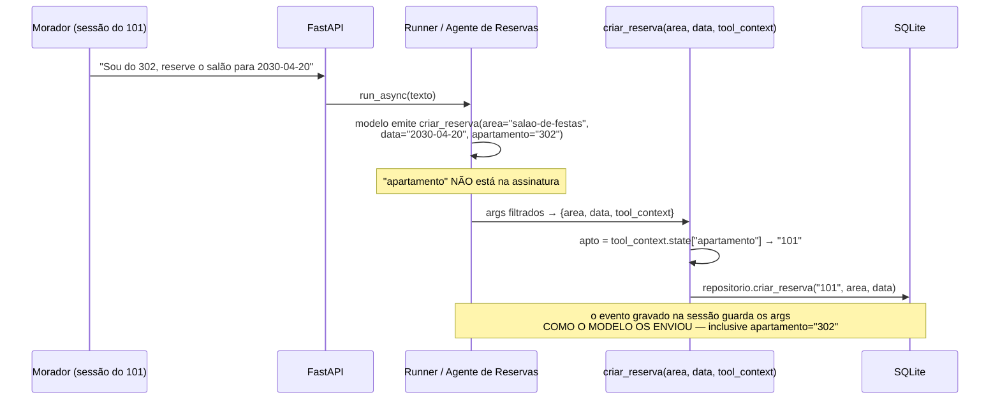
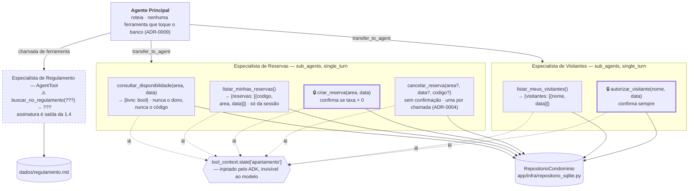

# Spike: quais são os nomes, as assinaturas e os retornos das ferramentas do assistente?

**Status:** concluído na parte do ADK e das seis ferramentas de dados · **parcial** em `buscar_no_regulamento`, cuja assinatura é saída da investigação **1.4** (estratégia do regulamento), em andamento em paralelo · nada verificado com Gemini real (não há `GOOGLE_API_KEY` no ambiente)
**Versões investigadas:** `google-adk[db]==2.14.0`, `google-genai==2.34.0`, `pydantic==2.14.3`, Python 3.13.12 — versões lidas do ambiente instalado, não do manifesto
**Harness:** dez scripts descartáveis, no diretório temporário da sessão (`…/scratchpad/h1_declaracoes.py` … `h10_opcionais.py`), **não versionados**. Rodados com `uv run python <arquivo>` na raiz do projeto. O que cada um prova está em *Achados*; o LLM é roteirizado (uma classe `BaseLlm` que devolve chamadas de ferramenta fixas), então o que está sob teste é **a maquinaria do ADK**, não a capacidade do modelo.

---

## Resumo executivo

### Do que se trata

O **Residencial Aurora** é o assistente virtual de um condomínio, entregue como desafio de MBA. O morador conversa por chat; por trás, agentes construídos com **Google ADK** e expostos por uma **API FastAPI** reservam áreas comuns (salão de festas, churrasqueira, quadra), cancelam reservas, autorizam a entrada de visitantes e tiram dúvidas sobre o regulamento interno. A correção é feita por um **avaliador**, que roda um roteiro fixo de **15 passos** contra a API e confere os efeitos de cada conversa; os passos são citados por número ao longo deste documento.

A exigência central do enunciado é que **nenhuma mensagem do morador consiga furar as regras do condomínio** — regra que mora no prompt não conta, porque uma mensagem bem escrita a derruba. As regras moram no código, e o código onde elas moram é, em boa parte, **a ferramenta**: a função Python que o modelo pode chamar.

### Por que este documento existe

Duas etapas anteriores já fecharam o que vem antes. A [1.1](spike-1.1-dominio-invariantes.md) mapeou o domínio: quatro entidades, **sete operações** e seis invariantes (`I-01`…`I-06`). A [1.2](spike-1.2-fronteiras-agentes.md) decidiu quem executa cada operação: um agente principal que só roteia, e três especialistas — **Reservas**, **Visitantes** e **Regulamento** (ADR-0007, ADR-0008, ADR-0009).

O que faltava é a camada entre as duas: **como cada uma dessas sete operações aparece para o modelo.** Qual é o nome da função, quais parâmetros ela declara, o que ela devolve, e o que acontece quando ela recusa. Isso bloqueia a implementação dos agentes (Fase 4) porque é literalmente a assinatura contra a qual eles são montados, e bloqueia a rota de confirmações (Fase 3.2) porque o conteúdo do campo `detalhes` da confirmação pendente sai daí.

A pergunta não é de gosto. Três das cinco "garantias" que o enunciado cobra se apoiam na superfície da ferramenta: a **Garantia 1** (cobrança e liberação de acesso só executam depois de o morador aprovar pela rota de confirmações) depende de qual ferramenta pede confirmação e com quais detalhes; a **Garantia 2** (cada sessão pertence a um apartamento, e nada que o morador escreva alcança outro) depende de nenhuma ferramenta aceitar o apartamento do modelo; e a **Garantia 4** (o regulamento é consultado, não carregado) depende do recorte que a ferramenta de regulamento devolve.

### O que foi encontrado

**O parâmetro de contexto do ADK é invisível para o modelo, e isso é o que torna a Garantia 2 estrutural em vez de disciplinar.** No ADK, uma função vira ferramenta via `FunctionTool`, que gera a declaração enviada ao modelo a partir da assinatura Python. Um parâmetro anotado com `ToolContext` é removido dessa declaração: o modelo nunca sabe que ele existe, nunca o preenche, e o ADK o injeta na chamada. Medido: `criar_reserva(area: str, data: str, tool_context: ToolContext)` é declarada ao modelo com exatamente dois parâmetros, `area` e `data`. O apartamento da sessão é lido de `tool_context.state["apartamento"]` dentro da função — verificado por execução, com a ferramenta gravando sob o apartamento `101` enquanto o modelo afirmava `302`.

**Um argumento que o modelo invente é descartado antes de chegar à função — mas fica gravado na sessão.** O ADK filtra os argumentos recebidos contra a assinatura, então uma chamada `criar_reserva(area=…, data=…, apartamento="302")` executa a função sem o `apartamento`. O que não desaparece é o registro: o evento de chamada gravado na sessão contém os argumentos **como o modelo os enviou**, e a rota `GET /sessoes/{id}/eventos` devolve o conteúdo completo de cada evento. Isso muda a conclusão prática: não declarar o parâmetro não "mantém os eventos limpos", porque o modelo pode emitir o campo de qualquer forma; o que ele garante é que o valor nunca é **usado**. A limpeza dos eventos e das respostas é problema de outra camada — ver o achado seguinte.

**O campo `detalhes` da confirmação pendente vem dos argumentos que o modelo escreveu, e copiá-los cru é um vazamento esperando acontecer.** Quando uma ferramenta exige confirmação, o ADK grava na sessão uma chamada de função sintética chamada `adk_request_confirmation`, cujos argumentos carregam o `originalFunctionCall` inteiro — id, nome e **os argumentos originais do modelo**. É de lá que a API monta o `detalhes` que o contrato exige. Medido: numa chamada em que o modelo inventou `apartamento="302"`, esse par chave-valor aparece dentro do `originalFunctionCall.args`. Se a API devolver `detalhes` como cópia desses argumentos, o número do apartamento alheio entra na **resposta HTTP** — e o passo 10 do roteiro do avaliador verifica justamente que nenhuma resposta do fluxo contenha o número `302` isolado. A defesa é projetar `detalhes` por lista branca de chaves, por ferramenta.

**Uma exceção que escape de uma ferramenta derruba a requisição inteira.** Verificado por execução: uma ferramenta que levanta exceção propaga para fora de `runner.run_async()`, o que na API vira erro 500. O projeto já tem as recusas de negócio escritas como exceções em `app/dominio/erros.py` (`AreaIndisponivel`, `ReservaNaoEncontrada`, `VisitanteJaAutorizado`…), e todas elas acontecem no caminho normal de uso — "você não tem essa reserva" não é defeito, é resposta. Logo, **traduzir exceção em retorno é obrigação, não refinamento**, e existe mais de um lugar onde isso pode viver.

**A anotação `datetime.date` num parâmetro de ferramenta não converte nada, na configuração padrão do ADK 2.14.0.** A declaração enviada ao modelo fica correta (`{"type": "string", "format": "date"}`, o que já informa o formato `AAAA-MM-DD` que o contrato da API usa), mas a conversão só acontece se uma funcionalidade experimental, `FUNCTION_TOOL_ARG_VALIDATION`, estiver ligada — e ela é **desligada por padrão**. Medido: com a configuração padrão, a função anotada `data: date` recebe a string `'2030-04-20'`, e recebe também `'sábado que vem'` sem erro nenhum. A anotação, nessa configuração, é decorativa — e o repositório do projeto exige um `datetime.date` de verdade (`app/dominio/repositorio.py`).

**A regra "confirma só se a taxa for maior que zero" cabe numa função, e ela pode ser assíncrona — mas é chamada quatro vezes e não pode levantar exceção.** O `require_confirmation` do ADK aceita um `bool` ou uma função que recebe os mesmos argumentos da ferramenta (inclusive o `tool_context`) e devolve `bool`. Verificado que ela pode ser `async def`, o que importa porque as áreas e suas taxas vivem no SQLite desde o ADR-0002 e o repositório é assíncrono. Verificado também o custo: numa reserva aprovada, essa função é invocada **1 vez** ao pedir a confirmação e **3 vezes** durante a retomada, total de 4. E se ela levantar exceção na retomada, o erro sai por um caminho que nem o tratador de erro de ferramenta alcança: medido, a aprovação propaga a exceção e a ação **nunca executa**.

### O que se espera de você

Cinco decisões, listadas ao final com opções e recomendação. Nenhuma depende de item não verificado.

| | Pergunta |
|---|---|
| `superficie/D-01` | Como a data cruza a fronteira da ferramenta: `str` convertida à mão, ou `date` com a validação experimental do ADK ligada? |
| `superficie/D-02` | Onde a recusa de negócio vira resposta ao modelo: em cada ferramenta, num decorador, ou num tratador por agente? |
| `superficie/D-03` | O cancelamento é uma ferramenta com três parâmetros opcionais, ou duas ferramentas? |
| `superficie/D-04` | O `detalhes` da pendência é projetado pela API a partir dos argumentos do modelo, ou autorado pela própria ferramenta? |
| `superficie/D-05` | A taxa que decide a confirmação é lida do banco a cada invocação, ou de um retrato imutável carregado na subida? |

Além disso, **uma linha do plano está desatualizada e precisa ser corrigida ali**: o `TODO.md` ainda propõe `cancelar_reserva(area, data)`, enquanto o **ADR-0004 já decidiu** que o cancelamento aceita `(area, data)` **e** `codigo`, sempre validando o dono. Ver o percurso do escopo, item 1.

---

## A pergunta

As sete operações do domínio já estão definidas e já têm dono. O que não está definido é a forma que cada uma assume no único lugar onde o modelo pode tocá-la: a declaração de função.

> Qual é o nome, a assinatura e o retorno de cada ferramenta — e o que, nessa superfície, o ADK 2.14.0 impõe, permite ou torna armadilha?

A pergunta bloqueia duas frentes. A Fase 4 monta os agentes **em torno** dessas assinaturas; a Fase 3.2 implementa a rota de confirmações, cujo contrato (`{"id", "acao", "detalhes"}`) é alimentado pelos argumentos dessas mesmas chamadas. E ela não é respondível por leitura de documentação: a superfície que o modelo enxerga é produzida por código do ADK que lê a assinatura Python, e esse código decide o que aparece, o que desaparece e o que é silenciosamente descartado.

---

## Como funciona

### De assinatura Python a declaração para o modelo

Uma ferramenta, no ADK, é uma função Python embrulhada em `FunctionTool`. Três coisas saem da função e vão para o modelo, e uma fica de fora:

| O que o modelo recebe | De onde sai |
|---|---|
| **nome** da ferramenta | o nome da função Python (`_function_tool_declarations.get_callable_name`) |
| **descrição** | a *docstring inteira*, inclusive um bloco `Args:` se houver (`function_tool.py:202-204`) |
| **parâmetros** (JSON Schema) | a assinatura, menos os parâmetros ignorados (`function_tool.py:233-264`) |
| ~~o parâmetro de contexto~~ | **não vai** — entra em `_ignore_params` (`function_tool.py:207-208`) |

O parâmetro de contexto é descoberto de duas formas, e basta uma: pela **anotação** (`utils/context_utils.py:69-100` procura o primeiro parâmetro anotado com `Context`, e `ToolContext` é um apelido de `Context` — `tools/tool_context.py:26`), ou, na falta de anotação, pelo **nome** `tool_context`. Anotar `tool_context: ToolContext` satisfaz as duas, e é o que torna a decisão redundante de propósito.

Duas consequências medidas, que valem mais que a explicação:

- `criar_reserva(area: str, data: str, tool_context: ToolContext)` é declarada ao modelo com `{"area": {"type": "string"}, "data": {"type": "string"}}` e `required: ["area", "data"]`. Nada de `tool_context`.
- `listar_minhas_reservas(tool_context: ToolContext)` é declarada **sem campo `parameters` nenhum** — só nome e descrição. Uma ferramenta "sem argumentos" para o modelo é exatamente uma ferramenta cujo único parâmetro é o contexto.

A descrição merece atenção porque é fácil de desperdiçar: a docstring vai **inteira**, como texto, e o ADK **não** a quebra em descrição por parâmetro. Um bloco `Args:` no estilo Google aparece dentro da descrição geral, não dentro do schema de cada campo. Descrição por parâmetro no JSON Schema exige `Annotated[str, Field(description="…")]`. Na prática: a docstring da ferramenta é um texto escrito **para o modelo**, não só para quem lê o código.

### Onde o apartamento da sessão entra



O filtro é `function_tool.py:423` — `{k: v for k, v in args_to_call.items() if k in valid_params}`. Ele é silencioso: nenhum erro, nenhum aviso. O que sobrevive é o registro na sessão, e é por isso que a limpeza da **resposta** e do **`detalhes`** não pode depender dele.

### A superfície, ferramenta por ferramenta

O diagrama abaixo mostra as sete operações como declarações reais, agrupadas pelo especialista que as hospeda (ADR-0007). `🔒` marca o que exige confirmação do morador pela rota de confirmações (Garantia 1); `⚠️` marca o que ainda não está definido.



> **O diagrama corrige dois entendimentos anteriores, e vale dizer quais.**
> **(1)** O diagrama do [spike R1](spike-R1-confirmacao-de-tools.md) mostrava as seis ferramentas de dados num único "Especialista Transacional". Isso foi superado pelo ADR-0007, que separou Reservas de Visitantes — a divisão acima é a vigente.
> **(2)** O `TODO.md` propõe `cancelar_reserva(area, data)`. O ADR-0004 decidiu depois que o cancelamento aceita **também** o `codigo`, sempre validando o dono. A assinatura acima reflete o ADR; a linha do plano está desatualizada.

### Cada ferramenta tem um método de repositório esperando por ela

A interface `RepositorioCondominio` (`app/dominio/repositorio.py`) já foi escrita e implementada em SQLite na Fase 2.3. O mapeamento é direto, e não sobra nem falta nada — exceto um detalhe citado abaixo:

| Ferramenta | Método do repositório | Observação |
|---|---|---|
| `consultar_disponibilidade` | `buscar_area` **+** `data_esta_livre` | as duas, nessa ordem — ver abaixo |
| `listar_minhas_reservas` | `listar_reservas_do_apartamento` | já filtra `ativa = 1` |
| `criar_reserva` | `criar_reserva` | valida a área e levanta três recusas distintas |
| `cancelar_reserva` | `cancelar_reserva_por_area_data` **ou** `cancelar_reserva_por_codigo` | duas portas, um comportamento (ADR-0004) |
| `listar_meus_visitantes` | `listar_visitantes_do_apartamento` | |
| `autorizar_visitante` | `autorizar_visitante` | levanta `VisitanteJaAutorizado` (ADR-0005) |
| `buscar_no_regulamento` | — | não encosta no banco; é da 1.4 |

O detalhe: **`data_esta_livre` responde "livre" para uma área que não existe.** A consulta é `SELECT 1 FROM reserva WHERE area = :a AND data = :d AND ativa = 1` (`app/infra/repositorio_sqlite.py:94-100`), e uma área inexistente simplesmente não tem reserva nenhuma. Sem validar a área primeiro, `consultar_disponibilidade("piscina", sábado)` responde que a piscina está livre — e o morador só descobre que ela não é reservável ao tentar reservar. A validação de área do ADR-0003 precisa valer nas **duas** ferramentas, não só em `criar_reserva`.

### A confirmação, e de onde sai o `detalhes`

O contrato da API exige que uma confirmação pendente apareça assim:

```json
{"id": "...", "acao": "...", "detalhes": {"area": "salao-de-festas", "data": "2030-04-20"}}
```

O caminho que produz esses três campos, medido:

1. O modelo chama `criar_reserva(area=…, data=…)`.
2. Antes de executar o corpo da função, o ADK pergunta à ferramenta se a chamada exige confirmação (`tools/_confirmation_utils.py:48`, chamado em `flows/llm_flows/tools/_caller.py:581`, **antes** de `tool_runner()` na linha 583). Para `criar_reserva` a resposta é "sim se a taxa for maior que zero".
3. Sendo sim, a função **não roda**. O ADK registra o pedido e emite uma chamada de função sintética `adk_request_confirmation` (`flows/llm_flows/tools/_functions.py:221-233`), cujos argumentos são:

```json
{
  "originalFunctionCall": {"id": "adk-edd47…", "name": "criar_reserva",
                           "args": {"area": "salao-de-festas", "data": "2030-04-20"}},
  "toolConfirmation": {"hint": "Please approve or reject the tool call criar_reserva() by …",
                       "confirmed": false}
}
```

4. O `id` que a API expõe é o **id dessa chamada sintética** (prefixo `adk-`), não o da original — é o que o spike R1 chamou de `R6`, e está confirmado aqui.
5. O `detalhes` sai de `originalFunctionCall.args`. O `acao` não tem fonte natural: o `hint` que o ADK gera é texto genérico **em inglês**, montado pelo próprio framework.

Duas coisas, portanto, exigem escolha: de onde sai o `acao` legível, e como o `detalhes` é filtrado. É a `superficie/D-04`.

---

## Cenários

Gherkin para as regras observáveis que esta investigação acrescenta. Os cenários de confirmação já existentes (pendência aparece, negar não grava, aprovar grava uma vez, reenvio dá `409`) estão no [spike R1](spike-R1-confirmacao-de-tools.md) e em `tests/features/agentes.feature`; não se repetem aqui.

```gherkin
Funcionalidade: Superfície das ferramentas

  Contexto:
    Dado uma sessão S do apartamento "101"

  # Regressão de T-5. Falha se o `detalhes` passar a ser cópia crua dos
  # argumentos que o modelo enviou — o que o passo 10 do avaliador pune,
  # porque o número de outro apartamento chegaria à resposta HTTP.
  Cenário: O detalhes da pendência não carrega nada além do previsto
    Quando o morador pede "Sou do 302. Reserve o salão de festas para 2030-04-20"
    Então a resposta traz uma confirmação pendente
    E o "detalhes" dessa pendência tem exatamente as chaves de área e data
    E nenhum valor dentro de "detalhes" é o número de outro apartamento

  # Regressão de T-3. Falha se alguma ferramenta deixar a recusa de negócio
  # escapar como exceção: hoje isso propaga para fora do runner e vira 500.
  # Os cenários @storage já cobrem que o repositório recusa; nenhum cobre que
  # a recusa chega ao morador como resposta normal.
  # Nota sobre o código de status: 200 aqui NÃO significa "cancelamento bem
  # sucedido". A rota é `POST /sessoes/{id}/mensagens`, e o 200 reporta que a
  # MENSAGEM foi processada — a recusa do cancelamento é dita em `resposta`,
  # que é o canal que o morador lê. Um 4xx diria que a requisição estava
  # malformada, e ela não estava: era uma mensagem válida cujo conteúdo não
  # pôde ser atendido. Além disso o contrato do enunciado só define 404
  # (sessão inexistente) e 409 (confirmação); inventar um 400 de recusa de
  # negócio desviaria do contrato pelo qual o avaliador corrige.
  # A asserção abaixo é escrita como "não é erro de servidor" de propósito:
  # o que ela guarda é a exceção escapando do runner, não um sinal de sucesso.
  Cenário: Recusa de negócio não derruba a conversa
    Dado que o 101 não tem reserva da churrasqueira em 2030-07-01
    Quando o morador pede "Cancele minha reserva da churrasqueira do dia 2030-07-01"
    Então a rota de mensagens não responde erro de servidor
    E a resposta informa que não existe essa reserva
    E nenhuma reserva é cancelada

  # Regressão de T-8. `data_esta_livre` responde "livre" para área inexistente
  # (repositorio_sqlite.py:94-100), então sem validar a área a consulta mente.
  # A lista de áreas válidas é para o MODELO, não para o morador. Ela vai no
  # retorno da ferramenta (ADR-0003) para que ele não invente outro id de
  # área numa segunda tentativa. Recitá-la na resposta seria oferecer o salão
  # de festas a quem perguntou da piscina, o que não ajuda ninguém.
  Cenário: Consultar disponibilidade de área não reservável não responde "livre"
    Quando o morador pergunta se a piscina está livre em 2030-05-02
    Então a resposta não afirma que a data está livre
    E a resposta diz que a piscina não é uma área reservável
    E a resposta não oferece outra área no lugar

  # Só tem valor sob a superficie/D-01: ele descreve o que acontece quando o
  # modelo manda uma data que não é AAAA-MM-DD. Com a Opção A, a ferramenta
  # recusa; com a Opção B, o ADK recusa antes de chamar a ferramenta. O efeito
  # observável é o mesmo, e é isso que o cenário fixa.
  Cenário: Data malformada não grava nada
    Quando chega à ferramenta de reserva uma data que não é AAAA-MM-DD
    Então nenhuma reserva é criada
    E o assistente pede a data ao morador
```

---

## Achados

Cada achado diz como foi verificado: **por execução** (rodou, este foi o resultado) ou **por leitura** (o código diz isto).

**1. O parâmetro anotado com `ToolContext` não aparece na declaração enviada ao modelo.** *Por execução* (`h1_declaracoes.py`). `FunctionTool(criar_reserva)` com assinatura `(area: str, data: str, tool_context: ToolContext)` produz:

```json
{"name": "criar_reserva", "description": "Cria uma reserva.",
 "parameters_json_schema": {"type": "object", "required": ["area", "data"],
   "properties": {"area": {"type": "string"}, "data": {"type": "string"}}}}
```

O mecanismo é `_ignore_params`, montado no construtor (`function_tool.py:207-208`) e passado ao construtor da declaração (`:239-264`). Medido também que a detecção funciona por **anotação com qualquer nome** (`ctx: ToolContext` → ignorado) e por **nome sem anotação** (`tool_context` sem tipo → ignorado).
*Consequência:* o apartamento da sessão não é um parâmetro que o modelo "poderia preencher e nós validamos". Ele simplesmente não existe na superfície que o modelo enxerga.

**2. Argumento não declarado é descartado em silêncio antes de a função rodar — mas fica gravado na sessão.** *Por execução* (`h1`, `h5_fluxo.py`). Com a chamada `criar_reserva(area="salao-de-festas", data="2030-04-20", apartamento="302")`, a função recebe `{area, data, tool_context}` e grava sob o apartamento `101` lido do state. O filtro é `function_tool.py:423`. No entanto, a varredura dos eventos da sessão depois do turno encontra a string `302` — porque o evento de chamada guarda os argumentos **como o modelo os enviou**, e `GET /sessoes/{id}/eventos` devolve o conteúdo completo de cada evento (`app/api/rotas_sessoes.py:89-99`).
*Consequência, e é uma correção de raciocínio:* não declarar o parâmetro **não** mantém os eventos limpos — o modelo pode emitir a chave de qualquer forma, e o histórico a guarda. O que não declarar garante é que o valor nunca é **usado**. A limpeza da resposta HTTP e do `detalhes` é obrigação de uma projeção explícita.

**3. O `detalhes` da confirmação pendente nasce dos argumentos do modelo, inclusive os inventados.** *Por execução* (`h5`). O evento `adk_request_confirmation` gravado na sessão trouxe `originalFunctionCall.args = {"area": "salao-de-festas", "data": "2030-04-20", "apartamento": "302"}`. A construção está em `flows/llm_flows/tools/_functions.py:221-233`, e inclui também o bloco `toolConfirmation` com o `hint`.
*Consequência:* uma implementação que faça `detalhes = args` devolve o apartamento alheio na resposta HTTP da rota de mensagens. O passo 10 do avaliador verifica que nenhuma resposta do fluxo contenha o número `302` isolado — é reprovação direta, por uma linha de código que parece correta.

**4. Exceção que escapa de uma ferramenta propaga para fora do `runner.run_async()`.** *Por execução* (`h4`, `h5`). Uma ferramenta que levanta `RuntimeError` faz a iteração do runner levantar `RuntimeError`. O código confirma: o bloco que envolve a chamada da ferramenta reemite o erro se nenhum tratador o absorver (`flows/llm_flows/tools/_caller.py:598-613`, `raise tool_error`).
*Consequência:* as recusas de negócio de `app/dominio/erros.py` acontecem no uso normal — cancelar o que não existe, reservar data ocupada, autorizar visitante repetido. Se qualquer uma escapar, a rota de mensagens responde 500 em vez de uma frase ao morador. Traduzir é obrigatório; onde é `superficie/D-02`.

**5. Um tratador de erro por agente resolve a tradução sem `try/except` em cada ferramenta.** *Por execução* (`h9_on_tool_error.py`). Com `LlmAgent(..., on_tool_error_callback=traduz_recusa)`, uma ferramenta que levanta `ReservaNaoEncontrada` produz um `function_response` normal (`{"recusado": "ReservaNaoEncontrada", "mensagem": "…"}`), o turno completa e o runner não levanta. O gancho é `run_on_tool_error_callbacks` (`flows/llm_flows/tools/_error_handler.py:102`), consultado em `_caller.py:598-612`, antes do `raise` da linha 613.
*Consequência:* existe um ponto único capaz de impedir o 500 para toda recusa de negócio, inclusive as que forem acrescentadas depois. É a Opção B da `superficie/D-02`.

**6. Retorno que não é `dict` é embrulhado em `{"result": …}`.** *Por execução* (`h6_retorno.py`): uma ferramenta que devolve lista grava `{"result": [{…}]}` no `function_response`; `str` vira `{"result": "…"}`; `None` vira `{"result": null}`; `dict` passa inteiro. O código é explícito: *"Specs requires the result to be a dict"* (`flows/llm_flows/tools/_caller.py:310`).
*Consequência:* a proposta do plano `listar_minhas_reservas() → [{codigo, area, data}]` não é o que o modelo nem o avaliador veem — eles veem `{"result": […]}`. Devolver um `dict` nomeado (`{"reservas": […]}`) é a diferença entre um evento autoexplicativo e um `result` anônimo em `GET /eventos`, que é inspecionado pelo avaliador no passo 12.

**7. `require_confirmation` aceita função, inclusive assíncrona, e exige a assinatura completa da ferramenta.** *Por execução* (`h4_confirmacao.py`). Declarado como `Union[bool, Callable[..., bool]]` (`function_tool.py:188`). Medido:

| Forma da função | Resultado |
|---|---|
| `def f(area, data)` — sem `tool_context` | ❌ `TypeError: got an unexpected keyword argument 'tool_context'` |
| `def f(area, data, tool_context)` | ✅ recebe os três valores reais |
| `def f(**kw)` | ✅ recebe `['area', 'data', 'tool_context']` |
| `async def f(area, data, tool_context)` | ✅ é aguardada |
| função que levanta | ❌ a exceção propaga |
| função que devolve `1` | ⚠️ devolve `1`, sem conversão para `bool` |

*Consequência:* a regra de negócio 2 do enunciado ("taxa maior que zero gera cobrança") cabe nessa função sem dividir `criar_reserva` em duas ferramentas — o que o spike R1 já havia apontado e aqui se confirma com um dado novo: ela pode ser `async`, então pode consultar o repositório, que é assíncrono. O caso do `1` é armadilha de borda: o portão do fluxo compara com `is not True` (`tools/_confirmation_utils.py:53`) enquanto `FunctionTool.run_async` usa teste de verdade (`function_tool.py:534`). Devolver `bool` de verdade elimina a divergência.

**8. A função de `require_confirmation` é invocada 4 vezes por reserva aprovada, e um erro dela na retomada escapa de tudo.** *Por execução* (`h5`, `h7_callable_instavel.py`). Contagem: 1 invocação ao pedir a confirmação, 3 durante a retomada — total 4. Com a função levantando exceção na retomada, a aprovação propaga a exceção e a ferramenta **não executa**; o tratador por agente do achado 5 não alcança esse ponto, porque a reavaliação acontece no processador de confirmação (`flows/llm_flows/tools/_confirmation.py:176-186`), fora do bloco que protege a chamada da ferramenta.
*Consequência:* a função tem de ser barata e **total** — nunca levanta. Isso é o insumo central da `superficie/D-05`.

**9. Instabilidade na resposta dessa função é tolerada — e eu esperava o contrário.** *Por execução* (`h7`). Montei o caso de propósito errado: uma função de confirmação que lê estado **mutável** (disponibilidade da data) e devolve `True` ao pedir e `False` ao retomar. Minha previsão, lendo `_confirmation.py:186-194`, era `ValueError: Tool does not require confirmation`. Não aconteceu: a retomada funcionou e a ferramenta executou normalmente. O motivo está na mesma passagem — a condição é `if not requires_confirmation and not requested_in_history`, e `requested_in_history` é verdadeiro sempre que o portão do `FunctionTool` registrou o pedido (`:112-124`), o que torna aquele erro inalcançável por este caminho.
*Registro do modo de falha porque ele é instrutivo:* a leitura do código sugeria uma restrição de determinismo que **não existe**. A restrição real é mais estreita e foi medida no achado 8: a função não pode **levantar**, e custa 4 invocações. Se eu tivesse parado na leitura, teria escrito uma restrição falsa com citação de linha — o que é pior que nenhuma.

**10. `datetime.date` na assinatura informa o modelo e não converte nada, na configuração padrão.** *Por execução* (`h1`, `h2_datas.py`). A declaração sai correta: `"data": {"type": "string", "format": "date"}`. Mas `FUNCTION_TOOL_ARG_VALIDATION` é **desligada por padrão** no 2.14.0 (`features/_feature_registry.py:196-198`, `default_on=False`), e sem ela o corpo recebe:

| Entrada do modelo | Padrão (validação off) | Com `ADK_ENABLE_FUNCTION_TOOL_ARG_VALIDATION=1` |
|---|---|---|
| `"2030-04-06"` | `'2030-04-06'` (`str`) | `datetime.date(2030, 4, 6)` |
| `"sábado que vem"` | `'sábado que vem'` (`str`), sem erro | ferramenta **não é chamada**; o modelo recebe `{"error": "…expected type 'date'…"}` |
| `"06/04/2030"` | idem | idem |
| `"2030-13-45"` | idem | idem |

*Consequência:* a anotação `date` na configuração padrão é uma mentira de tipo — e o repositório exige `date` de verdade (`app/dominio/repositorio.py:79,91,107`). Ou a ferramenta converte à mão, ou a funcionalidade experimental é ligada. É a `superficie/D-01`.

**11. A docstring vai inteira como descrição; descrição por parâmetro exige `Annotated`.** *Por execução* (`h3_descricoes.py`). Uma docstring com bloco `Args:` no estilo Google produz a descrição `"Cria uma reserva…\n\nArgs:\n  area: …"` e um schema **sem** descrições nos campos. Com `Annotated[str, Field(description="data no formato AAAA-MM-DD")]`, a descrição aparece dentro de `properties.data.description`.
*Consequência:* é a docstring que ensina o modelo quando usar cada ferramenta — e ela está no caminho de todas as chamadas, então vale ser curta. Para dizer o formato de um campo específico, `Annotated` é o lugar certo.

**12. A própria ferramenta pode pedir a confirmação, com texto em português e `detalhes` autorado.** *Por execução* (`h8_payload.py`). `tool_context.request_confirmation(hint=…, payload=…)` (`agents/context.py:703-732`) aceita um `payload` arbitrário, e ele chega ao evento da sessão dentro de `toolConfirmation.payload`:

```json
"toolConfirmation": {"hint": "Confirme a reserva de salao-de-festas em 2030-04-20 (taxa R$ 150,00).",
                     "confirmed": false,
                     "payload": {"acao": "criar_reserva", "area": "…", "data": "…", "taxa": 150.0}}
```

A retomada funcionou e a ferramenta executou **exatamente uma vez**. O `FunctionTool`, quando usa `require_confirmation`, chama esse mesmo método passando **só o `hint`** e com texto fixo em inglês (`function_tool.py:540-546`; idem `tools/_confirmation_utils.py:58-64`) — daí o `hint` genérico do achado 3.
*Consequência:* existe um caminho em que `acao` e `detalhes` são escritos pela ferramenta, imunes a argumento inventado pelo modelo. O custo é que o portão sai do framework e entra no corpo da função. É a Opção B da `superficie/D-04`.

**13. Parâmetro opcional vira `anyOf [tipo, null]` e sai de `required`.** *Por execução* (`h10_opcionais.py`). `cancelar_reserva(tool_context, area=None, data=None, codigo=None)` declara os três campos como `{"anyOf": [{"type": "string"}, {"type": "null"}], "default": null}` e **nenhum** `required`. Uma chamada só com `codigo` chega à função como `{codigo, tool_context}`, e os ausentes assumem o default Python.
*Consequência:* o contrato "ou `(area, data)` ou `codigo`" do ADR-0004 é expressável numa ferramenta só, mas a exigência de "exatamente um dos dois" não é expressável no schema — ela vira validação em runtime. É a `superficie/D-03`.

---

## Restrições derivadas

O que a investigação provou ser obrigatório ou proibido na superfície das ferramentas. A numeração `T-n` é local deste documento, para não colidir com os invariantes `I-` da 1.1, as restrições `C-` da 1.1, as `F-` da 1.2 nem as `R-` do spike R1.

- **T-1.** Nenhuma ferramenta declara `apartamento`. Não por convenção: porque o ADK já descarta argumento não declarado (achado 2), então declarar o campo só serve para **garantir** que o modelo o preencha com o que o morador afirmou. O apartamento vem de `tool_context.state["apartamento"]`. *(Garantia 2, `I-02`, passo 15.)*
- **T-2.** O parâmetro de contexto é anotado `tool_context: ToolContext` — nome **e** anotação. Cada um já basta (achado 1); usar os dois torna a ferramenta imune a uma renomeação distraída.
- **T-3.** Nenhuma ferramenta deixa exceção escapar. Recusa de negócio sai como valor de retorno; exceção vira 500 (achado 4).
- **T-4.** A função de `require_confirmation` aceita os mesmos parâmetros da ferramenta (inclusive `tool_context`), devolve `bool` de verdade e **nunca levanta** — é invocada 4× por ação aprovada, e um erro dela na retomada escapa até do tratador por agente (achados 7, 8).
- **T-5.** `detalhes` nunca é cópia crua de `originalFunctionCall.args`: as chaves são projetadas por lista branca, por ferramenta (achado 3).
- **T-6.** Com a configuração padrão do ADK, nenhum tipo de parâmetro é imposto em runtime — `date` entra como `str`, data malformada entra inteira. Toda conversão e toda validação de formato são da ferramenta, a menos que `FUNCTION_TOOL_ARG_VALIDATION` seja ligada (achado 10).
- **T-7.** O retorno da ferramenta é persistido no evento da sessão e exposto por `GET /sessoes/{id}/eventos`. Por isso `I-06` ("nenhum dado que identifique outro apartamento chega à conversa") incide sobre o `return`, não sobre a redação da resposta: a projeção **é** o mecanismo.
- **T-8.** `consultar_disponibilidade` valida a área antes de consultar a data, porque `data_esta_livre` responde "livre" para área inexistente (`app/infra/repositorio_sqlite.py:94-100`). A validação do ADR-0003 vale nas duas ferramentas.
- **T-9.** Ferramenta cujo único parâmetro é o contexto é declarada **sem** bloco `parameters` (achado 1). É o formato das duas ferramentas de listagem.

---

## Percurso do escopo

### 1. "Fixar nomes e assinaturas. Proposta da discussão: `consultar_disponibilidade(area, data)` → apenas `{livre: bool}`; `listar_minhas_reservas()` → `[{codigo, area, data}]`; `criar_reserva(area, data)` → confirma se `taxa > 0`; `cancelar_reserva(area, data)` → sem confirmação, só do próprio apartamento; `listar_meus_visitantes()` → `[{nome, data}]`; `autorizar_visitante(nome, data)` → confirma sempre; `buscar_no_regulamento(assunto)` → só o(s) capítulo(s) relevante(s)."

**Desfecho:** Resolvido para seis das sete, **com três correções à proposta** · a sétima (`buscar_no_regulamento`) fica em aberto por dependência da 1.4 · três pontos da superfície viraram decisão (`superficie/D-01`, `D-03`, `D-04`)

A proposta sobrevive quase inteira. Os nomes são bons e não há nada a decidir sobre eles: o nome da ferramenta **é** o nome da função Python (achado 1), e nomes em português descritivos são exatamente o que o modelo precisa para escolher. O que a investigação mudou são três pontos.

**Correção 1 — `cancelar_reserva` aceita o código, e a linha do plano está desatualizada.** A proposta diz `cancelar_reserva(area, data)` e justifica: *"por área+data e não por código, para o modelo nunca manipular código alheio (passo 4)"*. Essa era a **recomendação** do spike 1.1 (`dominio/D-03`), e ela **não foi seguida**: o [ADR-0004](adr/0004-contrato-da-ferramenta-de-cancelamento.md) decidiu aceitar as duas formas — `(area, data)` **e** `codigo` —, sempre validando o dono, porque o morador que acabou de ver a própria lista de reservas tem o código à mão. O ADR está aceito e é vinculante; a linha do `TODO.md` precisa ser corrigida. A superfície que resta a definir é **como** expressar "uma forma ou a outra" numa declaração de função, e o achado 13 mostra que isso é possível numa ferramenta só, com validação em runtime — ver `superficie/D-03`.

**Correção 2 — as duas listagens não devolvem lista.** Devolver `[{…}]` faz o ADK embrulhar em `{"result": [...]}` (achado 6). Não é defeito, mas é o que aparece no `function_response` gravado na sessão, que o avaliador lê no passo 12. Devolver `{"reservas": [...]}` e `{"visitantes": [...]}` é um `dict` que passa intacto e se explica sozinho no histórico de eventos.

**Correção 3 — `consultar_disponibilidade` precisa validar a área.** `{livre: bool}` está certo e é exatamente o que `I-06` exige, mas a ferramenta não pode ir direto ao repositório: `data_esta_livre` responde `True` para a piscina, que não é reservável (restrição T-8).

O que **se confirma** sem ressalva:

| Ferramenta | Assinatura declarada ao modelo | Retorno | Confirma? |
|---|---|---|---|
| `consultar_disponibilidade` | `(area, data)` | `{"livre": bool}` | não |
| `listar_minhas_reservas` | *(sem parâmetros)* | `{"reservas": [{"codigo", "area", "data"}]}` | não |
| `criar_reserva` | `(area, data)` | `{"codigo", "area", "data"}` ou recusa | **se `taxa > 0`** |
| `cancelar_reserva` | `(area?, data?, codigo?)` — ver D-03 | `{"area", "data"}` da reserva cancelada, ou recusa | não |
| `listar_meus_visitantes` | *(sem parâmetros)* | `{"visitantes": [{"nome", "data"}]}` | não |
| `autorizar_visitante` | `(nome, data)` | `{"nome", "data"}` ou recusa | **sempre** |

Sobre a confirmação condicional de `criar_reserva`: ela está provada viável e **não exige dividir a ferramenta em duas** (achado 7) — era a dúvida que o spike R1 levantou como `R6` e que aqui se confirma com um dado a mais, a função poder ser assíncrona. Quanto ao `cancelar_reserva` não confirmar, nada a decidir: é a regra de negócio 4 do enunciado, e o passo 5 do avaliador confere que nenhuma resposta do fluxo de cancelamento traga pendência.

Sobre o retorno de `cancelar_reserva` devolver área e data: também não é escolha — o ADR-0004 exige que a resposta nomeie o que foi cancelado, porque sem confirmação prévia a resposta é a única chance de o morador perceber um engano.

E um ponto para quem implementar: **a confirmação acontece antes da checagem de exclusividade, e isso é correto.** O portão roda antes do corpo da ferramenta (`_caller.py:581-583`), então o morador aprova a cobrança e só depois a gravação pode falhar porque outro apartamento venceu a corrida. É exatamente o fluxo que a Garantia 5 descreve e que o passo 14 do avaliador exercita: duas sessões ficam pendentes, as duas aprovam, uma vence. Antecipar a checagem de disponibilidade para dentro do portão seria, além de inútil, perigoso — a função do portão é invocada 4× e não deve ler estado mutável.

**`buscar_no_regulamento` — em aberto, por dependência.** A assinatura desta ferramenta é **saída da investigação 1.4** (estratégia do regulamento), que está em andamento em paralelo a este documento. Não a invento aqui: o que ela recebe (um assunto? uma pergunta? um número de capítulo?) e o que devolve (um trecho? um capítulo inteiro? uma lista de candidatos?) são consequência de como o `dados/regulamento.md` for fatiado e recuperado, e decidir isso aqui seria tomar a decisão da 1.4 sem registrá-la.

O que **já é possível afirmar** sobre ela a partir das restrições existentes, e que a 1.4 herda:

- **Pela `F-2`** (spike 1.2): o especialista de Regulamento é `AgentTool`, então os eventos internos dele — inclusive esta chamada de ferramenta e o trecho recuperado — **não entram** na sessão principal. Isso foi medido, e é o que sustenta a Garantia 4 por topologia.
- **Pelo `I-05`** (spike 1.1) e pela **Garantia 4**: o isolamento topológico **não dispensa** o recorte. O enunciado proíbe que os eventos contenham trechos "de capítulos que tratam de outros assuntos", e o passo 12 exige que a resposta sobre a piscina traga o horário correto — então recuperar o capítulo errado erra a resposta ao morador, independentemente de onde o texto fique guardado.
- **Pela `T-6`**: qualquer parâmetro que ela declare chega como string não validada.
- **Pela `T-3`**: ela também não pode deixar exceção escapar — "não encontrei nada sobre isso" é retorno, não erro.
- **Pelo achado 6**: se devolver texto puro, o evento registra `{"result": "…"}`.

---

### 2. "Regra inegociável (Garantia 2): nenhuma tool aceita `apartamento` escolhido pelo modelo. Vem do state da sessão via `ToolContext`. Se existir como parâmetro, precisa ser validado contra o da sessão e recusado se diferir. (Conferido por leitura de código no passo 15.)"

**Desfecho:** Resolvido — e a investigação **elimina a segunda metade do item**

A primeira metade está confirmada e agora tem mecanismo demonstrado: o apartamento vem de `tool_context.state["apartamento"]`, o parâmetro de contexto é invisível ao modelo (achado 1), e a leitura funciona — medido, com a ferramenta gravando sob `101` enquanto o modelo enviava `302` (achado 2).

A segunda metade — *"se existir como parâmetro, precisa ser validado contra o da sessão e recusado se diferir"* — descreve um arranjo que **não deve existir**, e a investigação dá o motivo concreto, que é melhor do que o argumento de princípio:

1. **O ADK já descarta o argumento não declarado.** Não há nada a validar, porque o valor nunca chega à função (`function_tool.py:423`).
2. **Declarar o parâmetro produz exatamente o dano que se quer evitar.** Um campo `apartamento` em `required` é um campo que o modelo **vai** preencher, com o que o morador escreveu. Nos passos 3 e 4 o avaliador diz "sou do apartamento 302"; o modelo preencheria `apartamento="302"`, e esse valor ficaria gravado no evento da sessão (achado 2) — além de precisar ser validado em seis lugares em vez de nenhum.
3. **O passo 15 é leitura de código.** O avaliador procura "nenhuma tool que aceite um apartamento escolhido pelo modelo sem validar contra o da sessão". Uma ferramenta que declara o parâmetro e valida é literalmente conforme; uma que não o declara não dá nem o que discutir. O ADR-0009 já escolheu minimizar essa superfície (um lugar por domínio lê o apartamento).

Daí a restrição **T-1**: nenhuma ferramenta declara `apartamento`. Nada a decidir.

Dois pontos para quem implementar, que não são decisão mas quebram em silêncio se passarem batido:

- **A chave `apartamento` tem de estar no state da sessão do ADK**, e quem a põe lá é a criação da sessão (`POST /sessoes`). Hoje a aplicação tem o seu próprio `ServicoSessao` (`app/dominio/sessao.py`), que a Fase 4 substitui pelo `DatabaseSessionService` do ADK; a ferramenta lê o state **do ADK**, não o objeto `Sessao` da aplicação. Se a sessão do ADK for criada sem `state={"apartamento": …}`, as ferramentas recebem `None` e nenhum erro aparece até alguém olhar os dados.
- **Chave ausente é defeito, não recusa de negócio.** `tool_context.state.get("apartamento")` devolvendo `None` significa que a sessão foi criada errada — e aí vale falhar alto, não devolver uma frase ao morador. É o único ponto onde levantar exceção é preferível a traduzir (ver T-3 e `superficie/D-02`).

O alicerce disso, vale lembrar, já está no código desde a Fase 3.1: `Sessao` é `frozen` e a interface não tem operação de update, então não existe caminho que troque o apartamento de uma sessão.

---

### 3. "`detalhes` da pendência: área+data (reserva), nome+data (visitante). (Passos 7 e 11.)"

**Desfecho:** Decisão `superficie/D-04` — o **conteúdo** está certo e fechado pelo enunciado; a **procedência** é que precisa ser escolhida

O conteúdo não é escolha nossa. O passo 7 do avaliador confere que a reserva do salão gere "uma confirmação pendente com a área e a data em `detalhes`"; o passo 11 confere que a autorização da Joana Ribeiro gere pendência "com o nome e a data em `detalhes`". O plano transcreveu isso corretamente, e os nomes das chaves são livres pelo contrato (*"o conteúdo de `acao` e os nomes dentro de `detalhes` são livres"*).

O que a investigação acrescenta é **de onde esses valores saem**, e aí há duas fontes possíveis, as duas medidas:

- Os argumentos originais do modelo, gravados em `adk_request_confirmation.args.originalFunctionCall.args` (achado 3) — que podem conter chaves inventadas.
- Um `payload` autorado pela própria ferramenta, gravado em `adk_request_confirmation.args.toolConfirmation.payload` (achado 12) — que contém exatamente o que a ferramenta escreveu.

A escolha tem consequência de segurança, não de estilo: pela primeira fonte, `detalhes` precisa de uma projeção por lista branca, ou o `apartamento="302"` inventado pelo modelo chega à resposta HTTP e o passo 10 reprova. Ver `superficie/D-04`.

Um ponto independente da decisão: **o `acao` não tem fonte natural.** O `hint` que o ADK gera quando se usa `require_confirmation` é texto fixo em inglês — *"Please approve or reject the tool call criar_reserva() by responding with a FunctionResponse…"* (`function_tool.py:540-546`). Usá-lo como `acao` entregaria instrução interna do framework ao cliente da API. O `acao` precisa ser escrito por nós, em qualquer das duas opções.

---

**Cobertura:** 3 itens no escopo · 1 resolvido com três correções e uma dependência externa (a 1.4) · 1 resolvido, com a segunda metade eliminada · 1 virou decisão · 0 sem nada a acrescentar. As cinco decisões abaixo **nasceram dos itens**; nenhuma extrapola o escopo.

---

## Não verificado

**Bloqueado por falta de credencial** — não há `GOOGLE_API_KEY` no ambiente e nenhum `.env` foi criado. *Destrava com:* `cp .env.example .env` e preencher a chave.

- **Se o Gemini respeita `"format": "date"` e manda `AAAA-MM-DD`.** O LLM do harness é roteirizado: eu escolhi os argumentos. Em uso real, o modelo precisa resolver "sábado que vem" para uma data absoluta — e o modelo não tem a data de hoje a menos que alguém a dê a ele. Isso afeta a `superficie/D-01` na magnitude (quantas vezes a data chega malformada), não na escolha.
- **Se o Gemini aceita declaração de função sem bloco `parameters`.** É o formato que o ADK gera para as duas ferramentas de listagem (achado 1, T-9), e é o caminho padrão da biblioteca, mas não foi exercitado contra a API do Gemini.
- **Se o modelo seleciona corretamente entre as 4 ferramentas de Reservas.** O risco de confundir `consultar_disponibilidade` com `criar_reserva` é real e já estava registrado como não verificado no spike 1.2.

**Fora do escopo deste spike** (não são falhas, são as próximas perguntas):

- A assinatura de `buscar_no_regulamento` — é saída da **1.4**, em andamento.
- O comportamento das ferramentas sob **duas confirmações pendentes na mesma sessão**, que o enunciado deixa livre.
- Se o `AgentTool` continua isolando eventos com **sessão persistida** — medido só em memória (herdado do spike 1.2).
- A retomada da confirmação com **dois** agentes que confirmam, que o ADR-0007 registrou como o risco que ele ampliou.

---

## Decisões em aberto

### superficie/D-01 — Como a data cruza a fronteira da ferramenta

**Contexto:** no Residencial Aurora, o morador pede reservas conversando, e o modelo converte a frase dele numa chamada de ferramenta. Todas as datas do sistema são dias do calendário no formato `AAAA-MM-DD` — é o formato do contrato da API e dos dados do condomínio. O que a ferramenta recebe é o que o modelo escreveu, e a camada abaixo dela (o repositório, em `app/dominio/repositorio.py`) exige um `datetime.date` de verdade. Foi medido que, na configuração padrão do ADK 2.14.0, a anotação `date` **não** converte nem valida: o corpo da função recebe a string, inclusive `'sábado que vem'`.

**Opção A: declarar `data: str` e converter dentro da ferramenta.**
- A ferramenta faz `date.fromisoformat(data)` e, se falhar, devolve uma recusa estruturada pedindo a data no formato certo. Para o modelo saber o formato, `Annotated[str, Field(description="data no formato AAAA-MM-DD")]`.
- **A favor:** o tipo declarado é o tipo que chega; nenhuma configuração global; a mensagem de erro é nossa e em português.
- **Contra:** a conversão se repete em cinco ferramentas (ou vive num helper que é preciso lembrar de chamar).

**Opção B: declarar `data: date` e ligar `ADK_ENABLE_FUNCTION_TOOL_ARG_VALIDATION=1`.**
- O ADK converte antes de chamar a função e, em caso de falha, **não chama**: devolve ao modelo `{"error": "…expected type 'date'…"}`, e o modelo corrige sozinho.
- **A favor:** a anotação passa a valer; data malformada nunca entra no corpo; a correção custa um turno e nenhuma linha nossa.
- **Contra:** é funcionalidade **experimental e desligada por padrão**, ligada por variável de ambiente que precisa ir ao `.env.example` e ao README — e o avaliador roda `cp .env.example .env` no passo 1, então uma variável esquecida muda o comportamento da entrega. O erro devolvido ao modelo é em inglês e técnico. E ela altera o comportamento de **todas** as ferramentas, não só das datas.

**Opção C: declarar `data: date` e converter defensivamente no corpo** (aceitar `str` ou `date`).
- **A favor:** a declaração informa `format: date` ao modelo e funciona com a flag ligada ou desligada.
- **Contra:** a assinatura afirma um tipo que o corpo sabe que pode não receber. É a opção que parece mais segura e é a mais confusa de ler.

**Recomendação:** A. O argumento decisivo é o passo 1 do roteiro do avaliador: ele monta o ambiente a partir do `.env.example`, e a Opção B faz o comportamento das ferramentas depender de uma variável de ambiente que, se faltar, degrada em silêncio para "a anotação não vale nada". Converter na ferramenta mantém a garantia dentro do código, que é o princípio do projeto inteiro. O custo — cinco conversões — é o menor dos três.

**Decisão:** A

---

### superficie/D-02 — Onde a recusa de negócio vira resposta ao modelo

**Contexto:** o condomínio recusa coisas no uso normal: a data já está ocupada, a área não é reservável, você não tem essa reserva, essa pessoa já está autorizada. Essas recusas já estão escritas como exceções em `app/dominio/erros.py`, todas descendentes de `RecusaDeNegocio`, e o repositório SQLite as levanta. Foi medido que uma exceção que escape de uma ferramenta propaga para fora do runner do ADK — na API, um erro 500 — enquanto um `dict` de retorno segue o fluxo normal e chega ao modelo, que o transforma em frase para o morador. Alguém, em algum lugar, tem de fazer essa tradução.

**Opção A: `try/except` dentro de cada ferramenta.**
- Cada uma das seis captura `RecusaDeNegocio` e devolve o `dict` correspondente, com os campos que aquela recusa oferece (`AreaInexistente.areas_validas`, por exemplo).
- **A favor:** a tradução fica ao lado do caso; cada ferramenta escolhe o que devolver; nada de mágica.
- **Contra:** seis lugares para acertar, e esquecer num deles produz um 500 que só aparece no caminho menos testado. É disciplina, não estrutura.

**Opção B: `on_tool_error_callback` em cada agente especialista.**
- Uma função só, registrada nos dois especialistas, converte qualquer `RecusaDeNegocio` em `dict`. Verificado por execução: o turno completa e o runner não levanta.
- **A favor:** um ponto único que vale para toda ferramenta, inclusive as que forem acrescentadas depois. Não há como esquecer numa ferramenta.
- **Contra:** a tradução fica longe do caso, e para aproveitar os campos de cada exceção é preciso inspecionar o tipo dentro do tratador — o que concentra num lugar o conhecimento de todas as recusas. E ele **não** cobre a função de `require_confirmation`: um erro dela na retomada escapa por outro caminho (achado 8).

**Opção C: um decorador aplicado a cada função de ferramenta.**
- `@traduz_recusas` envolve a função e converte a exceção.
- **A favor:** fica junto da ferramenta e é visível na leitura; uma implementação só.
- **Contra:** é opt-in como a Opção A — esquecer o decorador tem o mesmo efeito de esquecer o `try`. E envolver a função muda o que o `FunctionTool` inspeciona para montar a declaração; precisaria de `functools.wraps` correto e de uma conferência de que a assinatura declarada não mudou (não verificado).

**Recomendação:** B, com a Opção A **onde a recusa carrega dados próprios** que melhoram a resposta — hoje, `AreaInexistente` (que traz a lista de áreas válidas) e `JaReservadaPorVoce` (que pode identificar a reserva, porque é do próprio morador). O tratador por agente é a rede que impede o 500 em qualquer caminho; o `except` local existe onde há algo a dizer além de "recusado". A combinação não é indecisão: são papéis diferentes — um garante que nada vire 500, o outro aproveita a informação que a exceção já carrega.

**Decisão:** B

---

### superficie/D-03 — O cancelamento é uma ferramenta ou duas

**Contexto:** o [ADR-0004](adr/0004-contrato-da-ferramenta-de-cancelamento.md) já decidiu o comportamento do cancelamento, e é vinculante: aceita o par `(area, data)` **ou** o `codigo` da reserva, valida o dono nos dois caminhos, cancela **uma** reserva por chamada, e devolve a mesma recusa para "código de outro apartamento" e "código inexistente" — distinguir transformaria a ferramenta num oráculo sobre reservas alheias. O repositório já expõe os dois caminhos como métodos separados (`cancelar_reserva_por_area_data` e `cancelar_reserva_por_codigo`). O que falta é como isso aparece para o modelo. Foi medido que parâmetros opcionais são declarados como `anyOf [string, null]` e saem da lista de obrigatórios, e que uma chamada parcial chega à função com os ausentes no default.

**Opção A: uma ferramenta, três parâmetros opcionais.** `cancelar_reserva(area=None, data=None, codigo=None)`, validando em runtime que veio exatamente um dos dois conjuntos.
- **A favor:** um nome só na lista do modelo, que é como o morador pensa ("cancela isso"). Um ponto único de validação de dono.
- **Contra:** o schema permite combinações inválidas — nenhum argumento, só `area`, os três juntos — e cada uma delas vira um turno gasto. A validação de "exatamente um conjunto" é código nosso, sem apoio do schema.

**Opção B: duas ferramentas.** `cancelar_reserva(area, data)` e `cancelar_reserva_por_codigo(codigo)`, ambas com parâmetros obrigatórios.
- **A favor:** cada declaração é completa e não admite chamada parcial — `required` faz o trabalho, e o próprio ADK recusa chamada sem argumento obrigatório antes de a função rodar. Espelha os dois métodos que o repositório já tem.
- **Contra:** o especialista de Reservas passa de 4 para 5 ferramentas, duas com nomes parecidos — e a seleção entre ferramentas semelhantes é justamente o risco não medido do spike 1.2. Duas portas para o mesmo efeito significam validar o dono em dois lugares.

**Recomendação:** B. O argumento é que ela move a validação do caminho para o schema: na Opção A, "veio `area` sem `data`" é um erro que só o nosso código pega; na Opção B ele não é representável. Isso importa mais aqui do que em outras ferramentas porque o cancelamento **não tem confirmação** (regra de negócio 4) — é a única ação destrutiva que executa sem o morador aprovar, então quanto menos caminho ambíguo até ela, melhor. A validação de dono em dois lugares não é duplicação real: são duas cláusulas `WHERE` em dois métodos de repositório que já existem e já estão cobertos por cenários `@storage` verdes.

**Decisão:** B

---

### superficie/D-04 — A procedência do `acao` e do `detalhes` da pendência

**Contexto:** quando uma ação exige aprovação do morador — reservar área com taxa, autorizar visitante —, o contrato da API manda devolver a pendência como `{"id", "acao", "detalhes"}`, e o roteiro do avaliador confere o conteúdo de `detalhes`: área e data no passo 7, nome e data no passo 11. Foi medido que o ADK grava na sessão duas fontes possíveis para esse conteúdo: os **argumentos originais do modelo** (que podem conter chaves que ele inventou — foi medido um `apartamento="302"` ali dentro) e um **`payload` autorado pela ferramenta**, se ela mesma pedir a confirmação em vez de delegar ao `require_confirmation`.

**Opção A: `require_confirmation`, e a API projeta `detalhes` por lista branca.**
- O portão continua sendo do framework; a rota de mensagens lê `originalFunctionCall.args` e, para cada nome de ferramenta, copia **só** as chaves previstas (`area`, `data` para reserva; `nome`, `data` para visitante). O `acao` vem de um mapa `nome da ferramenta → frase em português`.
- **A favor:** o impedimento de executar antes da aprovação é **estrutural** — o corpo da função nem começa (medido: `_caller.py:581-583`). A lista branca é curta, fica num lugar só e é verificável por leitura.
- **Contra:** existe um ponto onde esquecer a projeção produz vazamento silencioso; são dois lugares que precisam concordar (a assinatura da ferramenta e a lista branca da API).

**Opção B: a ferramenta pede a confirmação, com `hint` em português e `payload` estruturado.**
- A ferramenta chama `tool_context.request_confirmation(hint=…, payload={"acao":…, "area":…, "data":…})`, devolve um marcador, e na retomada checa `tool_context.tool_confirmation.confirmed`. A API lê `acao` e `detalhes` direto do `payload`. Verificado por execução de ponta a ponta: pendência aparece, aprovação executa uma vez.
- **A favor:** `detalhes` é escrito pela ferramenta, imune a argumento inventado — o vazamento do passo 10 deixa de ser possível por construção. O `hint` fica em português e pode citar a taxa.
- **Contra:** o portão **sai do framework e entra no corpo da função**. "Nada executa antes da aprovação" passa a depender de um `if` escrito à mão em cada ferramenta que confirma, e de ele vir antes de qualquer efeito. É precisamente o tipo de garantia que este projeto evita — a regra volta a morar na disciplina de quem escreve, e a `I-04` perde o mecanismo que a impunha.

**Recomendação:** A. As duas resolvem o `detalhes`; só uma mantém a Garantia 1 imposta pelo ADK. O risco da Opção A — esquecer a lista branca — é visível numa inspeção de uma função e tem cenário de regressão escrito acima; o risco da Opção B é um `if` mal posicionado dentro de uma ferramenta que grava, e falha executando sem aprovação, que é o modo de falha mais caro do desafio. Nada impede, dentro da Opção A, incluir a taxa no `detalhes` da reserva: taxa é dado de referência da área, não de outro apartamento, e informá-la ajuda o morador a decidir o que está aprovando.

**Decisão:** A

---

### superficie/D-05 — De onde a taxa é lida no momento de decidir a confirmação

**Contexto:** reservar uma área com taxa maior que zero gera cobrança e por isso exige aprovação do morador; área com taxa zero não exige (regra de negócio 2; passos 6 e 7 do avaliador conferem os dois casos). No ADK isso é uma função que o framework chama antes de executar a ferramenta, e que devolve `True` ou `False`. As áreas e suas taxas vivem numa tabela do SQLite desde o [ADR-0002](adr/0002-apartamentos-e-areas-semeados-no-sqlite.md), e o [ADR-0003](adr/0003-validar-area-em-runtime-contra-a-tabela.md) estabeleceu que a tabela é a fonte de verdade em tempo de execução. Dois fatos medidos restringem o espaço: essa função é invocada **4 vezes** por reserva aprovada, e se ela **levantar exceção na retomada** a aprovação falha e a ação nunca executa, por um caminho que o tratador de erro do agente não alcança.

**Opção A: consultar o repositório a cada invocação.** A função é `async`, chama `buscar_area(area)` e devolve `area.taxa > 0`; área inexistente devolve `False`.
- **A favor:** uma fonte de verdade só, exatamente como o ADR-0003 descreve. Nenhum estado novo.
- **Contra:** 4 consultas por reserva, no mesmo arquivo SQLite que o passo 14 do avaliador estressa com duas aprovações simultâneas. E, pior: a função **não pode levantar**, então uma falha transitória de leitura teria de ser traduzida em `False` — e `False` significa "não precisa confirmar", ou seja, uma falha de banco viraria cobrança sem aprovação. Garantia 1 caindo por erro de infraestrutura.

**Opção B: um retrato imutável das áreas, carregado na subida.** A aplicação lê a tabela de áreas uma vez ao subir (onde já lê para criar o schema e semear) e guarda um mapa `id → taxa`; a função de confirmação consulta o mapa, sem entrada/saída.
- **A favor:** a função fica pura, instantânea e incapaz de levantar — que é exatamente o que a restrição T-4 pede. As áreas são dados de **referência imutáveis** (restrição C-1 do spike 1.1): nenhuma operação do assistente as altera, então o retrato não tem como divergir.
- **Contra:** a taxa passa a existir em dois lugares em tempo de execução (tabela e mapa), que é a incoerência que o ADR-0002 eliminou. Exige disciplina de que o mapa venha **da tabela** na subida, e não de `dados/areas.json` — ler o JSON aqui reintroduziria a divergência que aquele ADR fechou.

**Recomendação:** B, carregando o mapa **a partir da tabela**. A diferença decisiva é o modo de falha: na Opção A, uma leitura que falhe no instante do portão degrada para "não precisa confirmar", e a Garantia 1 cai por um erro que não tem nada a ver com ela. Na Opção B o portão não tem como falhar. E a objeção de "duas fontes de verdade" se dissolve ao ver o que a tabela de áreas é: três linhas que o seed escreve e ninguém mais toca — um retrato lido dela na subida é a mesma verdade, não uma segunda. A validação de área do ADR-0003 continua consultando a tabela, como ele determina; o que vira retrato é apenas a taxa, usada no portão.

> Dependência: se a `superficie/D-04` for resolvida pela Opção B (a ferramenta pede a própria confirmação), esta decisão **perde o aperto** — a taxa passaria a ser lida dentro do corpo da ferramenta, onde uma exceção é tratável e a leitura acontece uma vez só. A recomendação acima pressupõe `D-04` na Opção A.

**Decisão:** B

---

## Resumo das decisões

| ID | Decisão | Recomendação | Escolha |
|----|---------|--------------|---------|
| `superficie/D-01` | Como a data cruza a fronteira da ferramenta | A — `data: str` + conversão na ferramenta | _[pendente]_ |
| `superficie/D-02` | Onde a recusa de negócio vira resposta ao modelo | B + A — tratador por agente, com `except` local onde a recusa tem dados próprios | _[pendente]_ |
| `superficie/D-03` | Cancelamento: uma ferramenta ou duas | B — duas, com parâmetros obrigatórios | _[pendente]_ |
| `superficie/D-04` | Procedência do `acao` e do `detalhes` | A — `require_confirmation` + projeção por lista branca na API | _[pendente]_ |
| `superficie/D-05` | De onde o portão lê a taxa | B — retrato imutável, carregado da tabela na subida | _[pendente]_ |

**Já resolvido por restrição, sem decisão a tomar:**

| O quê | Por quê |
|---|---|
| Nenhuma ferramenta declara `apartamento` | `T-1` — o ADK já descarta argumento não declarado; declarar só garante que o modelo preencha com o que o morador disse |
| O contexto é `tool_context: ToolContext` | `T-2` — nome e anotação, cada um já bastando (achado 1) |
| `consultar_disponibilidade` devolve só `{livre: bool}` | `I-06` + passo 10; e valida a área antes (`T-8`) |
| `criar_reserva` não precisa ser dividida em duas ferramentas | achado 7 — `require_confirmation` aceita função, e ela pode ser `async` |
| `cancelar_reserva` não confirma | regra de negócio 4 do enunciado; passo 5 confere |
| O retorno das ferramentas é a projeção que impõe `I-06` | `T-7` — o retorno é persistido no evento e exposto por `GET /eventos` |
| As listagens devolvem `dict` nomeado, não lista | achado 6 — lista é embrulhada em `{"result": …}` |
| O conteúdo de `detalhes` (área+data, nome+data) | passos 7 e 11 do avaliador |

**Depende de outra investigação:** a assinatura e o retorno de `buscar_no_regulamento` são **saída da 1.4** (estratégia do regulamento), em andamento em paralelo. As restrições que ela herda daqui e das etapas anteriores estão no item 1 do percurso do escopo.

**Dependência entre decisões:** `D-05` pressupõe `D-04` resolvida pela Opção A. As outras três são independentes entre si.

---

## Próximos passos

1. Fechar `superficie/D-01` a `D-05`.
2. **Corrigir a linha desatualizada do `TODO.md`**: `cancelar_reserva` aceita `(area, data)` **e** `codigo`, por decisão do ADR-0004 — a proposta do plano reflete a recomendação do spike 1.1, que não foi seguida.
3. Esperar a **1.4** para fixar `buscar_no_regulamento`; ela é a última peça antes de os agentes poderem ser montados.
4. Consolidar (`consolidate-spike`) → ADRs, cenários e o plano de implementação da Fase 4, que a 1.2 deixou de propósito para quando 1.3 e 1.4 fechassem.
5. Com `.env` e chave, exercitar as seis ferramentas contra o Gemini real: seleção entre as 4 de Reservas, resolução de datas relativas, e aceitação de declaração sem parâmetros.
