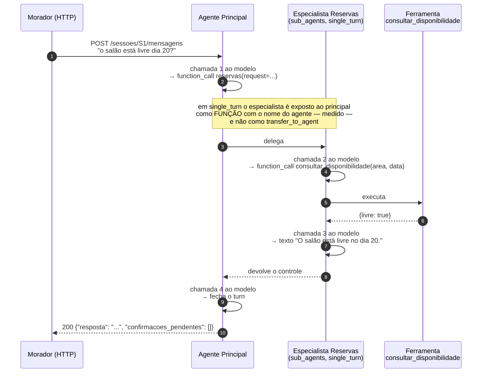
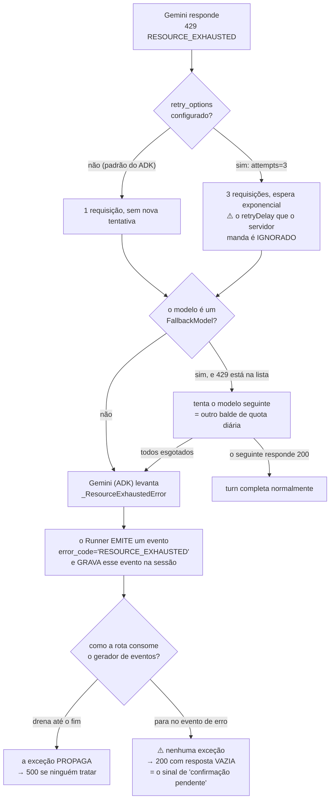

# Spike: qual modelo Gemini cada agente usa, e o que acontece quando a quota estoura?

**Status:** parcial — os **limites ativos do projeto** do avaliador não foram lidos (ver *Não verificado*). Todo o resto fechou.
**Versões investigadas:** `google-adk[db]==2.14.0`, `google-genai==2.34.0`, Python 3.13, `pgvector` (limites de dimensão, por documentação). Documentação do Gemini consultada em 2026-11-08, em `aistudio.google.com/docs` — o domínio antigo `ai.google.dev/gemini-api/docs` responde `301` para lá.
**Harness:** `scratchpad/spike24/` (descartável) — caminho completo nesta máquina: `/private/tmp/claude-501/-Users-pedroazeredo-Documents-Repos-MBA-desafios-mba-ia-desafio-criacao-agente/499d1e0a-b948-4049-9d93-e0115a53ef10/scratchpad/spike24/`. São sete arquivos, rodados com `uv run python h1_quota.py` e afins. **Nenhum precisou de chave de API:** um servidor HTTP local finge ser o endpoint do Gemini e conta as requisições, e um `BaseLlm` roteirizado conta as chamadas ao modelo. O que está sob medição é a maquinaria do ADK, não a capacidade do Gemini.

---

## Resumo executivo

### Do que se trata

O **Residencial Aurora** é um assistente de condomínio: pelo chat, o morador reserva áreas comuns (salão, churrasqueira, quadra), cancela as próprias reservas, autoriza visitantes e tira dúvidas sobre o regulamento interno. Ele é construído com **Google ADK** — o framework de agentes do Google — e exposto por uma API FastAPI em `localhost:8000`. É um trabalho de MBA, e a correção é feita por um avaliador humano que executa um **roteiro fixo de 15 passos** contra essa API, num clone limpo do repositório, **com a chave de API dele**.

A arquitetura já está decidida: um **agente principal** que só roteia, e três especialistas — **Reservas**, **Visitantes** e **Regulamento**. Os dois primeiros são `sub_agents` em `mode="single_turn"`; o terceiro é embrulhado como ferramenta (`AgentTool`). O porquê está no ADR-0007 e no ADR-0008.

### Por que este documento existe

Faltava escolher **qual modelo Gemini cada um desses quatro agentes usa**. O enunciado deixa a escolha livre e avisa duas coisas: *"consulte os limites ativos do seu projeto no próprio Google AI Studio, porque eles mudam com frequência"* e *"como ordem de grandeza, o fluxo do avaliador faz algumas dezenas de chamadas ao modelo"*. O passo 14 do roteiro dispara **duas aprovações simultâneas**. Se a quota estourar no meio da correção, a requisição falha e o passo reprova.

A pergunta parecia administrativa — "escolhe um Flash e segue". Não é. Ela tem uma resposta que **elimina a escolha mais intuitiva**.

### O que foi encontrado

**O plano gratuito do Gemini dá 20 requisições por dia nos modelos da família Flash.** Não 20 por minuto: por **dia**, contadas por projeto e por modelo, com reset à meia-noite do Pacífico. O roteiro do avaliador custa, pela medição deste spike, **60 a 90 chamadas ao modelo**. Com qualquer modelo Flash, a correção morre por volta do passo 5 — antes de chegar à primeira confirmação. Os modelos **Flash-Lite** dão 500 requisições por dia, e aí a correção cabe com folga de umas seis execuções diárias. Isso inverte a intuição: o modelo "melhor" é o que reprova.

**Um turn custa 4 chamadas ao modelo, não 1.** *Turn* é o termo do ADK para o ciclo inteiro que uma mensagem do morador dispara: ela entra, os agentes chamam ferramentas e chamam o modelo quantas vezes precisarem, e o ciclo fecha quando sai a resposta. É a unidade que importa aqui porque o limite do Gemini conta **chamadas ao modelo**, não mensagens. Medido com um LLM roteirizado contando as chamadas: numa pergunta que o principal encaminha a um especialista que usa uma ferramenta, o principal é chamado 2 vezes e o especialista 2 vezes. Cada ferramenta adicional no mesmo turn soma 1 chamada (um turn com duas ferramentas custou 5). O fator 4 é o que transforma "18 mensagens no roteiro" em "72 chamadas ao modelo" — e é consequência da topologia já decidida, não da escolha de modelo.

**O modelo que o ADK usa quando ninguém escolhe é um da família Flash.** `LlmAgent.DEFAULT_MODEL` é `'gemini-3.5-flash'` (verificado em execução), e a documentação de depreciações diz que esse endpoint roteia automaticamente para `gemini-3.8-flash`. Ou seja: um agente declarado sem `model=` cai exatamente no balde de 20 requisições por dia, sem aviso nenhum.

**O ADK não tenta de novo depois de um `429`.** Medido: com a configuração padrão, uma resposta `429` produz **exatamente uma** requisição HTTP e levanta `_ResourceExhaustedError`. Isso significa que um pico momentâneo de requisições por minuto — que é precisamente o que o passo 14 provoca — derruba o turn. Passar `retry_options=HttpRetryOptions(attempts=3)` faz o SDK tentar 3 vezes com espera exponencial, e um `429` isolado deixa de ser fatal. O SDK **ignora** o `retryDelay` que o próprio servidor manda no corpo do erro, e usa a sua própria espera.

**O erro de quota não chega à rota como um erro limpo: ele chega duas vezes, de duas formas.** O `Runner` do ADK primeiro **emite um evento** com `error_code='RESOURCE_EXHAUSTED'` — que fica **gravado na sessão** e portanto aparece em `GET /sessoes/{id}/eventos` — e depois, quando o consumidor continua a iteração, **levanta a exceção**. Quem escrever a rota `POST /sessoes/{id}/mensagens` juntando o texto dos eventos e parando no primeiro erro vai produzir um `200` com `resposta` vazia. E `resposta` vazia é, pelo contrato do enunciado, **exatamente o sinal de "parei esperando confirmação"**. Uma falha de quota viraria uma confirmação pendente inexistente.

**Existe uma rede de segurança pronta no ADK, e ela funciona no `429`.** `FallbackModel(models=[...])` tenta os modelos em ordem e passa ao seguinte quando o primeiro falha com um código da sua lista — `429` está nela por padrão. Verificado em execução, com controle: tirando o `429` da lista, o fallback não acontece. Como a quota diária é contada **por modelo**, uma cadeia de dois modelos é uma cadeia de dois baldes de quota.

**Gerar os vetores do regulamento custa uma única requisição**, não uma por trecho. Medido: `embed_content` com uma lista de 14 textos monta **uma** chamada ao endpoint `:batchEmbedContents` e devolve 14 vetores. A preocupação de que a restauração pudesse estourar o limite por minuto do modelo de embedding não se sustenta.

### O que se espera de você

Quatro decisões, e a primeira é a que importa:

1. **Qual modelo em qual agente** (`modelos/D-01`). A evidência elimina a família Flash e deixa duas formas de usar os Flash-Lite: um modelo só para todos os quatro agentes, ou dois modelos divididos entre eles — o que dobra a quota diária disponível, porque o limite é por modelo.
2. **O que fazer quando o `429` acontece de todo jeito** (`modelos/D-02`): nada, tentar de novo, cair para outro modelo, ou os dois.
3. **Como a API responde a um erro de modelo** (`modelos/D-03`). Aqui o que precisa ser evitado é concreto: `200` com resposta vazia, que o avaliador leria como confirmação pendente.
4. **Qual modelo de embedding e com quantas dimensões** (`modelos/D-04`). Esta nasce colada ao plano 1.4, que está travado esperando exatamente isso, e tem uma consequência de schema: 3.072 dimensões — o padrão — **não podem ser indexadas** pelo `pgvector`.

A `D-01` depende de um número que **não foi possível confirmar na fonte oficial**, porque o Google parou de publicar os limites do plano gratuito. Ele vem de duas medições independentes de terceiros, que concordam. Se você quiser a confirmação antes de decidir, ela custa uma olhada no AI Studio com a sua chave — ver *Não verificado*.

---

## A pergunta

A tarefa 2.4 do `TODO.md` tem três linhas:

1. conferir no AI Studio os modelos e limites ativos, que mudam com frequência;
2. escolher o modelo **por agente**, sabendo que o avaliador faz dezenas de chamadas e que o passo 14 é concorrente — "estourar quota vira 500 e reprova";
3. uma nota dizendo que **não** há decisão "LiteLLM vs nativo", porque Gemini com chave do AI Studio é obrigatório e o ADK aceita o modelo por string.

A dúvida que bloqueava: a tarefa parecia resolver-se com uma linha de configuração, e o item 2 insinuava um risco sem quantificá-lo. Sem saber **quantas chamadas** um turn custa e **quantas chamadas** cada modelo permite, "escolher por agente" não tem critério — vira preferência. E escolher errado aqui não dá erro de código: dá uma correção que trava no meio.

Há um fato do enunciado que molda toda a resposta: **a chave é do avaliador**, preenchida por ele no passo 1 (*"copia o `.env.example` para `.env`, preenche a própria chave"*). Não temos como habilitar faturamento, subir de tier ou aumentar quota. O projeto precisa **sobreviver ao plano gratuito de outra pessoa**, com os limites que ela tiver.

---

## Como funciona

### O que custa uma chamada ao modelo

Uma "chamada ao modelo" é uma requisição HTTP `POST .../models/<modelo>:generateContent`. É essa unidade que os limites do Gemini contam. O que o morador percebe como *uma mensagem* não é uma chamada: é um ciclo de várias.

O ciclo tem uma regra simples por trás: **cada vez que o modelo precisa olhar um resultado novo, é uma chamada nova.** O modelo pede uma ferramenta → o ADK executa a ferramenta → o modelo precisa ser chamado outra vez para ver o resultado e escrever a resposta. Com a topologia do ADR-0008, isso se multiplica pelos dois níveis: o especialista roda o seu ciclo e o principal roda o dele.

O diagrama abaixo mostra o turn medido — o morador pergunta se o salão está livre — com a contagem real de cada chamada:



**Total: 4 chamadas ao modelo para uma mensagem do morador.** Medido, não estimado (achado 3). Em `mode="chat"` o mesmo turn custa 3, porque o principal não é chamado para fechar — era a economia que o ADR-0008 previu e recusou, e a medição confirma o tamanho dela: uma chamada em quatro.

### O caminho de um `429`

Quando o Gemini recusa por quota, o percurso do erro passa por três camadas, e cada uma faz uma coisa diferente com ele:



O ramo `L` é o que preocupa, e é por isso que ele vira decisão (`D-03`). Ele não é hipotético: foi o comportamento do **primeiro harness escrito para este spike**, que parou no evento de erro e concluiu, errado, que o ADK engolia o `429` em silêncio (ver *Erro do harness*, mais abaixo).

### Onde a quota é contada

Três números governam, e eles são independentes:

| Limite | O que conta | Por quê importa aqui |
|---|---|---|
| **RPM** — requisições por minuto | janela de 60 s | o passo 14 dispara duas aprovações ao mesmo tempo; se o avaliador percorrer os 15 passos depressa, as chamadas se acumulam na mesma janela |
| **RPD** — requisições por dia | reset à meia-noite do Pacífico | **é o limite que mata**: 20/dia no Flash contra 60–90 chamadas de uma correção |
| **TPM** — tokens de entrada por minuto | janela de 60 s | 250 mil no plano gratuito; o nosso prompt é pequeno (o regulamento nunca entra inteiro, por desenho) — não é o gargalo |

E o detalhe que abre a porta para duas das mitigações: **o balde é por projeto *e por modelo*.** O `quotaId` que vem no corpo de um `429` real se chama `GenerateRequestsPerDayPerProjectPerModel-FreeTier`. Dois modelos diferentes no mesmo projeto são dois baldes diferentes.

---

## Cenários

Dois dos cenários abaixo rodam **sem chave de API**, porque inspecionam a árvore de agentes montada em vez de conversar — a mesma categoria do marcador `@estrutura` que o `pyproject.toml` já registra (*"inspeciona a arvore de agentes montada (sem chamar o modelo)"*). Isso é raro e vale aproveitar: é a diferença entre uma decisão protegida por teste e uma decisão protegida por memória.

```gherkin
Funcionalidade: Escolha de modelo por agente

  @estrutura
  Cenário: Nenhum agente usa um modelo da família Flash
    Dado o aplicativo montado com o agente principal e os três especialistas
    Quando eu percorro todos os agentes da árvore
    Então nenhum deles usa um modelo cujo nome case com "gemini-<n>.<n>-flash"
    E todos usam um modelo cujo nome termina em "-flash-lite"
    # Regressão de modelos/D-01: falha se alguém "melhorar" o modelo do
    # principal. 20 requisições por dia contra 60-90 de uma correção.

  @estrutura
  Cenário: Nenhum agente herda o modelo padrão do ADK
    Dado o aplicativo montado com o agente principal e os três especialistas
    Quando eu percorro todos os agentes da árvore
    Então cada um declara explicitamente o seu modelo
    # Regressão: LlmAgent.DEFAULT_MODEL é 'gemini-3.5-flash', que roteia para
    # gemini-3.8-flash — o balde de 20/dia. Agente sem model= cai nele calado.

  @conversa
  Cenário: Um 429 transitório não derruba o turn
    Dado um modelo que recusa a primeira requisição com 429 e aceita a segunda
    Quando o morador envia uma mensagem
    Então ele recebe uma resposta normal
    E foram feitas duas requisições ao endpoint do modelo
    # só tem valor se modelos/D-02 ficar na Opção B ou D — ver a decisão.

  @api
  Cenário: Quota esgotada nunca vira resposta vazia
    Dado um modelo que recusa toda requisição com 429
    Quando o morador envia uma mensagem
    Então a rota NÃO responde 200 com "resposta" vazia
    # Regressão de modelos/D-03, e é o cenário mais importante dos quatro:
    # resposta vazia é, pelo contrato, o sinal de "parei esperando
    # confirmação". Uma falha de quota se disfarçaria de confirmação pendente.

  @api
  Cenário: O evento de erro do modelo fica visível na sessão
    Dado um modelo que recusa toda requisição com 429
    Quando o morador envia uma mensagem
    E eu consulto GET /sessoes/{id}/eventos
    Então existe um evento com error_code "RESOURCE_EXHAUSTED"
    # Não é desejo: é o que o ADK já faz (achado 6). O cenário existe para
    # que a contagem de eventos dos passos 12 e 13 não seja uma surpresa.
```

> O cenário do `429` transitório está marcado `@conversa` por rodar contra o caminho do modelo, mas ele **não precisa da chave**: precisa de um endpoint que responda `429`, que é o stub de `h1_quota.py`. Se ele entrar na suíte, vale um marcador próprio ou a reutilização do stub como fixture — detalhe de implementação, não decisão.

---

## Achados

### 1. O plano gratuito dá 20 requisições por dia na família Flash, e 500 nos Flash-Lite

**Evidência (documentação + duas medições independentes de terceiros, nenhuma nossa):**

A página oficial de limites (`aistudio.google.com/docs/rate-limits`, que recebe o `301` do antigo `ai.google.dev/gemini-api/docs/rate-limits`) **não publica mais** tabela por modelo para o plano gratuito. Ela diz que *"rate limits são aplicados por projeto, não por chave de API"*, que exceder devolve `429 RESOURCE_EXHAUSTED`, e manda o leitor olhar *"View your active rate limits in AI Studio"*. A única tabela que sobrou começa no Tier 1.

Dois terceiros preenchem o vazio, por caminhos diferentes, e concordam:

| Modelo | RPM | RPD | TPM entrada |
|---|---|---|---|
| `gemini-3.8-flash` | 5 | **20** | 250 mil |
| `gemini-3.6-flash` | 5 | **20** | 250 mil |
| `gemini-3.5-flash` | 5 | **20** | — |
| `gemini-3.5-flash-lite` | 10–15 | **500** | 250 mil |
| `gemini-3.1-flash-lite` | 10–15 | **500** | 250 mil |
| `gemini-embedding-2` | 100 | 1.000 | — |
| `gemini-4-argon` | — | — | **sem plano gratuito** |

As duas fontes divergem só no RPM dos Flash-Lite (uma diz 10, a outra 15). Uma delas descreve o método: ler o próprio corpo do `429`, que traz o limite violado em `quotaId` e `quotaValue` — o que dá o limite real, não um piso observado. A outra é um levantamento de novembro de 2026 com tabelas de plano gratuito e Tier 1. Uma terceira fonte, de maio de 2026, cita "~15 RPM e ~1.500 RPD" e **avisa para não confiar nela**; ela é de antes da geração 3.x e está listada aqui só para registrar a divergência.

**Consequência:** os modelos Flash estão fora. Não por qualidade: por aritmética. E a diferença entre Flash e Flash-Lite no plano gratuito é de 25× em requisições diárias, não os ~2,5× de preço que a tabela paga sugere.

### 2. O modelo padrão do ADK é um Flash — e um agente sem `model=` cai nele calado

**Evidência (execução):**

```
DEFAULT_MODEL do LlmAgent: gemini-3.5-flash
agente sem model -> canonical: Gemini gemini-3.5-flash
```

E o código declara isso em `google/adk/agents/llm_agent.py:280`: `DEFAULT_MODEL: ClassVar[str] = 'gemini-3.5-flash'`. A documentação de depreciações diz que `gemini-3.5-flash` *"não está mais disponível no Google AI Studio; o endpoint não está sendo desligado e roteia automaticamente para `gemini-3.8-flash`"* — o balde de 20/dia.

**Consequência:** declarar `model=` em **todos** os quatro agentes não é zelo, é requisito. Um agente criado sem ele não dá erro, não dá aviso, e consome o balde mais apertado que existe. Daí o cenário `@estrutura` que exige modelo explícito.

### 3. Um turn custa 4 chamadas ao modelo; cada ferramenta a mais soma 1

**Evidência (execução, `h3_chamadas.py` e `h7_duas_tools.py`):**

```
  Reservas como sub_agents, mode='single_turn':
   pedido que vai para Reservas                   4 chamadas  (principal=2, reservas=2)
   duvida que vai para Regulamento (AgentTool)    4 chamadas  (principal=2, regulamento=2)

  Reservas como sub_agents, mode='chat':
   pedido que vai para Reservas                   3 chamadas  (principal=1, reservas=2)
   duvida que vai para Regulamento (AgentTool)    4 chamadas  (principal=2, regulamento=2)

  L — turn com DUAS ferramentas: 5 chamadas  ({'principal': 2, 'reservas': 3})
```

O harness monta a topologia do ADR-0008 com um `BaseLlm` roteirizado que incrementa um contador por agente a cada `generate_content_async`. Sem chave: o que está sob medição é quantas vezes o ADK vai ao modelo, não o que o modelo responde.

**Consequência:** o custo em quota é uma propriedade da **topologia**, e ela já está decidida. Com 4 chamadas por turn, o roteiro do avaliador — que tem cerca de 18 requisições que invocam o modelo (contadas no percurso do escopo, abaixo) — custa da ordem de **70 chamadas**, e passa de 80 com os turns de duas ferramentas. Isso bate com o *"algumas dezenas de chamadas"* do enunciado e confirma que `20/dia` é inviável por uma margem larga, não apertada.

### 4. `mode="chat"` economizaria 1 chamada em 4 — e segue recusado

A medição acima quantifica o "risco aceito" do ADR-0008: `single_turn` custa a chamada extra do principal fechando o turn, 25% a mais por turn encaminhado. O ADR já decidiu pagar isso por previsibilidade de roteamento.

**Consequência:** nada a mudar. Mas o número agora existe: se a quota se mostrar o gargalo real na Fase 5, trocar para `chat` recupera um quarto das chamadas dos turns transacionais — e custa a garantia de roteamento que o ADR-0008 comprou. Fica registrado como válvula conhecida, com preço conhecido.

### 5. O ADK não tenta de novo depois de um `429`; `retry_options` resolve, e ignora o `retryDelay` do servidor

**Evidência (execução, `h1_quota.py`, contra um stub que responde `429`):**

```
A — 429 sempre, retry_options=None (o default do ADK)
   requisicoes ao endpoint: 1
   resultado: excecao -> google.adk.models.google_llm._ResourceExhaustedError
B — 429 sempre, retry_options=HttpRetryOptions(attempts=3)
   requisicoes ao endpoint: 3  em 0.17s
C — 429 uma vez, depois 200, com retry
   requisicoes ao endpoint: 2
   resultado: ok
D — 429 uma vez, depois 200, SEM retry (default)
   requisicoes ao endpoint: 1
   resultado: excecao -> _ResourceExhaustedError
```

A causa está no SDK, não no ADK: em `google/genai/_api_client.py:677-678`, a função que monta a política de tentativas devolve `{'stop': stop_after_attempt(1), 'reraise': True}` quando `retry_options` é `None` — literalmente "nunca tente de novo". O campo `Gemini.retry_options` existe (`google/adk/models/google_llm.py:188`) e o padrão dele é `None`. A lista de códigos que o SDK considera retentáveis quando configurado inclui `429` (`_api_client.py:652-658`).

O caso **D** é o que importa e é o menos óbvio: um `429` **isolado** — um pico de RPM, não quota diária esgotada — derruba o turn inteiro com a configuração padrão. O caso **C** mostra que uma linha de configuração transforma isso em uma resposta normal.

Sobre o `retryDelay`: o corpo do `429` que o stub devolve inclui, como o do Google, um `google.rpc.RetryInfo` com `retryDelay: "25s"`. As três tentativas do caso **B** terminaram em **0,17 s**. O SDK usa a sua própria espera exponencial e **não lê** o `retryDelay`. Com `initial_delay` baixo, "tentar de novo" vira três recusas em sequência; a espera precisa ser escolhida com isso em mente.

### 6. O erro de quota chega à rota de duas formas, e uma delas é silenciosa

**Evidência (execução, `h5_evento.py`):**

```
I.1 — consumidor DRENA o gerador ate o fim (o caso normal da rota)
   desfecho: EXCECAO _ResourceExhaustedError
   evento: author=principal error_code='RESOURCE_EXHAUSTED' texto=None
   eventos GRAVADOS na sessao: 2
           gravado: author=user error_code=None
           gravado: author=principal error_code='RESOURCE_EXHAUSTED'

I.2 — consumidor da BREAK ao ver o evento de erro
   desfecho: parou no evento de erro (break)
   eventos GRAVADOS na sessao: 2
```

Três fatos, e todos têm consequência:

**(a) O evento de erro é emitido antes da exceção.** O `Runner` entrega um evento com `error_code='RESOURCE_EXHAUSTED'`, `error_message` contendo o link de mitigação do ADK mais o corpo do `429`, e `content` vazio.

**(b) Esse evento fica gravado na sessão.** São dois eventos persistidos: a mensagem do morador e o erro. Isso aparece em `GET /sessoes/{id}/eventos`, que os passos 12 e 13 do roteiro inspecionam e **contam**.

**(c) A exceção só propaga se o consumidor drenar o gerador.** Quem para no primeiro evento de erro não vê exceção nenhuma. Em `google/adk/flows/llm_flows/core/_finalizer.py:579` o `raise model_error` acontece depois do `yield`, então fechar o gerador antes engole o erro.

**Consequência:** a rota `POST /sessoes/{id}/mensagens` precisa decidir isso de propósito. O modo de falha ruim é específico e fácil de cair nele: montar `resposta` com o texto dos eventos e parar no erro produz `200 {"resposta": "", "confirmacoes_pendentes": []}` — e `resposta` vazia é, pelo próprio contrato do enunciado, o sinal de que o fluxo **parou esperando confirmação**. O avaliador leria "sem capacidade" como "pendência criada".

### 7. `FallbackModel` troca de modelo no `429`, e a troca vale um balde de quota novo

**Evidência (execução, `h2_fallback.py`, dois stubs em portas distintas):**

```
E — primario responde 429 sempre; reserva responde 200
   requisicoes ao primario: 1
   requisicoes a reserva:   1
   resultado: ok -> ok de gemini-3.5-flash-lite
F — os DOIS respondem 429
   resultado: excecao -> _ResourceExhaustedError
G — 429 FORA de retriable_status_codes: ha fallback mesmo assim?
   requisicoes: primario=1 reserva=0
   resultado: excecao -> _ResourceExhaustedError
```

O caso **G** é o controle: tirando `429` da lista `retriable_status_codes`, o fallback não acontece. Sem ele, o caso **E** poderia ser "cai para o próximo em qualquer erro"; com ele, está estabelecido que a troca é governada pela lista de códigos, que inclui `429`, `500`, `502`, `503` e `504` por padrão (`google/adk/models/_fallback_model.py:258`).

Dois avisos de uso. O recurso é **experimental**: importar e usar emite `UserWarning: [EXPERIMENTAL] feature FALLBACK_MODEL is enabled` — funciona sem nenhuma habilitação, mas o contrato pode mudar. E `FallbackModel.model` reporta o nome do **primário** (`'gemini-3.8-flash'` no teste), não o do modelo que efetivamente respondeu; qualquer log ou evento que use esse campo vai mentir sobre quem atendeu.

O que torna o recurso valioso aqui é o cruzamento com o achado 8: a quota diária é por modelo. Uma cadeia de dois Flash-Lite é uma cadeia de dois baldes de 500.

### 8. A quota é contada por projeto **e por modelo**

**Evidência (documentação + o nome do próprio `quotaId`):** a página de limites afirma que *"rate limits são aplicados por projeto, não por chave de API"*. O `quotaId` que acompanha um `429` real do plano gratuito é `GenerateRequestsPerDayPerProjectPerModel-FreeTier` — e há a variante por minuto, `GenerateRequestsPerMinutePerProjectPerModel-FreeTier`. O nome diz: por projeto, **por modelo**.

**Consequência, e é a mais acionável do documento:** dar modelos **diferentes** a agentes diferentes não é só uma escolha de capacidade — é uma escolha de **quota**. Quatro agentes num só modelo dividem 500 requisições por dia. Os mesmos quatro agentes em dois modelos têm 500 cada, e o dobro de folga de RPM. O custo é ter dois nomes de modelo no projeto em vez de um.

⚠️ Este achado é de documentação e do formato do erro, **não de medição nossa** — medir exigiria esgotar quota de verdade com uma chave. Ele sustenta uma opção da `D-01` e da `D-02`; está em *Não verificado* com o que o confirma.

### 9. Gerar N vetores custa **uma** requisição, não N

**Evidência (execução, `h6_embed.py`, stub que inspeciona o corpo enviado):**

```
K — 14 strings numa lista
   requisicoes HTTP: 1
   endpoint=gemini-embedding-001:batchEmbedContents  chaves=['requests']  len(requests)=14
   vetores devolvidos ao chamador: 14
K — 14 Content separados
   requisicoes HTTP: 1
   endpoint=gemini-embedding-001:batchEmbedContents  len(requests)=14
   vetores devolvidos ao chamador: 14
```

O SDK transforma `embed_content(contents=[14 textos])` numa única chamada a `:batchEmbedContents`, com 14 entradas, e devolve 14 vetores.

**Consequência:** `aurora-restaurar` gera os vetores do regulamento em **1 requisição** (ou poucas, se o servidor limitar o tamanho do lote — limite que não conseguimos verificar sem chave). A quota de embedding não é um risco: 1 requisição contra 1.000 por dia.

### 10. O modelo de embedding padrão devolve **um** vetor para uma lista, não um por item

**Evidência (documentação de embeddings):** *"Gemini Embedding 2 produz um único embedding agregado para múltiplas entradas"* e *"adicionar múltiplas entradas diretamente ao parâmetro `contents` produz um embedding agregado de todas as entradas"*. A saída: *"embrulhar cada entrada num objeto `Content` e passá-las no parâmetro `contents` devolve embeddings separados para cada uma"*. O modelo anterior se comporta ao contrário: *"enquanto `gemini-embedding-001` permite gerar embeddings individuais para uma lista de strings, o Gemini Embedding 2 produz um único embedding agregado"*.

**Consequência:** é uma armadilha silenciosa com `gemini-embedding-2`. Passar os 96 artigos como lista de strings devolve **1 vetor** — a média semântica do regulamento inteiro — em vez de 96. Nenhum erro: só uma busca que responde sempre a mesma coisa. Com esse modelo, cada trecho tem que ser um `Content`. O harness confirmou que o SDK aceita as duas formas e manda as duas como `requests`; **o que o servidor faz com elas não foi verificado** (precisa de chave).

### 11. As duas famílias de embedding diferem no mecanismo de "tipo de tarefa" — e uma delas é prompt

| | `gemini-embedding-2` | `gemini-embedding-001` |
|---|---|---|
| Entrada | texto, imagem, vídeo, áudio, PDF | só texto |
| Limite de entrada | 8.192 tokens | 2.048 tokens |
| Dimensões | padrão 3.072; 128–3.072; recomendadas 768 / 1.536 / 3.072 | idem |
| Tipo de tarefa | **prefixo no prompt** (sem parâmetro) | **parâmetro `task_type`**: `RETRIEVAL_DOCUMENT`, `RETRIEVAL_QUERY`, `SEMANTIC_SIMILARITY`, … |
| Situação | atual | depreciado, **desligamento em 2028-05-14**, substituto é o `-2` |
| Plano gratuito | "sem custo" para texto | "sem custo" |

O parâmetro existe no SDK instalado — `types.EmbedContentConfig` tem os campos `task_type`, `output_dimensionality`, `auto_truncate`, `title`, `mime_type` (verificado em execução).

**Consequência:** a nossa busca é **assimétrica** — a pergunta do morador contra o texto do artigo são textos de naturezas diferentes, e é para isso que `RETRIEVAL_QUERY`/`RETRIEVAL_DOCUMENT` existem. No `embedding-001` isso é um parâmetro; no `embedding-2`, uma instrução em texto no começo do conteúdo. Alimenta a `D-04`.

### 12. 3.072 dimensões — o padrão — não podem ser indexadas pelo `pgvector`

**Evidência (documentação do `pgvector`):** o tipo `vector` armazena *"até 16.000 dimensões"*, mas os índices aproximados param antes: `hnsw` e `ivfflat` suportam *"até 2.000 dimensões"* para `vector` e *"até 4.000"* para `halfvec`.

**Consequência:** `embedding vector(3072)` grava e consulta, mas **não aceita índice** `hnsw` nem `ivfflat`. Para 96 artigos isso é irrelevante — varredura exata sobre 96 vetores é instantânea, e o plano 1.4 já prevê "índice vetorial, se o volume justificar". Mas a escolha da dimensão fecha ou mantém aberta a porta do índice, e 768 dimensões gastam um quarto do espaço. É o lado de schema da `D-04`.

### 13. LiteLLM não está instalado, e o nome do modelo resolve direto para a classe nativa

**Evidência (execução):**

```
litellm instalado? False
  'gemini-3.8-flash'      -> google.adk.models.google_llm.Gemini  model='gemini-3.8-flash'
  'gemini-3.5-flash-lite' -> google.adk.models.google_llm.Gemini  model='gemini-3.5-flash-lite'
  'modelo-inventado'      -> ValueError: Model modelo-inventado not found. ...
  'gemini/gemini-3.8-flash' -> ValueError: ... require the litellm package.
```

**Consequência:** a nota do `TODO.md` está correta e não há o que decidir. Mas há um detalhe que vale levar para a Fase 4, e ele **não** é o que o resultado acima sugere à primeira vista: o `ValueError` só acontece para nomes que **não começam** com `gemini-`. Verificado em execução, `'gemini-9.9-inexistente'` e até `'gemini-'` são **aceitos na construção** e resolvem para a classe `Gemini`. Um erro de digitação em nome de modelo não falha ao subir: falha na primeira chamada ao modelo, com `404`, no meio da conversa do avaliador.

### 14. O ADK avisa que transferir entre agentes invalida o cache de contexto

**Evidência (execução, aviso emitido pelo próprio ADK ao rodar `h3_chamadas.py`):**

> `App "aurora" can transfer between agents but has no context_cache_config. Every transfer swaps the system instruction and the tool set, so the request prefix changes and the whole prompt is re-sent uncached after each transfer. Set context_cache_config on the app to give each agent its own cache.`

**Consequência:** é sobre **tokens**, não sobre requisições — e tokens não são o nosso gargalo (TPM de 250 mil contra prompts pequenos, com o regulamento isolado por desenho). Não muda nenhuma decisão deste spike. Fica registrado porque é um aviso que vai aparecer no terminal da Fase 4 e alguém vai perguntar o que é: a resposta é "é esperado, e não nos custa nada relevante".

---

## Erro do harness que vale registrar

O primeiro harness escrito para o achado 6 (`h4_rota.py`) consumia os eventos assim:

```python
async for ev in runner.run_async(...):
    if getattr(ev, "error_code", None):
        return "evento-de-erro", ev.error_code, eventos   # <- fecha o gerador
```

e reportou, com toda a convicção: *"o `429` não vira exceção; o Runner emite um evento de erro e termina normalmente"*. Isso é falso — e falso de um jeito confortável, porque é a resposta que facilita a vida. A exceção existe e é levantada **depois** do `yield` do evento (`_finalizer.py:579`); o `return` fechava o gerador antes de chegar lá.

O erro foi pego porque um harness seguinte, que drenava o gerador, estourou com `_ResourceExhaustedError` e contradisse o anterior. `h5_evento.py` então mediu **os dois modos de consumir** em vez de um.

Fica registrado por dois motivos. Primeiro, quem repetir a medição vai cair no mesmo lugar. Segundo, e mais importante: esse exato bug de consumo é o **ramo `L` do diagrama** — o modo de falha que a `D-03` precisa evitar. O harness não só errou: ele demonstrou acidentalmente que o erro é fácil de cometer em código de produção.

---

## Restrições derivadas

O que a investigação provou ser obrigatório ou proibido. Prefixo `M-` de "modelos", seguindo o padrão dos outros spikes (`F-` de fronteiras, `G-` de guardrails, `R-` de confirmação).

| | Restrição | Vem de |
|---|---|---|
| **M-1** | **Nenhum agente pode usar modelo da família Flash** (`gemini-3.8-flash`, `3.6-flash`, `3.5-flash`). 20 requisições por dia contra 60–90 de uma correção. | achados 1, 3 |
| **M-2** | **Todo agente declara `model=` explicitamente.** O padrão do ADK é `gemini-3.5-flash`, que roteia para o balde de 20/dia, e cair nele não produz aviso nenhum. | achado 2 |
| **M-3** | **Não se pode contar com tier pago.** A chave é do avaliador, preenchida por ele no passo 1. Qualquer desenho que só funcione acima do plano gratuito está fora. | enunciado, passo 1 |
| **M-4** | **A rota de mensagens não pode responder `200` com `resposta` vazia por causa de erro do modelo.** Resposta vazia é, pelo contrato, o sinal de confirmação pendente. | achado 6 |
| **M-5** | **Com `gemini-embedding-2`, cada trecho precisa ser um `Content` próprio.** Lista de strings devolve um único vetor agregado, sem erro. | achado 10 |
| **M-6** | **Dimensão de embedding acima de 2.000 impede índice `hnsw`/`ivfflat`** no `pgvector` com o tipo `vector`. | achado 12 |
| **M-7** | **Erro de digitação em nome de modelo não falha ao subir.** Qualquer `gemini-*` é aceito na construção e só quebra na primeira chamada, com `404`. Se isso tem que falhar cedo, precisa de verificação explícita. | achado 13 |

**M-1 e M-3 juntas eliminam metade do espaço de design** da `D-01` antes de ela ser lida: não há decisão "Flash no principal, Flash-Lite nos especialistas", porque os 2 turns iniciais do avaliador já consumiriam um terço do balde diário do principal.

---

## Percurso do escopo

Os três itens da tarefa 2.4 do `TODO.md`, na ordem, reproduzidos literalmente.

### "Conferir no AI Studio os modelos e **limites ativos** (mudam com frequência)."

**Desfecho:** Pontos levantados — a lista de modelos resolveu; os *limites ativos* são, por construção, inverificáveis daqui.

A lista de modelos está no achado 1, e a conferência produziu três fatos que mudam coisas:

1. **A documentação mudou de endereço.** `ai.google.dev/gemini-api/docs/*` responde `301` para `aistudio.google.com/docs/*`. Links antigos ainda funcionam por redirecionamento.
2. **O Google parou de publicar os limites do plano gratuito.** A página de limites não tem mais tabela por modelo para o plano gratuito; ela manda olhar *"View your active rate limits in AI Studio"*. O aviso do enunciado — *"consulte os limites ativos do seu projeto no próprio AI Studio, porque eles mudam com frequência"* — não é só uma precaução: é hoje o **único** caminho oficial.
3. **O que o curso provavelmente ensinou está depreciado.** `gemini-2.5-flash` tem desligamento marcado para **2026-12-01** e roteia para `gemini-3.5-flash-lite`; `gemini-2.0-flash` foi desligado em 2026-06-01. Se algum exemplo do curso usar esses nomes, copiá-lo hoje funciona por roteamento automático e deixa de funcionar em semanas.

**O bloqueio, dito em voz alta:** não há `.env` neste ambiente (`ls` confirma: só `.env.example`), e "limites ativos do projeto" é informação de uma conta específica, atrás de autenticação no AI Studio. **Nenhuma investigação feita daqui pode responder esse item** — e, pior, a resposta certa é a do *projeto do avaliador*, não a do nosso. É por isso que `M-3` existe: o desenho precisa sobreviver ao limite que ele tiver, e não a um que a gente confirmou.

O que destrava, e o que fazer com isso, está em *Não verificado*.

### "Escolher por agente. O avaliador faz dezenas de chamadas e o passo 14 é concorrente — estourar quota vira 500 e reprova."

**Desfecho:** Decisões `modelos/D-01`, `D-02` e `D-03`.

O item vira três decisões porque contém três perguntas distintas que o texto comprime numa:

- *qual modelo* em cada agente → `D-01`, agora com um critério duro (`M-1`) em vez de preferência;
- *o que fazer quando o `429` acontece mesmo assim* → `D-02`, com duas mitigações medidas (`retry_options`, `FallbackModel`);
- *"estourar quota vira 500"* → isto era uma **suposição**, e a medição a corrigiu: vira 500 **ou** `200` com resposta vazia, dependendo de como a rota consome os eventos (achado 6). O segundo caso é pior, porque se disfarça de confirmação pendente. → `D-03`.

A parte do item que a medição **quantificou** sem precisar de decisão: "dezenas de chamadas" são ~70–90, e a conta se faz assim — o roteiro tem cerca de 18 requisições que invocam o modelo, cada uma custando 4 chamadas (5 quando o turn usa duas ferramentas):

| Passo | Requisições que invocam o modelo | Observação |
|---|---|---|
| 1, 2 | 0 | subida, restauração, `POST /sessoes` |
| 3 | 1 | pede reservas **e** visitantes do 302 — pode acionar dois especialistas |
| 4, 5, 6 | 3 | um cancelamento alheio, um próprio, uma reserva sem taxa |
| 7 | 2 | mensagem + negar a confirmação |
| 8 | 2 | mensagem + aprovar *(o reenvio do mesmo `id` é `409` e não chama o modelo)* |
| 9 | 0 | `id` inexistente → `409`; sessão inexistente → `404` |
| 10 | 1–2 | mensagem, e aprovação se houver |
| 11 | 2 | mensagem + aprovação |
| 12, 13 | 2 | pergunta do regulamento; pergunta após o reinício |
| 14 | 4 | duas mensagens + **duas aprovações simultâneas** |
| 15 | 0 | inspeção de repositório |
| **Total** | **~18** | × 4 chamadas ≈ **72**, chegando a ~85 com turns de duas ferramentas |

⚠️ Uma ressalva honesta nessa conta: **o custo em chamadas de uma retomada de confirmação não foi medido.** Medi-lo exige a maquinaria de confirmação do spike R1 montada de novo; a tabela assume que uma retomada custa o mesmo que um turn comum. Está em *Não verificado*.

Sobre a concorrência do passo 14, especificamente: duas sessões aprovando ao mesmo tempo produzem um pico de ~8 chamadas quase simultâneas. Contra 10–15 RPM, o pico em si cabe; o que não cabe é o pico **somado** ao que foi gasto nos segundos anteriores, se o avaliador percorrer os passos depressa. É esse cenário que a `D-02` endereça — e ele é de **RPM**, não de RPD: a espera de alguns segundos resolve, e é exatamente o que `retry_options` faz.

### "*Nota:* não há decisão "LiteLLM vs nativo". Gemini + chave do AI Studio é obrigatório e o ADK fala por string de modelo."

**Desfecho:** Resolvido — a nota está correta, confirmada por execução, e nada a decidir.

`litellm` não está instalado (verificado: `importlib.util.find_spec("litellm") is None`), e o `LLMRegistry` resolve `'gemini-3.5-flash-lite'` direto para `google.adk.models.google_llm.Gemini`. Nomes no formato `provider/model` levantam `ValueError` com a mensagem *"require the litellm package"*. Não existe caminho LiteLLM a comparar, e o registro usado é o nativo — é o que a nota afirma.

Um ponto de implementação que cabe aqui, e que vale mais que a confirmação da nota: o `ValueError` protetor **não cobre** nomes `gemini-*` inventados. `'gemini-9.9-inexistente'` constrói sem reclamar (achado 13, `M-7`). A consequência prática é que a validação de um nome de modelo, se for desejada, é trabalho nosso — o ADK não a oferece.

---

**Cobertura:** 3 itens no escopo · 1 resolvido · 1 virou decisão (três, na verdade) · 1 com pontos levantados · 0 sem nada a acrescentar.

> Uma decisão a mais nasceu **adjacente** ao escopo: `modelos/D-04`, o modelo de embedding e a sua dimensão. Ela não está nos três bullets da 2.4 — eles falam de agentes — mas é escolha de modelo Gemini, com limite ativo próprio, e é a **dependência declarada que trava o passo P4 do [plano 1.4](plano-1.4-postgres-e-recuperacao-semantica.md)**, que registra em voz alta: *"Decisão pendente que este plano precisa antes de começar: qual modelo gera os embeddings?"*. Aquele plano decidiu a **família** (`regulamento/D-06` = Gemini, por API) e não o modelo nem a dimensão. Como a investigação dos limites passou por cima dessa informação de qualquer forma, ela está aqui em vez de virar um spike próprio de dois parágrafos. Se você preferir que ela fique fora da 2.4, ela sai sem afetar `D-01` a `D-03`.

---

## Não verificado

### Falta chave de API (`GOOGLE_API_KEY`)

Não existe `.env` neste ambiente — só `.env.example`.

| O quê | O que destrava |
|---|---|
| **Os limites ativos do plano gratuito**, na fonte autoritativa. Os números do achado 1 são de dois terceiros que concordam, não do Google. | Abrir o AI Studio logado e ler *"View your active rate limits"*; ou fazer uma chamada e ler o `quotaValue` do `429`. **Isto afeta `D-01` e eu me ofereço a medir antes de você decidir.** |
| **Se os Flash-Lite dão 10 ou 15 RPM.** As duas fontes divergem. | Idem. Não muda a `D-01` (os dois valores comportam o pico do passo 14), muda a folga. |
| **Se uma requisição recusada com `429` consome quota.** Importa porque `retry_options` multiplica as requisições. | Medição com chave: gastar o RPM de propósito e comparar o contador. |
| **Se o servidor aceita 96 entradas num `batchEmbedContents`.** Medimos que o SDK monta **uma** requisição; o limite do lado do servidor não aparece na documentação. | Uma chamada com 96 trechos e uma chave. |
| **Se `gemini-embedding-2` devolve 96 vetores quando cada trecho é um `Content`.** A documentação diz que sim; nada foi executado contra o servidor. Afeta a `D-04` e a restrição `M-5`. | Idem. |
| **Qualidade de roteamento de cada modelo.** Se um Flash-Lite erra o especialista com mais frequência que um Flash, isso é custo que a aritmética de quota não vê. | Rodar o roteiro com cada modelo, na Fase 5. |

### Falta medição que não dependia de chave, e ficou de fora

| O quê | Por quê ficou de fora | O que destrava |
|---|---|---|
| **O custo em chamadas de uma retomada de confirmação.** A tabela do roteiro assume "igual a um turn comum". | Exige remontar a maquinaria de confirmação do spike R1 dentro do harness de contagem. É fazível sem chave. | Umas duas horas de harness, ou medir na Fase 4, quando o caminho existir de verdade. |
| **O comportamento de `FallbackModel` com tool de confirmação.** `FallbackModel` embrulha o modelo, não o agente, então em princípio não toca a topologia que a restrição `R1` protege — mas "em princípio" é exatamente o tipo de frase que o `AgentTool` já desmentiu neste projeto, de forma silenciosa. | Mesma razão acima. | Se a `D-02` incluir `FallbackModel`, medir **antes** de confiar: um turn com `require_confirmation` sob `FallbackModel`, com retomada, como o spike R1 fez. |

---

## Decisões em aberto

### `modelos/D-01` — Qual modelo Gemini cada agente usa?

**Contexto.** O assistente tem quatro agentes: um **principal**, que só roteia, e três especialistas — **Reservas**, **Visitantes** e **Regulamento**. Cada um precisa de um modelo Gemini, declarado por string (`model="..."`). A escolha é livre pelo enunciado, mas duas restrições desta investigação fecham a maior parte do espaço: nenhum agente pode usar modelo da família **Flash**, porque o plano gratuito dá 20 requisições por dia neles e uma correção custa 60–90 (`M-1`); e não se pode contar com plano pago, porque a chave é do avaliador (`M-3`). Sobram os **Flash-Lite**, com 500 requisições por dia — e o fato de que esse balde é contado **por modelo**, de forma que usar dois modelos distintos dá dois baldes (achado 8).

**Opção A: `gemini-3.5-flash-lite` nos quatro agentes.**
- Um nome de modelo no projeto inteiro, num só lugar de configuração.
- **A favor:** simples de explicar no README (é item avaliado); comportamento uniforme, então um problema de roteamento não se confunde com diferença de modelo; é o Flash-Lite mais recente, o de melhor qualidade entre os viáveis.
- **Contra:** um balde de 500/dia e 10–15 RPM para tudo. Uma correção gasta ~15% do dia; depurar o roteiro algumas vezes no mesmo dia encosta no limite.

**Opção B: dois Flash-Lite, divididos por volume de chamadas.** Principal em `gemini-3.5-flash-lite`; os três especialistas em `gemini-3.1-flash-lite`.
- O principal responde por metade das chamadas (2 de 4 por turn, medido), então a divisão fica perto de 50/50.
- **A favor:** ~1.000 requisições por dia e o dobro de folga de RPM, de graça — só muda a string. A divisão tem uma justificativa de capacidade além da quota: roteamento é a tarefa mais sensível e fica no modelo mais novo.
- **Contra:** dois modelos para explicar e justificar no README; `gemini-3.1-flash-lite` é a geração anterior, e se um especialista responder pior, há uma variável a mais entre a causa e o sintoma.

**Opção C: dois Flash-Lite, divididos por domínio.** Principal, Reservas e Visitantes em `gemini-3.5-flash-lite`; Regulamento em `gemini-3.1-flash-lite`.
- **A favor:** o Regulamento tem a tarefa mais fácil — redigir uma frase curta a partir de um artigo já recuperado —, então é o candidato natural ao modelo mais fraco. Tira do balde principal as 2 chamadas por turn de regulamento.
- **Contra:** divisão desigual: os turns de regulamento são minoria no roteiro (o passo 12 é um), então o alívio de quota é pequeno. Ganha-se pouco da `B` e paga-se o mesmo preço de ter dois modelos.

**Recomendação: B.** Dois baldes em vez de um custa uma string a mais e dobra a margem no único limite que pode reprovar o trabalho — e a divisão por volume de chamadas, com o principal sozinho no modelo mais novo, é a que tem a melhor justificativa para o README: *o agente que decide o caminho fica no melhor modelo disponível; os que executam tarefa estreita ficam no outro, e isso duplica a quota diária porque o limite é por modelo*. A `A` é defensável se você preferir uniformidade e já souber que o avaliador não vai rodar o roteiro mais de três ou quatro vezes no mesmo dia — o que não temos como saber.

⚠️ **Esta decisão depende de item não verificado:** os 20/dia e os 500/dia vêm de medições de terceiros, não do Google, que parou de publicá-los. As duas fontes concordam e uma descreve o método (ler o `quotaValue` do próprio `429`), mas **nenhuma é nossa**. Se você quiser a confirmação antes de decidir, diga: com a chave no `.env`, é uma consulta ao AI Studio ou uma chamada que lê o corpo do erro.

**Decisão:** A
---

### `modelos/D-02` — O que o sistema faz quando o `429` acontece mesmo assim?

**Contexto.** Mesmo com o modelo certo, um `429` pode acontecer por **pico de requisições por minuto** — e o passo 14 do roteiro do avaliador produz exatamente isso: duas sessões aprovando uma reserva ao mesmo tempo, o que dispara cerca de 8 chamadas ao modelo quase simultâneas. Medimos que, com a configuração padrão do ADK, **um único `429` derruba o turn**: nenhuma nova tentativa, exceção levantada. Duas mitigações existem e ambas foram verificadas em execução. Elas resolvem problemas diferentes: `retry_options` resolve pico de RPM (esperar alguns segundos basta); `FallbackModel` resolve quota de modelo esgotada (esperar não resolve, trocar de balde resolve). Esta decisão é independente da `D-01` — vale para qualquer modelo escolhido lá.

**Opção A: nada. Deixar o padrão.**
- **A favor:** zero código novo, zero configuração. A falha é alta e visível, não silenciosa.
- **Contra:** um `429` isolado — o caso **D** do harness — reprova um passo do avaliador por um pico de segundos. É o único cenário aqui em que a causa da reprovação é totalmente evitável por uma linha.

**Opção B: `retry_options` em todos os modelos.** `types.HttpRetryOptions(attempts=3, initial_delay=2)`.
- **A favor:** medido: com `attempts=3`, um `429` seguido de `200` termina em resposta normal. Resolve o pico do passo 14, que é o risco nomeado pelo enunciado. Uma linha por modelo.
- **Contra:** o SDK **ignora** o `retryDelay` que o servidor manda (medido: 3 tentativas em 0,17 s com `initial_delay` baixo), então a espera é escolha nossa e um `initial_delay` curto viraria três recusas em sequência — mitigação de aparência. Com `initial_delay=2`, o turn pode levar ~6 s a mais, e o `curl` do avaliador espera. E não resolve nada quando a quota **diária** acabou: só gasta três requisições no lugar de uma.

**Opção C: `FallbackModel` em todos os agentes.** Cadeia `gemini-3.5-flash-lite` → `gemini-3.1-flash-lite`.
- **A favor:** medido, com controle: o fallback dispara no `429` e o segundo modelo responde. Como a quota é por modelo, a cadeia é uma cadeia de baldes — e, ao contrário da Opção B, isso **resolve quota diária esgotada**. Só paga o segundo modelo quando o primeiro falha, o que é melhor que a divisão estática da `D-01`.
- **Contra:** o recurso é **experimental** no ADK 2.14 e emite `UserWarning` ao ser usado; `FallbackModel.model` reporta o nome do primário, então log e evento mentem sobre quem respondeu. E **não está medido** o que ele faz com uma ferramenta que exige confirmação — este projeto já pagou caro por supor comportamento de embrulho de modelo/agente (a armadilha do `AgentTool`, restrição `R1`).

**Opção D: B + C.** `retry_options` em cada modelo da cadeia, e a cadeia como modelo do agente.
- **A favor:** cobre os dois modos de falha, que são distintos: a espera resolve pico de RPM, a troca resolve balde esgotado. O próprio ADK documenta a composição (`_fallback_model.py:210-212`: *"tentar de novo um único modelo é uma preocupação separada, tratada pela configuração de retry do próprio modelo"*).
- **Contra:** o pior caso de latência soma — 3 tentativas no primário, depois 3 na reserva. Num pico, isso é cerca de 12 s antes de responder. E herda o risco não medido da `C`.

**Recomendação: B agora, e C depois de medir.** A `B` resolve o risco que o enunciado nomeia (o passo 14 concorrente), custa uma linha e não tem dependência não verificada. A `C` é mais poderosa e cobre o caso que a `B` não cobre, mas o seu risco está exatamente onde este projeto já se queimou: comportamento de retomada de confirmação sob um embrulho de modelo. Adotá-la sem medir seria repetir a `R1` com outro nome. Se você escolher `D`, o primeiro passo do plano tem que ser **um turn de reserva com confirmação, aprovado após reinício do processo, com `FallbackModel` no lugar** — exatamente o teste que o ADR-0014 exigiu antes de migrar para Postgres, e pela mesma razão: a falha é silenciosa.

**Decisão:** B

---

### `modelos/D-03` — Como a API responde a um erro de modelo?

**Contexto.** O contrato do enunciado para `POST /sessoes/{id}/mensagens` é `200` com `{"resposta", "confirmacoes_pendentes": []}`, e a `resposta` **pode ser vazia quando o fluxo parou esperando confirmação**. A medição mostrou que um erro de quota chega ao `Runner` de duas formas: um **evento** com `error_code='RESOURCE_EXHAUSTED'` — que fica gravado na sessão e aparece em `GET /sessoes/{id}/eventos` — e, se o consumidor drenar o gerador, uma **exceção**. Daí o problema: uma rota que monta a `resposta` com o texto dos eventos e para no primeiro erro devolve `200` com resposta vazia, que é indistinguível de "parei esperando confirmação". A restrição `M-4` proíbe esse resultado; esta decisão escolhe o que colocar no lugar. Ela é vizinha do ADR-0011 ("recusa de negócio nunca vira erro de servidor"), mas do outro lado: falta de quota **não é** recusa de negócio — é indisponibilidade, e tratá-la como recusa seria mentir para o morador sobre a regra do condomínio.

**Opção A: deixar a exceção propagar → `500`.**
- O `exception handler` do FastAPI responde `500` sem que a gente escreva nada.
- **A favor:** honesto e alto; nenhuma linha de código; impossível confundir com confirmação pendente.
- **Contra:** o avaliador vê um `500` sem explicação, e o `500` é o que o `TODO.md` chamou de reprovação. Entre `500` e `503`, o segundo diz "volte depois" e o primeiro diz "tem bug aqui" — e para quem está corrigindo, essa diferença conta.

**Opção B: traduzir para `503`, com `Retry-After`.**
- Um `exception handler` para `ClientError` com `code == 429`, devolvendo `503` e o cabeçalho.
- **A favor:** diz a verdade no código HTTP certo. Semanticamente correto, e demonstra que o caso foi pensado — o que é bom no README, que é entregável avaliado.
- **Contra:** `503` não está no contrato do enunciado (que define `200`, `404` e `409`). O avaliador não testa este caminho, então o ganho é de qualidade, não de nota. E há uma sutileza: o erro só chega como exceção se a rota drenar o gerador — então a Opção B **obriga** a drenar, de propósito, o que precisa estar escrito e comentado para ninguém "otimizar" de volta.

**Opção C: `200` com uma mensagem de indisponibilidade no campo `resposta`.**
- Por exemplo `{"resposta": "Estou sem capacidade de atendimento agora, tente em um minuto.", "confirmacoes_pendentes": []}`.
- **A favor:** fica dentro do contrato; o morador recebe texto em vez de erro cru.
- **Contra:** **é o modo de falha disfarçado de sucesso.** Qualquer verificação automática — a nossa da Fase 5, inclusive — vê `200` e segue. É o mesmo defeito do `@skip` que a regra 3 do `CLAUDE.md` proíbe: desaparecer em silêncio. E texto fabricado pelo código no campo onde o modelo escreve embaralha quem disse o quê.

**Recomendação: B,** com a drenagem do gerador escrita explicitamente e comentada citando a restrição `M-4`. A razão não é a nota — o avaliador não testa indisponibilidade — é que `B` é a única opção em que **a falha de quota tem uma assinatura própria**, distinguível de confirmação pendente e de bug. A `A` é perfeitamente aceitável se você preferir não escrever `handler` nenhum: ela respeita a `M-4` do mesmo jeito, só com uma mensagem pior. A `C` está eliminada pela `M-4`, e não é uma opção real — está listada porque é o caminho que um código escrito sem pensar nisso produz sozinho.

**Decisão:** B

---

### `modelos/D-04` — Qual modelo gera os embeddings, e com quantas dimensões?

**Contexto.** O especialista de Regulamento acha o trecho que responde a dúvida do morador por **similaridade semântica**: cada trecho do regulamento vira um vetor, a pergunta vira um vetor, e a busca é por proximidade, feita pelo Postgres com `pgvector` (ADR-0015 e ADR-0014). Isso exige um modelo que transforme texto em vetor. O [plano 1.4](plano-1.4-postgres-e-recuperacao-semantica.md) está **travado** nesta pergunta — ele a declara como "decisão pendente que este plano precisa antes de começar" — e a parte já decidida (`regulamento/D-06`) escolheu só a **família**: Gemini, por API, em vez de modelo local. Falta o modelo e a dimensão. A dimensão não é detalhe: ela é o `vector(N)` da coluna, e acima de 2.000 o `pgvector` não aceita índice `hnsw` nem `ivfflat` (`M-6`). As duas escolhas andam juntas porque a dimensão é parâmetro da chamada que gera o vetor.

Dois fatos da investigação moldam as opções. O `gemini-embedding-2` é o modelo atual e aceita 8.192 tokens de entrada, mas o "tipo de tarefa" nele é **prefixo de texto no prompt**, e ele **agrega** múltiplas entradas num vetor só quando elas não vêm embrulhadas em `Content` (`M-5`). O `gemini-embedding-001` é a geração anterior — depreciado, com desligamento em **2028-05-14**, muito depois deste projeto —, aceita 2.048 tokens, devolve um vetor por item de uma lista, e tem `task_type` como **parâmetro**: `RETRIEVAL_DOCUMENT` para os trechos, `RETRIEVAL_QUERY` para a pergunta. A nossa busca é assimétrica (pergunta de morador contra texto de artigo), que é o caso para o qual esses dois valores existem.

**Opção A: `gemini-embedding-2`, 768 dimensões.**
- Cada trecho embrulhado num `Content` próprio; tipo de tarefa por prefixo no texto.
- **A favor:** é o modelo atual, sem depreciação; mais contexto por trecho (8.192 tokens) se a unidade de recuperação crescer; 768 mantém o índice `pgvector` possível e gasta um quarto do espaço do padrão.
- **Contra:** o controle de assimetria é **texto de prompt**, não parâmetro — e este projeto existe para pôr no código o que não pode depender de prompt. A armadilha `M-5` é silenciosa: errar o embrulho devolve 1 vetor em vez de 96, sem erro nenhum.

**Opção B: `gemini-embedding-001`, 768 dimensões.**
- `task_type='RETRIEVAL_DOCUMENT'` ao semear, `task_type='RETRIEVAL_QUERY'` ao buscar.
- **A favor:** a assimetria da busca é **parâmetro verificável em código**, não instrução em texto — coerente com o tema do desafio e inspecionável por quem ler o repositório. Devolve um vetor por item de uma lista, sem a armadilha do embrulho. 2.048 tokens sobram com folga: o artigo mediano do regulamento tem ~442 caracteres, e o capítulo inteiro ~3.223 (≈950 tokens).
- **Contra:** modelo depreciado. O desligamento é em 2028, mas "escolhi o modelo depreciado" é uma frase que precisa de justificativa no README. E o espaço de embedding dos dois é incompatível: mudar de modelo depois exige regerar todos os vetores.

**Opção C: `gemini-embedding-2`, 3.072 dimensões (o padrão).**
- **A favor:** nenhum parâmetro de dimensão para escolher nem justificar; é a representação mais rica que o modelo oferece.
- **Contra:** **fecha a porta do índice** — `vector(3072)` não aceita `hnsw` nem `ivfflat` (`M-6`); quatro vezes mais espaço por vetor; e herda os dois contras da Opção A. Para 96 artigos a varredura exata é instantânea, então o que se perde é opção futura, não desempenho hoje.

**Recomendação: B.** O argumento decisivo não é qualidade de vetor — para 96 artigos curtos, qualquer um dos três acerta ou erra pelos mesmos motivos. É que `task_type` é um **parâmetro** e prefixo de prompt é **texto**: num projeto cuja tese é que regra em prompt não conta, preferir o mecanismo que o código controla é consistente, e é uma frase defensável no README. A depreciação em 2028 não é risco para um trabalho de MBA entregue em 2026. Se você der mais peso a "não começar com modelo depreciado" — que é um critério legítimo —, a `A` é a escolha, e aí a restrição `M-5` precisa virar comentário no código que gera os vetores, porque errá-la não dá erro.

Em qualquer das opções: **768 dimensões**, não o padrão de 3.072. A diferença custa nada e preserva a opção do índice.

⚠️ **Esta decisão depende de item não verificado:** que `gemini-embedding-2` devolva um vetor por `Content` separado é afirmação da documentação, sem execução contra o servidor. Se você escolher `A` ou `C`, isso precisa ser confirmado no primeiro passo da implementação — antes de haver 96 vetores gravados que podem ser todos o mesmo.

**Decisão:** B

---

## Resumo das decisões

| ID | Decisão | Recomendação | Escolha |
|----|---------|--------------|---------|
| `modelos/D-01` | Qual modelo em cada agente | **B** — principal em `gemini-3.5-flash-lite`, especialistas em `gemini-3.1-flash-lite` (dois baldes de quota) | **A** — ver [ADR-0017](adr/0017-um-modelo-flash-lite-nos-quatro-agentes.md) |
| `modelos/D-02` | O que fazer quando o `429` acontece | **B agora** (`retry_options`), **C depois de medir** (`FallbackModel`) | **B** — ver [ADR-0018](adr/0018-tres-tentativas-no-429-sem-fallback-de-modelo.md) |
| `modelos/D-03` | Como a API responde a erro de modelo | **B** — `503` com `Retry-After`, drenando o gerador de propósito | **B** — ver [ADR-0019](adr/0019-erro-de-quota-vira-503-com-retry-after.md) |
| `modelos/D-04` | Modelo de embedding e dimensão | **B** — `gemini-embedding-001` com `task_type`, 768 dimensões | **B** — ver [ADR-0020](adr/0020-embeddings-do-gemini-embedding-001-em-768-dimensoes.md) |

**Dependências entre elas:** `D-02` pressupõe `D-01` (a cadeia de fallback é feita dos modelos escolhidos lá). `D-03` é independente das duas. `D-04` é independente de todas e pertence ao plano 1.4.

**Dependem de item não verificado:** `D-01` (os números de quota não são nossos) e `D-04` na Opção A ou C (o comportamento de agregação do `embedding-2`). Ofereço medir ambos antes de você decidir — o primeiro exige a chave no `.env`; o segundo também.

---

## Próximos passos

1. **Responder `D-01` a `D-04`.** Se quiser os números de quota confirmados na fonte antes de fechar a `D-01`, é uma consulta ao AI Studio com a sua chave, ou uma chamada que lê o `quotaValue` do `429`.
2. **Consolidar.** `M-1` a `M-7` são restrições que precisam sobreviver à Fase 4, e pelo menos duas delas (`M-1`, `M-2`) têm cenário `@estrutura` que roda **sem chave de API** — barato e durável. As decisões `D-01` a `D-03` viram ADR; `D-04` destrava o passo `P4` do plano 1.4.
3. **Anotar no ADR-0008 a medição do custo de `single_turn`.** Ele registrou o risco aceito ("cada turn custa uma chamada a mais") sem número; agora o número é 4 contra 3, medido. Não muda a decisão — dá tamanho ao que foi aceito.
4. **Se a `D-02` incluir `FallbackModel`:** medir antes de confiar, com um turn de confirmação aprovado após reinício de processo. É o teste que o spike R1 fez e que o ADR-0014 repetiu como primeiro passo, pela mesma razão — a falha é silenciosa.
5. **Na Fase 5**, instrumentar o script de validação para **contar as chamadas ao modelo** de uma execução inteira do roteiro. A conta deste documento é 72–85 a partir de uma medição por turn; uma contagem real fecha a última estimativa que sobrou e diz se `D-01` e `D-02` foram suficientes.
