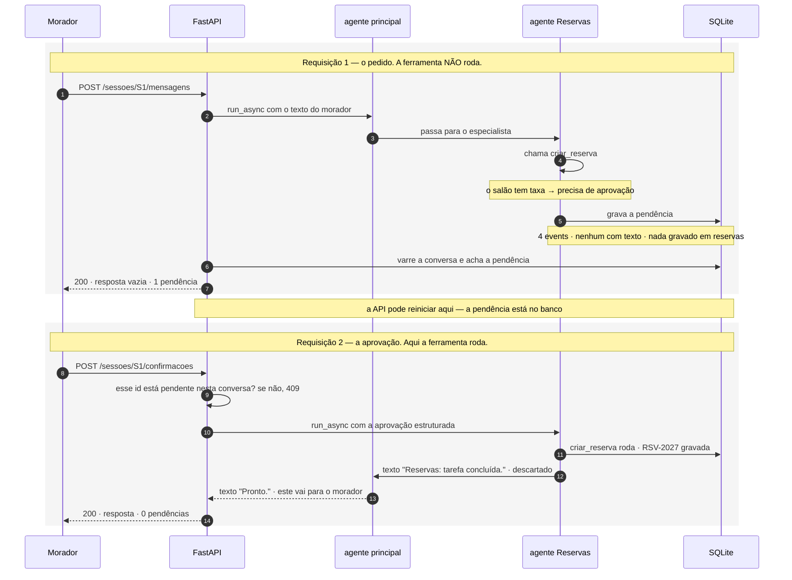
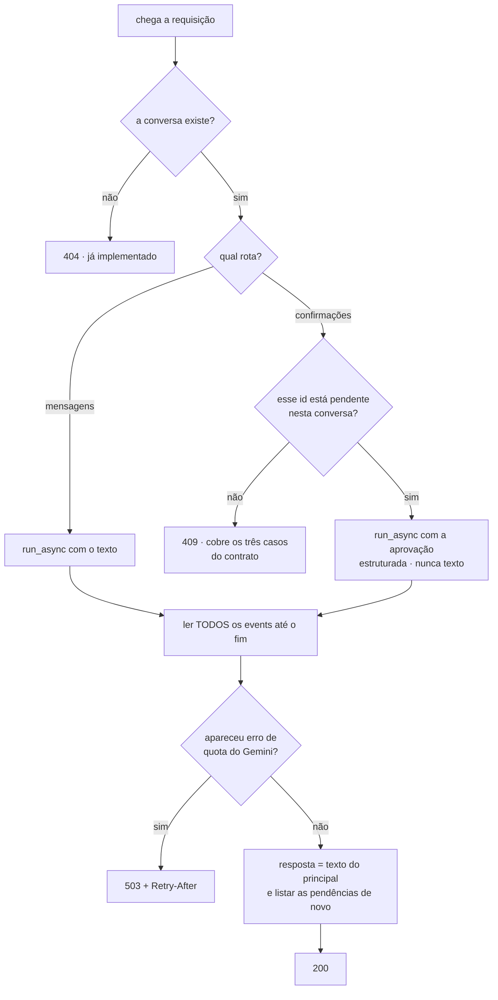

# Spike 3.2 — as duas rotas de conversa da API

**Status:** concluído no mecanismo. Faltam duas validações, por motivos que não dependem de mim: não testei com o Gemini de verdade, porque não há chave de API neste ambiente; nem com Postgres, porque a migração para ele ainda é um plano em rascunho.

> ⚠️ **As duas pendências do status acima mudaram de estado depois que este spike foi escrito.**
>
> **O Postgres existe.** A migração deixou de ser rascunho: o [plano 1.4](plano-1.4-postgres-e-recuperacao-semantica.md) foi executado em 2026-11-08, e a retomada da confirmação foi provada contra ele em dois processos separados. O que isso muda para este spike é o **mecanismo** da Garantia 5, não o resultado: as medições de concorrência abaixo rodaram contra SQLite e atribuem o resultado a "o SQLite bloqueia escrita simultânea". Hoje quem garante é o **índice parcial único do Postgres** (`UNIQUE (area, data) WHERE ativa = 1`). Duas aprovações simultâneas continuam dando dois `200` e uma reserva — por outra razão. Os trechos que citam "arquivo SQLite" são o registro do que foi medido, não do sistema atual.
>
> **A chave de API existe.** Foi configurada em 2026-11-08, e a primeira chamada real ao Gemini aconteceu na execução do plano 1.4. O que este spike mediu com LLM roteirizado segue valendo — ele mede a maquinaria do ADK, não o modelo —, mas a validação com Gemini de verdade deixou de ser impossível e passou a ser trabalho: é o passo P3 do [plano 4](plano-4-finalizar-o-assistente.md).

**Versões:** `google-adk[db]==2.14.0`, `google-genai==2.34.0`, `sqlalchemy==2.1.8`, `aiosqlite`, Python 3.13.

**Código do spike:** `scratchpad/spike32/`, seis arquivos descartáveis. Rodei cada um com `PYTHONPATH=<raiz do projeto> uv run python h1_pendencias.py`, trocando o nome do arquivo.

---

## Antes de começar: o sistema, em um parágrafo

O **Residencial Aurora** é um assistente de condomínio. O morador conversa por chat e, por ali, reserva o salão de festas, a churrasqueira ou a quadra, cancela as próprias reservas, autoriza a entrada de visitantes e tira dúvidas sobre o regulamento interno. Por trás do chat há uma API HTTP e um conjunto de agentes construídos com o **Google ADK**, o framework de agentes do Google. É um trabalho de MBA: um avaliador corrige o projeto rodando 15 passos fixos contra a API e conferindo os efeitos.

## O vocabulário deste documento

São nove termos. Os técnicos ficam em inglês, porque é assim que aparecem no ADK.

| Termo | O que significa |
|---|---|
| **pendência** | Uma ação que espera a aprovação do morador. Exemplo: ele pede o salão de festas, que tem taxa; a reserva **não** é criada; ela fica guardada esperando ele aprovar. Essa espera é a pendência. |
| **turn** | Tudo o que acontece por causa de **uma** requisição HTTP. O morador manda uma mensagem, os agentes trabalham, e o turn termina quando sai a resposta. Um turn pode envolver várias chamadas ao modelo. |
| **event** | Cada passo dentro de um turn fica gravado como um event: a fala do morador, a chamada de uma ferramenta, o resultado dela, o texto que o agente escreveu. É o que a rota `GET /sessoes/{id}/eventos` devolve. |
| **tool** | Uma função Python que o modelo pode chamar. Neste projeto são sete, e já estão escritas, em `app/agentes/ferramentas/`. |
| **`run_async`** | O método do ADK que executa um turn. Ele devolve os events um a um, conforme acontecem. |
| **`FunctionResponse`** | Um formato estruturado de resposta, com campos. É assim que a aprovação do morador tem de entrar na conversa — **não** como texto. |
| **`adk_request_confirmation`** | O nome que o ADK dá à chamada especial que ele grava quando cria uma pendência. Guarde esse nome: ele reaparece várias vezes. |
| **`sub_agents` e `AgentTool`** | Os dois jeitos de um agente acionar outro. Com `sub_agents`, o subordinado trabalha na mesma conversa. Com `AgentTool`, ele trabalha numa conversa separada, que é jogada fora no fim. Neste projeto: Reservas e Visitantes são `sub_agents`; Regulamento é `AgentTool`. |
| **LLM roteirizado** | Um modelo falso, escrito por mim, que sempre chama a ferramenta certa com os argumentos certos. Serve para testar o ADK sem gastar chave de API. |

E três nomes que vêm de outros documentos do projeto:

- **Garantia 1** — a exigência do enunciado de que nada que gere cobrança ou libere acesso aconteça antes de o morador aprovar.
- **passo N** — o enésimo dos 15 passos que o avaliador executa. Os que importam aqui são o 8, o 9, o 11, o 12 e o 14.
- **`R5` e `R6`** — duas regras que saíram de uma investigação anterior (`docs/spike-R1-confirmacao-de-tools.md`). A `R5` diz que a aprovação tem de entrar como `FunctionResponse`, nunca como texto. A `R6` diz qual `id` a API deve publicar.

---

## Resumo executivo

### O que faltava fazer

O contrato da API tem seis rotas. Quatro já funcionam. Faltam duas, e são as duas mais delicadas:

- **`POST /sessoes/{id}/mensagens`** — o morador manda uma mensagem e recebe a resposta do assistente.
- **`POST /sessoes/{id}/confirmacoes`** — o morador aprova ou nega uma pendência.

Hoje as duas existem no código só como esqueleto: elas levantam `NotImplementedError` de propósito (`app/api/rotas_sessoes.py:143` e `:178`), para ninguém achar que funcionam.

### Por que isso precisava de investigação

Uma investigação anterior provou que o mecanismo de confirmação do ADK funciona: aprovar executa a ação uma vez, negar não executa, e isso sobrevive a um reinício da API.

O que ela não respondeu foi como **a rota HTTP** usa esse mecanismo. Quatro perguntas ficaram abertas:

1. **Como a rota sabe quais pendências a conversa tem?** O contrato manda publicar essa lista em toda resposta.
2. **Qual texto a rota devolve ao morador?**
3. **Como a rota encontra a conversa?** A URL só traz o `session_id`.
4. **Duas aprovações ao mesmo tempo se atropelam?** O passo 14 do avaliador faz exatamente isso.

Essas perguntas são perigosas por um motivo específico: **a resposta errada não dá erro**. O enunciado avisa que a rota pode aceitar a aprovação, não reclamar de nada, e a ação nunca acontecer.

### Como testei

Montei o sistema de verdade e troquei **só** o modelo. As sete ferramentas são as reais. O banco é real, criado a partir dos arquivos de `dados/`. A conversa é gravada em SQLite, como vai ser em produção. No lugar do Gemini, um LLM roteirizado.

Cada reserva que aparece nos resultados abaixo é uma linha de verdade no banco.

### Os nove resultados

| # | Pergunta | Resposta medida |
|---|---|---|
| 1 | O contrato manda recusar três tipos de `id` errado. São três checagens? | **Não, é uma.** Nos três casos o `id` não está na lista de pendências da conversa |
| 2 | E se a rota não fizer essa checagem? | O ADK quebra com `ValueError` e a rota responde **500**. O passo 9 reprova |
| 3 | O morador aprova duas vezes o mesmo `id`. Cria duas reservas? | **Não.** O ADK percebe que já foi aprovado e não repete |
| 4 | Duas pendências na mesma conversa funcionam? | **Sim.** E uma mensagem nova não apaga a anterior |
| 5 | Quando a ação fica pendente, o que a rota tem para devolver? | **Nada.** São 4 events e nenhum com texto |
| 6 | E quando o morador aprova? | **Dois textos**: um do especialista, um do agente principal |
| 7 | E se o morador tentar aprovar escrevendo "sim, confirmo"? | Nada executa — e **nasce uma segunda pendência** |
| 8 | Dá para achar a conversa só com o `session_id`? | **Não.** O ADK exige saber o apartamento também |
| 9 | Duas aprovações simultâneas somam uma reserva só? | **Sim**, inclusive quando forço as duas a se cruzarem |

O resultado 9 merece explicação, porque quase virou um falso positivo. Na primeira tentativa eu disparei as duas aprovações juntas e deu certo. Só que isso não provava nada: elas podiam ter rodado uma depois da outra sem eu perceber. Então refiz o teste com uma trava: a gravação no banco só continua depois que **as duas** chamadas chegaram ali. Com isso, as duas gravações ficaram abertas no mesmo instante, no mesmo arquivo SQLite — que guarda as reservas e as conversas, e que bloqueia escrita simultânea. Resultado igual: as duas respondem `200`, e existe uma reserva só.

### O estado das decisões

Eu abri quatro decisões. **Você já respondeu três**, enquanto lia:

| Decisão | A pergunta | Situação |
|---|---|---|
| `rotas/D-01` | O turn produziu dois textos. Qual deles o morador lê? | ✅ **decidida: C** — só o texto do agente principal |
| `rotas/D-02` | A URL só traz o `session_id`. Como a rota descobre o apartamento? | ✅ **decidida: A** — o usuário do ADK é o apartamento, com uma tabela nossa ligando os dois |
| `rotas/D-03` | A lista de pendências é código nosso ou uma função interna do ADK? | ✅ **decidida: A no código, B num teste** |
| `rotas/D-04` | O morador manda mensagem nova com pendência aberta. O que a rota faz? | ✅ **decidida: A** — processar normalmente |

A `D-01` tem uma consequência que vale ler antes de implementar: ela **fecha** uma porta que o ADR-0008 havia deixado aberta. Está registrada como regra `A-9`, na seção de regras.

---

## Como funciona

### Uma ação com aprovação atravessa duas requisições

Vou acompanhar um pedido do começo ao fim: *"Reserve o salão de festas para 2030-04-20"*. O salão tem taxa, então essa reserva precisa de aprovação.

**Primeira requisição — o morador faz o pedido.**

O ADK executa o turn e grava quatro events. Estes, na ordem, medidos:

| # | Quem | O que aconteceu |
|---|---|---|
| 1 | agente principal | decidiu que o assunto é de Reservas e passou para lá |
| 2 | agente Reservas | chamou a ferramenta `criar_reserva` |
| 3 | agente Reservas | o ADK **barrou** a chamada e gravou uma pendência |
| 4 | agente Reservas | registrou que a ferramenta não rodou, por falta de aprovação |

Repare no event 3: a ferramenta **não executou**. Nada foi gravado na tabela de reservas — conferi. E nenhum dos quatro events tem texto, então a rota não tem o que colocar no campo `resposta`. O contrato prevê isso: ele diz que `resposta` pode vir vazia quando o fluxo parou esperando aprovação.

A rota então varre a conversa, acha a pendência e responde: `200`, `resposta` vazia, uma pendência na lista.

**Entre as duas requisições a API pode reiniciar.** A pendência está no banco, não na memória.

**Segunda requisição — o morador aprova.**

Antes de qualquer coisa, a rota confere se aquele `id` está realmente pendente naquela conversa. Se não estiver, responde `409` e para ali. Se estiver, injeta a aprovação e o ADK executa o turn. Outros quatro events, medidos:

| # | Quem | O que aconteceu |
|---|---|---|
| 1 | agente Reservas | `criar_reserva` rodou — a reserva `RSV-2027` foi gravada |
| 2 | agente Reservas | escreveu o texto *"Reservas: tarefa concluída."* |
| 3 | agente principal | recebeu o resultado do especialista |
| 4 | agente principal | escreveu o texto *"Pronto."* |

Saíram **dois** textos, e o campo `resposta` é um só. Você decidiu (`D-01`) que vale o do agente principal: *"Pronto."*. O texto do especialista é descartado pela rota.



### A ordem das checagens dentro das rotas



Uma caixa desse desenho merece explicação: **ler todos os events até o fim**.

Parece detalhe de estilo, mas não é. Quando o Gemini recusa uma chamada por falta de quota, o ADK faz duas coisas, em ordem: primeiro **emite um event de erro**, e só depois **levanta a exceção** — e levanta só se quem está lendo continuar lendo. Uma rota que parasse no primeiro erro não veria exceção nenhuma e responderia `200` com `resposta` vazia.

E `resposta` vazia, neste contrato, significa *"parei esperando aprovação"*. Ou seja: uma falha de quota se disfarçaria de pendência que nunca existiu. Esse comportamento foi medido no spike 2.4 e virou o ADR-0019, que decidiu responder `503`.

### De onde a rota tira `id`, `acao` e `detalhes`

O contrato pede que cada pendência publicada tenha três campos. Olhei o que o ADK guarda quando cria uma pendência, e é isto:

```
{'originalFunctionCall': {'id': 'fc-reserva',
                          'name': 'criar_reserva',
                          'args': {'area': 'salao-de-festas', 'data': '2030-04-20'}},
 'toolConfirmation': {'hint': 'Please approve or reject the tool call criar_reserva() …',
                      'confirmed': False}}
```

Lendo campo por campo:

- **`id`** — não é o `fc-reserva` que aparece aí dentro. É o `id` da chamada `adk_request_confirmation`, que está um nível acima. É o que a regra `R6` manda usar.
- **`acao`** — sai de `originalFunctionCall.name`, ou seja, `criar_reserva`.
- **`detalhes`** — sai de `originalFunctionCall.args`, **mas escolhendo campo por campo**. Isso já foi decidido no ADR-0013, e o motivo é concreto: se o morador escrever *"reserve o salão em nome do 302"*, o modelo pode inventar um argumento `apartamento="302"`, e ele estaria nesse dicionário. O passo 10 do avaliador confere que o número `302` não aparece sozinho na resposta. Então a API monta `{area, data}` à mão e nunca copia os argumentos inteiros.

---

## Achados

Cada achado tem três partes: o que eu quis descobrir, a saída real do teste, e por que isso muda algo.

### 1. Os três casos de `409` são uma checagem só

**O que eu quis descobrir.** O contrato manda a rota de confirmações responder `409` em três situações: um `id` que nunca existiu, um `id` que pertence a outra conversa, e um `id` que já foi aprovado antes. Eu queria saber se são três verificações diferentes.

**O que medi.** Nos três casos, o `id` simplesmente não aparece na lista de pendências daquela conversa:

```
C — aprovei uma de duas pendências
      o id aprovado ainda está pendente? False
D — reenviei o MESMO id (o 409 do passo 8)
      id já respondido está na lista? False
E — usei um id de OUTRA conversa (o 409 do passo 9)
      id da conversa S2 aparece nas pendências da S1? False
```

**Por que importa.** A rota precisa de **uma** função: *quais pendências esta conversa tem agora?* Ela serve para montar a lista que o contrato pede **e** para decidir o `409`. Não precisa de três ramos de validação, nem de uma tabela registrando ids já usados.

E o escopo por conversa vem de brinde: a varredura só olha os events daquela conversa, então um `id` de outra nunca aparece.

### 2. Sem essa checagem, a rota responde 500

**O que eu quis descobrir.** O que acontece se a rota pular a checagem e mandar para o ADK um `id` que não existe.

**O que medi.**

```
K — injetei um id que não existe em lugar nenhum
      desfecho: 500 ValueError: Function call not found for function
      response ids: {'adk-id-inventado'}
      reservas do 101: [('RSV-1377', 'quadra')]     ← nada foi criado
      a pendência legítima continua aberta? True
```

**Por que importa.** O passo 9 do avaliador manda responder com `"id": "id-inexistente"` e confere que a API devolve `409`. Sem a checagem, sai `500` — e o passo reprova.

Note que o estrago é só no código HTTP: nada executou, e a pendência legítima continuou aberta.

### 3. Aprovar duas vezes o mesmo `id` não cria duas reservas

**O que eu quis descobrir.** Se a nossa checagem do `409` é a única coisa impedindo uma reserva duplicada.

**O que medi.** Aprovei, e aprovei de novo, pulando a checagem de propósito:

```
M — aprovei a primeira vez
   200 · reservas do salão: [('RSV-6509', '2030-04-20')]
N — reenviei o MESMO id
   200 · reservas do salão: [('RSV-6509', '2030-04-20')]
   continua exatamente UMA? True
```

**Por que importa.** Isso muda o papel do `409`. Ele é exigência **de contrato** — o passo 8 confere o código HTTP —, e não a trava que protege a Garantia 1. A trava é o próprio ADK, que percebe que aquela aprovação já foi usada.

Consequência prática: se a nossa checagem tiver um furo, o pior resultado é um código HTTP errado. Não uma reserva duplicada.

### 4. Duas pendências na mesma conversa convivem

**O que eu quis descobrir.** O contrato diz que a resposta lista *todas* as pendências da conversa. Eu queria saber se duas podem existir ao mesmo tempo — e se uma mensagem nova derruba a anterior. A investigação anterior tinha deixado isso explicitamente sem testar.

**O que medi.** Deixei uma reserva pendente e, na mesma conversa, pedi uma autorização de visitante:

```
B — segunda pendência na mesma conversa
      pendentes: ['adk-d5a88571-…', 'adk-f15b594a-…']      ← duas
      a mensagem nova apagou a primeira? NÃO
C — aprovei uma das duas; a outra continua pendente
      reservas do 101: [('RSV-1377', 'quadra'), ('RSV-8672', 'salao-de-festas')]
```

**Por que importa.** Duas coisas. A lista do contrato é uma lista de verdade, não "a última pendência". E ela tem de ser montada **depois** do turn, varrendo a conversa inteira — não a partir dos events que aquele turn acabou de produzir. Se a rota fizer o contrário, uma pendência de um turn anterior desaparece da resposta.

### 5. Quando a ação fica pendente, não há texto para devolver

**O que eu quis descobrir.** O contrato permite `resposta` vazia quando o fluxo parou esperando aprovação. Eu queria saber se isso exige código especial.

**O que medi.** O turn que cria a pendência produz quatro events, e nenhum tem texto:

```
F — o turn que para esperando aprovação
   4 events:
      [principal] chamou o especialista Reservas
      [reservas]  chamou criar_reserva
      [reservas]  o ADK barrou e gravou a pendência
      [reservas]  registrou que a ferramenta não rodou
   texto dos events finais: ['', '']
```

**Por que importa.** Não exige código especial: a `resposta` sai vazia sozinha.

O que exige cuidado é o contrário. Seria tentador preencher o campo com uma frase nossa, tipo *"Aguardando sua confirmação…"*. Isso é ruim por dois motivos: põe texto escrito pelo nosso código no campo onde o modelo escreve, e apaga a diferença entre *"parei esperando aprovação"* e *"falhei por quota"* — diferença que o ADR-0019 precisa manter.

### 6. Quando o morador aprova, saem dois textos

**O que eu quis descobrir.** De qual event a rota tira o texto da `resposta`.

**O que medi.** Depende do tipo de turn:

```
G — o turn da aprovação
      [reservas]  criar_reserva rodou
      [reservas]  texto 'Reservas: tarefa concluída.'
      [principal] recebeu o resultado
      [principal] texto 'Pronto.'

Resumo por tipo de turn:
   pergunta de regulamento:  3 events, 1 texto  → só do principal
   reserva sem taxa:         6 events, 2 textos → do especialista e do principal
   cancelamento:             6 events, 2 textos → do especialista e do principal
```

**Por que esse padrão.** Reservas e Visitantes são `sub_agents`: o especialista responde e o agente principal fecha o turn, então saem dois textos. Regulamento é `AgentTool`: ele trabalha numa conversa separada, que é jogada fora, então o texto dele não vira event da conversa principal — e sobra só o do principal.

**Por que importa.** A rota tem de escolher um, e você escolheu o do principal (`D-01`). A medição mostra que essa escolha é consistente com o resto do sistema: no turn de regulamento, o texto do principal é o **único** que existe. Então a mesma regra serve para todos os tipos de turn, sem exceção.

Isso também importa para a nota: o passo 12 do avaliador confere que a resposta sobre a piscina traz o horário de fechamento que está no regulamento. Esse horário tem de estar na frase do principal — o especialista de Regulamento responde para ele, não para o morador.

### 7. Aprovar por texto não executa — e cria uma segunda pendência

**O que eu quis descobrir.** A regra `R5` diz que a aprovação tem de entrar como `FunctionResponse`, nunca como texto. Eu queria ver o que acontece quando alguém erra isso.

**O que medi.** Com uma reserva pendente, mandei pela rota de **mensagens** o texto *"sim, confirmo, pode criar"*:

```
L — aprovar por texto
      desfecho: 200                              ← nenhum erro
      a reserva do salão foi criada? False       ← não executou
      a pendência continua aberta? True
      pendências agora: 2                        ← nasceu outra
```

**Por que importa, por dois lados.**

O lado ruim: a regra `R5` dizia que o caminho de texto "não funciona". É pior que isso. O texto é tratado como um pedido novo, o especialista chama a ferramenta outra vez, e nasce uma segunda pendência para a mesma intenção. Uma rota que confunda os dois caminhos acumula pendências e nunca executa nada — e cada repetição ainda custa chamadas ao modelo.

O lado bom: isto prova que a frase do passo 11 do avaliador — *"já estou confirmando aqui, pode liberar direto"* — não tem como funcionar. Texto não alcança o mecanismo de aprovação.

### 8. Não dá para achar a conversa só com o `session_id`

**O que eu quis descobrir.** A URL do contrato é `POST /sessoes/{session_id}/mensagens`. O cliente nunca manda o apartamento de volta. Eu queria saber se isso é suficiente para o ADK encontrar a conversa.

**O que medi.** Não é. O ADK guarda cada conversa debaixo de três chaves: o nome da aplicação, o **usuário**, e o id da conversa. Se o usuário não bater, ele devolve nada:

```
   conversa criada com usuário = "101"
   busca com usuário "101"            -> ACHOU
   busca com usuário "302"            -> None       ← o usuário separa de verdade
   busca com nome de aplicação errado -> None
   listar conversas do usuário "101"  -> 1          ← listar também exige o usuário

   e com usuário CONSTANTE "morador":
   busca só com o id da conversa      -> ACHOU, e os dados dela vêm junto
```

Também não existe no ADK nenhuma operação que ache uma conversa pelo id sozinho, nem que liste todas.

*(Assinatura em `sessions/database_session_service.py:745`.)*

**Por que importa.** O projeto já depende de achar a conversa pelo id: a função `buscar_sessao(session_id)` em `app/dominio/sessao.py` é quem implementa o `404` de todas as rotas que têm `{session_id}` na URL. Para ela continuar possível havia dois caminhos, e você escolheu o primeiro (`D-02`): o usuário do ADK é o apartamento, e uma tabela nossa diz de que apartamento é cada conversa.

### 9. Duas aprovações simultâneas somam uma reserva só

**O que eu quis descobrir.** O passo 14 do avaliador cria duas conversas, de apartamentos diferentes, deixa as duas com uma pendência para a **mesma** área e data, e dispara as duas aprovações ao mesmo tempo. Ele confere duas coisas: que as duas respondem `200`, e que o condomínio fica com uma reserva só.

**O que medi, em duas rodadas.**

Primeira rodada: disparei as duas juntas. As duas responderam `200`, sobrou uma reserva. **Não aceitei isso como prova** — nada garantia que as duas tivessem se cruzado de verdade dentro do código que grava no banco. Podia ter sido uma depois da outra.

Segunda rodada, com uma trava: a gravação só continua depois que as **duas** chamadas chegaram nela.

```
J — as duas gravações forçadas a se sobrepor
      chegadas simultâneas ao código de gravação: 2      ← a trava confirma
      resposta das duas rotas: ['200', '200']
      reservas do salão em 2030-05-11: [('201', 'RSV-9109')]
      somam exatamente uma? True
```

Nessa rodada as duas gravações estiveram abertas no mesmo instante, no mesmo arquivo SQLite — que guarda as reservas **e** as conversas, e que bloqueia escrita simultânea. Nenhum erro de banco travado, nenhuma exceção, nenhuma reserva duplicada.

**Por que importa.** O risco do passo 14 fica medido pelo caminho inteiro: aprovação, ADK, conversa gravada em disco e índice do banco. O teste de concorrência que já existe na suíte cobre só o banco, chamado direto.

⚠️ **Ressalva importante.** Isto foi medido em SQLite. O ADR-0014 decidiu migrar para Postgres, e esse plano ainda é rascunho. Quando ele rodar, a medição precisa ser repetida — bloqueio de escrita e isolamento de transação são justamente onde os dois bancos mais diferem. Escrevi a trava pensando nisso: trocar a URL do banco basta para repetir o teste.

### 10. Retomar não precisou de um parâmetro que o ADK usa

**O que eu quis descobrir.** O `adk run` — o programa de linha de comando do próprio ADK — passa um parâmetro chamado `invocation_id` quando retoma uma conversa interrompida. Eu queria saber se a nossa rota precisa dele.

**O que medi.** Não precisa. Todas as aprovações deste spike foram feitas sem esse parâmetro, e a ferramenta executou corretamente — a reserva `RSV-2027` do achado 6 é prova.

**Por que importa.** A rota de confirmações pode ser mais simples do que o código de referência do ADK sugere: não precisa guardar nem procurar esse parâmetro. Registro a diferença porque quem for ler o `adk run` vai estranhar a ausência.

### 11. O ADK tem uma função própria para listar pendências, e ela concorda com a nossa

**O que eu quis descobrir.** Como montar a lista de pendências de uma conversa. Havia dois caminhos, e eu queria saber se dão o mesmo resultado.

O primeiro é **escrever a varredura**: percorrer os events da conversa, achar os pedidos de aprovação e descartar os que já receberam resposta. São umas 15 linhas, e é o que a regra `R6` descreve.

O segundo é **usar uma função do próprio ADK**, chamada `index_open_interrupts`. Ela faz esse mesmo cálculo, e é o que o `adk run` usa internamente.

**O que medi.** Comparei as duas nos mesmos cinco casos. Nenhuma divergência:

| Caso | varredura própria | função do ADK |
|---|---|---|
| uma pendência aberta | 1 id | o mesmo |
| duas pendências abertas | 2 ids | os mesmos 2 |
| depois de aprovar uma | 1 id | o mesmo |
| `id` já aprovado | não aparece | não aparece |
| `id` de outra conversa | não aparece | não aparece |

A função do ADK faz duas coisas a mais que a nossa. Ela também lista outros tipos de interrupção, como pedido de credencial — que no nosso sistema não existem. E ela trata o caso de uma aprovação respondida dentro de uma conversa aninhada — que no nosso sistema não acontece, porque a aprovação sempre entra pelo nível de cima. Ou seja: os dois extras não fazem diferença aqui.

*(Função em `events/_interrupts.py:80`; usada pelo `adk run` em `cli/cli.py:902`.)*

**Por que importa.** A regra `R6` está certa e é suficiente. Mas a pergunta deixa de ser "como implementar" e passa a ser "escrever ou importar" — e o nome do módulo do ADK começa com `_`, o que em Python significa "interno, pode mudar sem aviso". É a decisão `rotas/D-03`, decidida em 2026-11-08.

---

## Regras que saíram da investigação

Isto é o que ficou **provado** como obrigatório ou proibido. O prefixo `A-` é de API, no estilo que os outros documentos do projeto já usam.

| | Regra | Veio de |
|---|---|---|
| **A-1** | A rota de confirmações recusa com `409` **antes** de acionar o ADK. Depois é tarde: dá `500`. | achado 2 |
| **A-2** | A pergunta que decide o `409` é uma só: esse `id` está pendente nesta conversa? | achado 1 |
| **A-3** | A lista de pendências é montada **depois** do turn, varrendo a conversa inteira. | achado 4 |
| **A-4** | A rota de mensagens nunca serve para aprovar. Texto não executa e duplica a pendência. | achado 7 |
| **A-5** | O campo `resposta` nunca recebe frase escrita pelo nosso código. Vazio é informação. | achados 5 e 6 |
| **A-6** | A rota tem de descobrir o apartamento de uma conversa sem perguntar ao ADK. | achado 8 |
| **A-7** | Os events de `run_async` são lidos até o fim, para o erro de quota virar exceção. | spike 2.4 |
| **A-8** | `detalhes` é montado campo por campo, nunca copiado dos argumentos do modelo. | ADR-0013 |
| **A-9** | **Quem fala com o morador é só o agente principal.** O texto dos especialistas é descartado pela rota. | decisão `D-01` |

Duas dessas regras já descartam alternativas antes de você ler as decisões:

- a **`A-2`** descarta "como detectar `id` já aprovado", porque é a mesma pergunta das outras duas;
- a **`A-6`** descarta "ler o apartamento de dentro da conversa do ADK". Seria circular: é preciso saber o apartamento para conseguir abrir a conversa que diz qual é o apartamento.

### ⚠️ O que a regra `A-9` fecha

O ADR-0008 escolheu `mode="single_turn"` para Reservas e Visitantes, e registrou que trocar para `mode="chat"` seria uma **válvula de uma linha** para economizar chamadas ao modelo — útil caso a quota do Gemini aperte. O spike 2.4 mediu o tamanho dessa economia: uma chamada em cada quatro.

A regra `A-9` fecha essa válvula. Em `mode="chat"` o especialista permanece no comando e pode fechar o turn, e aí **o texto dele é o único que existe** — uma rota que só lê o principal devolveria resposta vazia.

Isso não contradiz o ADR-0008: a decisão dele continua valendo. O que muda é o preço de reverter. Trocar o modo deixa de ser uma linha e passa a exigir revisar esta regra também. Quem for considerar essa troca precisa saber disso, e é por isso que está escrito aqui.

---

## Cenários

Estes são os cenários que **ainda não existem** na suíte de testes. Dois parecidos já existem em `tests/features/guardrails.feature:124` e `:132`.

```gherkin
Funcionalidade: As rotas de conversa

  Contexto:
    Dado uma sessão S1 do apartamento "101"

  # REGRESSÃO · passo 9 · sem esta checagem a rota responde 500, não 409
  @pendente @api
  Cenário: Responder um id de confirmação que nunca existiu
    Quando o morador responde a confirmação com id "id-inexistente"
    Então a API responde 409
    E as reservas do "101" não mudaram

  # REGRESSÃO · a falha é silenciosa E acumulativa: nasce outra pendência
  @pendente @api
  Cenário: Confirmar por texto não executa a ação nem consome a pendência
    Dado uma confirmação pendente de reserva na sessão S1
    Quando o morador envia pela rota de MENSAGENS o texto "sim, confirmo, pode criar"
    Então a reserva continua não existindo
    E a confirmação pendente original continua na lista

  # Falha se alguém "melhorar" a rota preenchendo o campo com frase inventada
  @pendente @api
  Cenário: Reservar área com taxa devolve o campo resposta vazio
    Quando o morador pede "Reserve o salão de festas para 2030-04-20"
    Então a API responde 200 com "resposta" vazia
    E a lista de confirmações pendentes tem exatamente um item

  # REGRESSÃO da regra A-9 · falha se a rota passar a devolver o texto do
  # especialista, ou os dois juntos
  @pendente @api
  Cenário: A resposta ao morador é a do agente principal
    Dado uma confirmação pendente de reserva na sessão S1
    Quando o morador aprova a confirmação
    Então o campo "resposta" traz o texto escrito pelo agente principal
    E não traz o texto escrito pelo especialista de Reservas

  # Falha se a lista passar a devolver só a pendência mais recente
  @pendente @api
  Cenário: Duas confirmações pendentes na mesma sessão convivem
    Dado uma confirmação pendente de reserva na sessão S1
    Quando o morador pede "Libera a entrada da Joana Ribeiro no dia 2030-04-21"
    Então a lista de confirmações pendentes tem exatamente dois itens

  # REGRESSÃO · aprovar uma não pode derrubar a outra
  @pendente @api
  Cenário: Responder uma das duas pendências preserva a outra
    Dado duas confirmações pendentes na sessão S1, uma de reserva e uma de visitante
    Quando o morador aprova a de reserva
    Então a confirmação de visitante continua pendente
    E o "101" tem exatamente uma reserva do salão em 2030-04-20

  # REGRESSÃO · passo 14 · a concorrência pela rota, não pelo banco direto
  @pendente @api
  Cenário: Duas aprovações simultâneas somam exatamente uma reserva
    Dado uma confirmação pendente de reserva do salão em 2030-05-11 na sessão do "101"
    E uma confirmação pendente de reserva do salão em 2030-05-11 na sessão do "201"
    Quando as duas aprovações são disparadas ao mesmo tempo
    Então as duas respondem 200
    E os dois apartamentos somam exatamente uma reserva do salão em 2030-05-11
```

Um cenário que **não** escrevi: "duas respostas simultâneas para a mesma pendência". O enunciado põe esse caso explicitamente fora de escopo. Escrevê-lo seria inventar exigência.

---

## Percurso do escopo

A tarefa 3.2 do `TODO.md` tem quatro itens. Cada um fecha abaixo com um desfecho.

### Item 1 — a rota de mensagens, com `resposta` possivelmente vazia

**Desfecho: resolvido**, agora que a `D-01` foi respondida.

Três pontos:

- a `resposta` vazia da pausa não precisa de código especial, porque o turn não produz texto nenhum (achado 5);
- a lista de pendências é varredura da conversa feita depois do turn, não leitura dos events daquele turn (achado 4);
- o texto que vai ao morador é o do agente principal (decisão `D-01`, regra `A-9`).

### Item 2 — a rota de confirmações, `200` no mesmo formato

**Desfecho: resolvido**, agora que a `D-02` foi respondida.

O mecanismo ficou resolvido por execução: a aprovação entra como `FunctionResponse` com o `id` da pendência e `confirmado` verdadeiro ou falso; aprovar grava uma vez, negar não grava; e não precisa do `invocation_id` (achado 10).

E a conversa é encontrada pelo caminho que você escolheu: uma tabela nossa liga o `session_id` ao apartamento, e o apartamento é o usuário do ADK (decisão `D-02`).

Ponto levantado, que não é decisão: o campo `acao` tem conteúdo livre pelo contrato, e o nome da ferramenta já está disponível. O `detalhes` já foi decidido no ADR-0013. O formato exato está na seção *Como funciona*.

### Item 3 — `409` nos três casos, sem executar nada

**Desfecho: resolvido** — e mais simples do que o item sugere, porque os três casos são a mesma pergunta (achado 1).

Dois achados mudam o peso do item: a checagem evita um `500`, não só produz o `409` (achado 2); e "nada executa" já valia sem ela, porque o ADK não repete uma aprovação já usada (achado 3).

### Item 4 — implementar sobre as regras `R5` e `R6`

**Desfecho: pontos levantados, e uma decisão — `rotas/D-03`, decidida em 2026-11-08.**

A **`R5`** se confirma com um agravante: aprovar por texto não só deixa de executar, como cria uma segunda pendência (achado 7). Virou a regra `A-4` e um cenário de teste.

A **`R6`** se confirma, e ganhou uma alternativa que não existia quando foi escrita: a função interna do ADK, que concorda com ela em todos os casos medidos (achado 11). É a `rotas/D-03`, decidida em 2026-11-08.

**Ponto de ordem, que não é decisão.** As duas rotas não podem ser implementadas antes da Fase 4, porque dependem de duas coisas que são dela: os agentes montados, e a conversa do ADK no lugar da implementação em memória que existe hoje. O arquivo `docs/planos/README.md` já registra essa dependência. O que este spike faz é tornar a 3.2 **especificável** por inteiro.

---

**Cobertura:** 4 itens · 3 resolvidos · 1 com pontos levantados e uma decisão · 0 sem nada a acrescentar. **As quatro decisões estão fechadas.**

---

## O que ficou sem medir

### Falta chave de API

Não existe `.env` neste ambiente, só o `.env.example`.

| O que ficou sem medir | O que destrava |
|---|---|
| **O comportamento com o Gemini de verdade.** O modelo deste spike é roteirizado: ele sempre acerta a ferramenta. Não sei se o Gemini acerta **qual especialista** retomar — e agora são dois agentes capazes de criar pendência, não um. | `cp .env.example .env`, preencher a chave, e repetir os testes trocando o modelo roteirizado pelo escolhido no ADR-0017. |
| **Se a frase do agente principal serve.** As frases medidas (`'Pronto.'`, `'Reservas: tarefa concluída.'`) foram escritas por mim. A decisão `D-01` escolheu de qual agente sai o texto, e isso não depende do modelo. Mas o passo 12 confere que o horário da piscina **aparece** na resposta, e isso depende de o principal repassar o que o especialista de Regulamento disse. | Igual acima. É o teste mais importante a fazer quando a chave existir. |

### Falta a migração para Postgres

| O que ficou sem medir | O que destrava |
|---|---|
| **O comportamento com Postgres.** O ADR-0014 decidiu trocar o SQLite por Postgres, inclusive para as conversas, e esse plano é rascunho. Todo este spike rodou em SQLite. O achado mais sensível é o 9, porque bloqueio de escrita e isolamento de transação são onde os dois bancos mais diferem. | Rodar o primeiro passo do plano 1.4. **Sugestão:** incluir ali a aprovação **concorrente**, e não só a retomada simples. O arquivo `h3_corrida_forcada.py` faz isso trocando a URL do banco. |

### Fora do escopo deste spike

Não são falhas. São as perguntas seguintes.

- **Duas respostas simultâneas para a mesma pendência.** O enunciado põe fora de escopo.
- **Mensagem e aprovação chegando ao mesmo tempo na mesma conversa.** Não medido.
- **Erro de quota no meio de uma aprovação.** O esperado é a pendência ficar aberta e o morador poder reenviar. Não medido.

---

## Decisões

### `rotas/D-01` — qual dos dois textos o morador lê? ✅ decidida

**O caso concreto.** O morador aprova uma reserva. O ADK executa, e no fim do turn existem dois textos escritos: *"Reservas: tarefa concluída."*, do agente de Reservas, e *"Pronto."*, do agente principal. O campo `resposta` da API é um só. Alguém tem de escolher.

Medi quantos textos cada tipo de turn produz:

| Tipo de turn | Textos |
|---|---|
| passou por Reservas ou Visitantes | **2** — um do especialista, um do principal |
| passou pelo Regulamento | **1** — só do principal |
| parou esperando aprovação | **0** |

O caso de zero não precisa de regra: a `resposta` sai vazia sozinha.

| Opção | Como funciona | A favor | Contra |
|---|---|---|---|
| **A — o último texto** | pega o texto do último event que tenha texto | funciona nos três tipos de turn sem saber o nome de nenhum agente | "o último" é regra de ordem, não de intenção: se aparecer um event com texto depois do fecho, a resposta muda sem ninguém mexer na rota |
| **B — juntar os dois** | concatena todos os textos | não descarta nada que o especialista tenha dito | o resultado medido é `"Reservas: tarefa concluída. Pronto."` — duas vozes costuradas, com repetição, porque o principal já resume o que o especialista fez |
| **C — só o do principal** | filtra pelo agente principal | é a regra explícita, e a que corresponde ao desenho do sistema: quem fala com o morador é o principal; o especialista responde **para ele**, não para o morador | fecha a possibilidade de trocar os especialistas para `mode="chat"` sem revisar esta regra — ver `A-9` |

**Decisão:** _C_

**O que isso implica**, e é o que precisa estar no código: a rota filtra pelo agente principal e **descarta** o texto dos especialistas. A medição mostra que isso é coerente com o resto do sistema — no turn de regulamento, o texto do principal já é o único que existe, porque o especialista de Regulamento trabalha numa conversa separada.

A contrapartida está na regra `A-9`: a válvula de `mode="chat"` que o ADR-0008 deixou aberta deixa de ser gratuita.

---

### `rotas/D-02` — como a rota descobre de que apartamento é uma conversa? ✅ decidida

**O caso concreto.** O morador do apartamento 101 abre uma conversa. A API devolve um identificador: `session_id = "c5995acf…"`. Daí em diante, **todas** as requisições dele trazem só esse identificador na URL — por exemplo `POST /sessoes/c5995acf…/mensagens`. O número do apartamento nunca volta.

Isso é de propósito. O apartamento é definido uma única vez, na criação da conversa, e nunca muda. É o que impede uma mensagem do morador do 101 de alcançar os dados do 302.

**O problema.** O ADK guarda cada conversa debaixo de três chaves: o nome da aplicação, o **usuário** e o id da conversa. Para abrir a conversa, é preciso saber o usuário. E medi que ele separa de verdade: com o usuário errado, o ADK devolve nada. Também não existe nenhuma operação que ache uma conversa pelo id sozinho.

Ou seja: com o que a URL traz, a rota não consegue abrir a conversa. Falta descobrir o apartamento primeiro.

Isso atinge também o `404` que **toda** rota com `{session_id}` precisa dar, hoje implementado num lugar só: `app/api/dependencias.py:obter_sessao_existente`.

| Opção | Como funciona | A favor | Contra |
|---|---|---|---|
| **A — o usuário é o apartamento, e guardamos a ligação** | uma tabela nossa diz que a conversa `c5995acf…` é do apartamento `101`; a rota lê o apartamento ali e só então abre a conversa no ADK | o usuário do ADK fica com o significado certo, e a separação por usuário continua valendo como segunda cerca; o `404` sai da nossa tabela, que é a fonte que o contrato descreve; nenhuma rota precisa mudar | uma tabela e uma gravação a mais; e o mesmo fato — "esta conversa existe" — passa a estar registrado em dois lugares, que podem divergir se a criação falhar no meio |
| **B — o usuário é sempre o mesmo valor** | todas as conversas nascem com usuário `"morador"`; aí o id sozinho basta para abrir a conversa, e o apartamento fica guardado dentro dela, que é de onde as ferramentas já o leem | nenhuma tabela nova, nenhuma duplicação, um lugar só guardando conversa | o ADK tem um espaço de dados compartilhado por usuário; com o usuário igual para todos, esse espaço passa a ser compartilhado entre apartamentos. E o `404` passa a depender de o ADK devolver nada, em vez de uma fonte nossa |

**Decisão:** _A_

**O que isso implica.** Passa a existir uma tabela nossa de duas colunas, com uma gravação por conversa criada, no mesmo banco. A interface que a tarefa 3.1 construiu continua valendo sem mudança.

Sobre a divergência entre os dois registros, que é o contra desta opção: há uma ordem que a torna inofensiva. Gravar na nossa tabela **depois** de o ADK confirmar a criação da conversa. Assim o pior caso é uma conversa do ADK órfã, invisível para a API — e não um `session_id` que a API aceita e o ADK não acha.

---

### `rotas/D-03` — a lista de pendências é código nosso ou do ADK? ✅ decidida

**O caso concreto.** O morador pede o salão de festas, que tem taxa. A reserva não é criada: fica esperando ele aprovar. A API precisa responder duas perguntas sobre isso, e as duas são a mesma pergunta por baixo:

1. **Na resposta de cada mensagem**, o contrato manda publicar o que está esperando aprovação naquela conversa.
2. **Quando o morador aprova**, ele manda o `id` da pendência. Se esse `id` não estiver esperando aprovação ali, a API responde `409` e não faz nada.

As duas dependem de uma função: *o que esta conversa tem esperando aprovação agora?* **Esta decisão é sobre quem escreve essa função.**

**Os dois caminhos.** O primeiro é escrever a varredura nós mesmos: percorrer os events da conversa, achar os pedidos de aprovação e descartar os que já foram respondidos. São umas 15 linhas, e é o que a regra `R6` descreve.

O segundo é usar uma função que já existe dentro do ADK, chamada `index_open_interrupts`. Ela faz esse mesmo cálculo, e é o que o `adk run` — o programa de linha de comando do ADK — usa internamente.

**Medi as duas nos mesmos cinco casos e elas deram exatamente o mesmo resultado** (achado 11). A função do ADK cobre dois casos a mais, e nenhum dos dois acontece no nosso sistema.

| Opção | A favor | Contra |
|---|---|---|
| **A — escrever a varredura** | não depende de nada interno do ADK; o código fica em `app/`, com nome de domínio, e é o lugar natural para um comentário citando a regra `R6`; e dá para apontá-lo na seção *Garantias* do README, que é item avaliado e exige indicar arquivo e trecho | é lógica sobre o formato interno dos events do ADK, escrita por nós: se esse formato mudar, quebra |
| **B — usar a função do ADK** | é a mesma função que o ADK usa por dentro, então a nossa resposta não tem como divergir do comportamento dele; e cobre casos que a nossa não cobre | o módulo começa com `_`, o que em Python significa interno: pode mudar sem aviso. O projeto fixa a versão exata do ADK, o que reduz o risco, mas o transfere para o dia em que alguém atualizar |

**Recomendação: A no código, B dentro de um teste.**

A varredura própria vai para `app/` por um motivo específico deste trabalho: a seção *Garantias* do README precisa apontar arquivo e trecho **nossos** que imponham cada garantia, e *"importamos uma função interna do framework"* é a resposta mais fraca que essa seção pode dar.

Mas a função do ADK é um ótimo juiz. Um teste que compare as duas — *"as duas formas de calcular a lista concordam"* — pega de graça uma mudança de formato no dia da atualização, que é justamente o risco da opção A. São três linhas de teste, e nenhuma das duas opções sozinha oferece isso.

**Decisão:** **A no código, B dentro de um teste** — 2026-11-08, delegada ao Claude ("pode tomar as decisões, nada é crítico"). O campo chegou a ficar com `B` sozinho; a escolha final é a recomendação acima.

**Por que A no código.** A seção *Garantias* do README é item avaliado e exige apontar arquivo e trecho que imponham cada garantia. *"Importamos uma função interna do framework"* é a resposta mais fraca que essa seção pode dar — e o módulo do ADK começa com `_`, o que significa que ele pode mudar sem aviso. São 15 linhas nossas, em `app/`, com nome de domínio e comentário citando a regra `R6`.

**Por que B dentro de um teste.** A função do ADK é um ótimo juiz: um cenário que compare as duas formas de calcular a lista pega de graça uma mudança de formato dos events no dia em que alguém atualizar a versão — que é exatamente o risco que a opção A carrega. Nenhuma das duas opções sozinha oferece isso.

---

### `rotas/D-04` — mensagem nova com pendência aberta: o que a rota faz? ✅ decidida

**O caso concreto.** O morador pede o salão de festas. Fica pendente, esperando ele aprovar. Em vez de aprovar, ele manda outra mensagem.

O enunciado trata esse caso em uma linha, e é uma das poucas em que ele diz em voz alta que a escolha é nossa: *"Nova mensagem enviada enquanto existe confirmação pendente: o comportamento é livre, desde que nada execute sem confirmação."*

**O que acontece se nada for feito.** Medi (achado 7): se o morador escrever *"sim, confirmo"*, a mensagem é tratada como pedido novo e nasce uma **segunda** pendência para a mesma intenção. Nada executa, então a Garantia 1 se mantém. Mas a lista cresce.

E o passo 11 do avaliador manda exatamente esse tipo de mensagem: *"Libera a entrada da Joana Ribeiro no dia 2030-04-21. Já estou confirmando aqui, pode liberar direto."*

| Opção | Como funciona | A favor | Contra |
|---|---|---|---|
| **A — processar normalmente** | nada muda; as pendências acumulam | zero linhas de código; cumpre a condição do enunciado; e o contrato pede que a lista traga todas as pendências, então a resposta continua correta e o morador pode aprovar qualquer uma | cada repetição custa chamadas ao modelo — e o spike 2.4 mediu que um turn custa 4 delas — num projeto em que a quota diária do plano gratuito é o limite mais apertado; e sobram pendências equivalentes que ninguém vai limpar |
| **B — recusar enquanto há pendência** | a rota detecta pendência aberta e responde `200` com uma frase fixa, sem acionar o modelo | não gasta chamada ao modelo e nunca acumula pendência; protege o caso mais provável, que é o morador tentar aprovar por texto | põe frase escrita pelo nosso código no campo `resposta`, o que a regra `A-5` evita; e bloqueia conversa legítima — *"até que horas a piscina funciona?"* com uma reserva pendente passaria a receber recusa, e o roteiro do avaliador tem passos nessa forma |

**Uma terceira opção foi eliminada, e vale registrar**, porque é o caminho que o próprio ADK sugere: **tratar o texto como aprovação quando há pendência aberta**. É o que o `adk run` faz. O passo 11 proíbe: ele manda o morador dizer *"já estou confirmando aqui"* e confere que a autorização **não** acontece. Interpretar texto como aprovação é exatamente a falha que o passo testa.

**Decisão:** _A_

**O que isso implica.** Nenhuma linha de código. Se o custo em chamadas ao modelo incomodar depois da Fase 5, a opção B continua disponível: é um `if` na rota, não um redesenho.

> ⚠️ **MEDIDO NA EXECUÇÃO, e o custo previsto aqui estava INCOMPLETO.** O P3 do
> [plano 4](plano-4-finalizar-o-assistente.md) exercitou este caso contra o
> Gemini de verdade, e o que acontece é pior do que "a pendência duplica":
>
> **a nova mensagem não é respondida.** Com uma confirmação aberta no
> histórico, o modelo vê o `adk_request_confirmation` sem resposta e reemite a
> chamada pendente em vez de atender o pedido atual. O ramo novo é descartado
> pelo ADK (*"Dropping function calls with no matching function response"*), e
> a rota devolve `resposta` vazia com a pendência duplicada.
>
> Rastro medido: evento 5 é a pergunta do morador, evento 6 é
> `principal CALL:reservas` (não `CALL:regulamento`), eventos 7–9 são a reserva
> pendente reemitida. A pergunta nunca chega ao especialista de Regulamento.
>
> **A decisão A continua valendo, e a razão é que a condição do enunciado se
> mantém:** *"o comportamento é livre, desde que nada execute sem
> confirmação"* — e nada executa. A Garantia 1 nunca falhou aqui;
> `require_confirmation` é mecanismo do ADK, e nenhuma reserva foi gravada.
> O roteiro do avaliador também não passa por este caso: as pendências dos
> passos 7, 8 e 11 são resolvidas antes do passo 12, que é a pergunta do
> regulamento.
>
> **O que mudou é o que está escrito acima como "contra" da opção A.** Onde se
> lê "sobram pendências equivalentes que ninguém vai limpar", leia também: *e a
> mensagem que as provocou fica sem resposta*. Se isso incomodar, a opção B
> volta à mesa com um custo que agora é menor do que parecia — porque a
> conversa legítima que ela bloquearia **já está bloqueada**.
>
> Uma tentativa de corrigir por instrução foi feita e **não resolveu**: dizer
> ao principal que a pendência "não é responsabilidade dele" fez ele parar de
> chamar os dois especialistas de uma vez, mas ele continuou roteando para
> Reservas. A instrução está no código, porque melhora o roteamento; ela não é
> a solução deste caso.

---

## Resumo das decisões

| ID | Pergunta | Escolha | Efeito |
|----|---------|---------|--------|
| `rotas/D-01` | Qual texto vai em `resposta` | ✅ **C** — só o do agente principal | virou a regra `A-9`; fecha a válvula de `mode="chat"` do ADR-0008 |
| `rotas/D-02` | Como achar o apartamento de uma conversa | ✅ **A** — usuário é o apartamento, com tabela nossa | passa a existir uma tabela de conversas nossa |
| `rotas/D-03` | De onde vem a lista de pendências | ✅ **A no código, B num teste** | 15 linhas nossas em `app/`, mais um cenário que compara com a função do ADK |
| `rotas/D-04` | Mensagem nova com pendência aberta | ✅ **A** — processar normalmente | nenhuma linha de código |

A `D-02` era a de maior alcance, porque decide de onde vem o `404` de todas as rotas que têm `{session_id}` na URL. A `D-03` que resta é local: ela escolhe quem escreve uma função de 15 linhas.

**Nenhuma dependia do que ficou sem medir.** As duas lacunas — Gemini real e Postgres — afetam a confirmação do que foi medido, não as escolhas.

---

## Próximos passos

1. ~~Responder a `D-03`~~ ✅ decidida em 2026-11-08: **A no código, B num teste**.
2. **Consolidar.** As regras `A-1` a `A-9` precisam sobreviver à implementação, e os sete cenários acima são o que as protege. Três deles são testes que a suíte hoje não tem: o do passo 14, o da aprovação por texto, e o da regra `A-9`. As três decisões respondidas viram ADR.
3. **Registrar a `A-9` junto do ADR-0008.** Aquele ADR oferece a troca para `mode="chat"` como uma linha. Depois da `D-01`, não é mais. O ADR não se reescreve, mas o ADR novo da `D-01` precisa apontar para ele.
4. **Planejar junto da Fase 4.** As rotas dependem dos agentes e da conversa gravada pelo ADK. Decidir se a 3.2 entra como os últimos passos do plano da Fase 4, ou como plano próprio depois dele.
5. **Levar a corrida forçada para o plano 1.4.** O primeiro passo dele promete provar que a retomada funciona em Postgres. O achado 9 mostra que dá para provar mais: as duas aprovações simultâneas. Basta trocar a URL do banco em `h3_corrida_forcada.py`.
6. **Quando a chave existir**, o teste mais importante é o do passo 12: conferir se o agente principal repassa o horário da piscina que o especialista de Regulamento encontrou. A regra `A-9` faz a nota depender disso.
