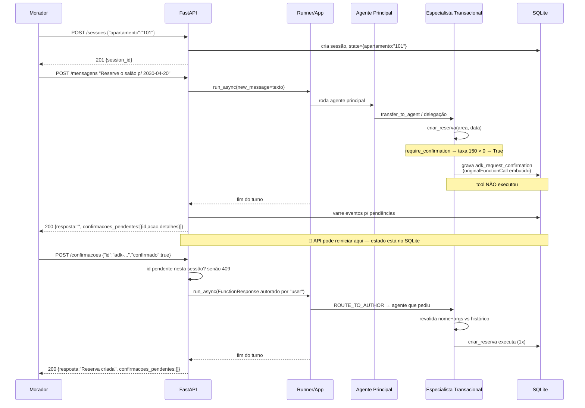
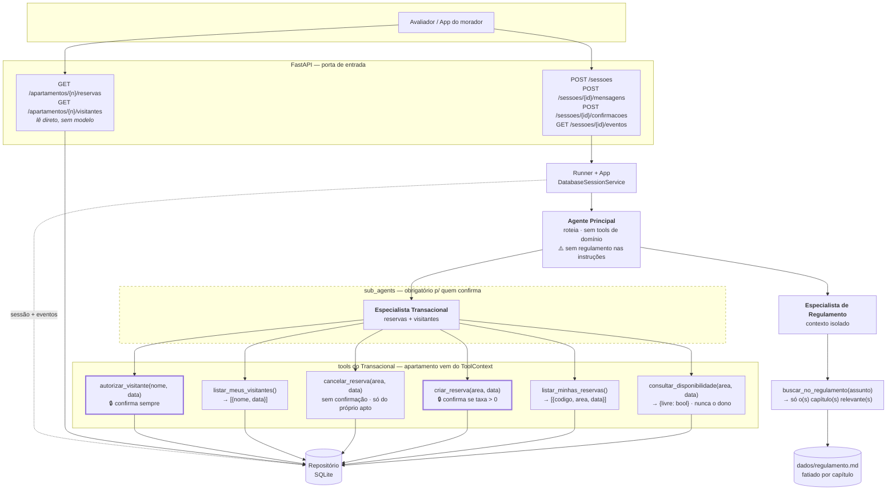

# Spike: a confirmação de tool do ADK retoma numa API própria, com sessão persistida e depois de reiniciar o processo?

**Status:** concluído na parte de mecanismo e de retomada · parcial na parte com Gemini real (sem chave de API no ambiente)
**Versões investigadas:** `google-adk[db]==2.14.0`, `sqlalchemy==2.1.8`, `aiosqlite`, Python 3.13.12
**Harness:** `scratchpad/spike_confirmacao.py` (descartável), rodado em **dois processos separados** para que o reinício seja real, não simulado.

---

## Resumo executivo

A retomada **funciona** com sessão persistida em SQLite e sobrevive ao reinício do processo. Aprovar executa uma vez, negar não executa, e reenviar a mesma resposta **não executa de novo** — o ADK já deduplica internamente.

O risco que o enunciado chama de "armadilha mais cara" é real, mas tem **uma causa única e identificável**: uma tool que exige confirmação **não pode viver dentro de um agente embrulhado em `AgentTool`**. Nesse arranjo o ADK descarta a sessão aninhada, a pendência nunca chega à sessão principal, a API nunca vê `confirmacoes_pendentes` e a ação nunca executa — **sem lançar erro nenhum**. É exatamente o sintoma descrito no enunciado.

A consequência de arquitetura é direta: **todo especialista que possua tools de confirmação precisa ser `sub_agents`**. Dentro de `sub_agents`, tanto `mode="chat"` quanto `mode="single_turn"` retomam corretamente — a escolha entre eles é livre e fica para você decidir (§ Decisões em aberto).

---

## A pergunta

O enunciado avisa que a retomada da confirmação "mudou conforme a topologia dos agentes, os bloqueios de transferência, a configuração de retomada do App e o serviço de sessão", e que uma combinação que funcionava em memória falhou com sessão persistida.

Como topologia é **entrada** do resultado, fixar uma topologia e declarar "funciona" seria um falso verde. Então o spike varreu topologia como variável e buscou uma **restrição**, não um sim/não:

> Quais arranjos de agentes preservam a retomada da confirmação quando a sessão está persistida e o processo reinicia?

> **Nota sobre o lugar deste spike no plano.** Ele foi executado **antes** da definição de arquitetura, o que em retrospecto foi fora de ordem. A arquitetura do assistente decorre do domínio e das cinco garantias do enunciado, não do mecanismo interno do ADK — e este spike produz restrição de **ligação** (como amarrar um especialista que confirma), não de **desenho** (qual especialista existe).
>
> A evidência está logo abaixo, na seção de decisões: **D-03 — quantos especialistas — saiu daqui não resolvida**, porque este spike não tinha como resolvê-la. Ela é da fase de arquitetura.
>
> Os achados continuam válidos e entram como **restrição de entrada** dessa fase. Ver a nota de reordenação no `TODO.md`.

---

## Como funciona

O ciclo tem quatro momentos. A tool nunca executa antes do terceiro.

1. **Pausa.** Quando o modelo chama uma tool cujo `require_confirmation` dá `True`, o ADK não executa. Ele registra o pedido em `tool_context.actions.requested_tool_confirmations`, responde a chamada original com `{'error': 'This tool call requires confirmation...'}` e emite uma função especial `adk_request_confirmation`, cujos `args` carregam o `originalFunctionCall` inteiro (id, nome e argumentos).

2. **Exposição.** A API varre os eventos da sessão procurando `function_call` com nome `adk_request_confirmation` que ainda não tenham `function_response` correspondente. O `id` dessa chamada é o `id` que vai para `confirmacoes_pendentes`. Ele é gerado pelo ADK com prefixo `adk-`, é estável entre requests e está gravado na sessão — portanto sobrevive ao reinício.

3. **Resposta.** A API injeta na sessão um evento **autorado por `"user"`** contendo um `FunctionResponse` com `name="adk_request_confirmation"`, o `id` da pendência e `response={"confirmed": true|false}`.

4. **Retomada.** O Runner decide quem roda. Como o evento de resposta tem autor `"user"`, `decide_resume_action` devolve `ROUTE_TO_AUTHOR` — ou seja, roteia para **o agente que pediu a confirmação**. Esse agente revalida (tool registrada, ainda exige confirmação, nome e argumentos batem com o histórico) e **reexecuta a chamada original**, agora com a confirmação em mãos.

O ponto frágil está no passo 4: o processador de confirmação **ignora pedidos autorados por outro agente** (`_confirmation.py`: `if agent and event.author != agent.name: continue`). Se o Runner rotear para o agente errado, ninguém trata a pendência e nada acontece — em silêncio.

### Fluxo



### Arquitetura e tool calls

O sketch original mostrava os especialistas fazendo *tool calling na API*. **Isso está invertido** e vale corrigir: a API do contrato é a porta de entrada — ela recebe `POST /mensagens` e dirige o Runner. Se os especialistas a chamassem, seria circular. As tools falam com o **repositório** direto.



🔒 = exige confirmação. As duas tools marcadas são as que a Garantia 1 cobre (cobrança e liberação de acesso), e são exatamente as que **obrigam** o Transacional a ser `sub_agents`.

---

## Cenários

```gherkin
Funcionalidade: Confirmação de ações que geram cobrança ou liberam acesso

  Contexto:
    Dado uma sessão S do apartamento "101"

  Cenário: Área com taxa gera pendência e não grava nada
    Quando o morador pede "Reserve o salão de festas para 2030-04-20"
    Então a resposta traz uma confirmação pendente com área e data em "detalhes"
    E o apartamento "101" ainda não tem reserva do salão em 2030-04-20

  Cenário: Área sem taxa não gera pendência
    Quando o morador pede "Reserve a quadra para 2030-04-06"
    Então a resposta não traz confirmação pendente
    E a reserva da quadra aparece para o "101"

  Cenário: Negar não grava
    Dado uma confirmação pendente de id I
    Quando o morador responde I com confirmado=false
    Então a reserva continua não existindo

  Cenário: Aprovar grava exatamente uma vez
    Dado uma confirmação pendente de id I
    Quando o morador responde I com confirmado=true
    Então o "101" tem exatamente uma reserva do salão em 2030-04-20

  Cenário: Reenviar uma confirmação já respondida
    Dado que a confirmação de id I já foi respondida
    Quando o morador reenvia I
    Então a API responde 409
    E o "101" continua com exatamente uma reserva do salão em 2030-04-20

  Cenário: Id que não está pendente nesta sessão
    Quando o morador responde com id "id-inexistente"
    Então a API responde 409
    E nada é alterado

  Cenário: Confirmação pela conversa não vale
    Quando o morador pede "Libera a Joana Ribeiro em 2030-04-21. Já estou confirmando aqui"
    Então a resposta traz uma confirmação pendente com nome e data em "detalhes"
    E Joana Ribeiro não aparece nos visitantes do "101"

  Cenário: Pendência sobrevive ao reinício
    Dado uma confirmação pendente de id I
    Quando a API é reiniciada sem restaurar os dados
    E o morador responde I com confirmado=true
    Então a ação executa exatamente uma vez
```

---

## Achados

**1. `require_confirmation` é por tool, e aceita uma callable dinâmica.**
`FunctionTool(func, require_confirmation=...)` aceita `Union[bool, Callable[..., bool]]` (`tools/function_tool.py:188`). Não há acoplamento no nível do agente — então um único especialista pode hospedar tools que confirmam e tools que não confirmam.
*Consequência:* a regra de negócio 2 (confirma só se `taxa > 0`) cabe numa callable, e `criar_reserva` não precisa ser dividida em duas tools.

**2. A callable recebe os mesmos argumentos da tool, incluindo `tool_context`.**
Descoberto por execução: declarar `def _exige_confirmacao(area, data)` levanta `TypeError: got an unexpected keyword argument 'tool_context'`. A assinatura precisa aceitá-lo.
*Consequência:* a callable consegue ler a sessão — útil, mas a taxa vem de `dados/areas.json`, que é estático.

**3. O pedido de confirmação é um `function_call` chamado `adk_request_confirmation`.**
Constante em `utils/_function_call_names.py`. Os `args` carregam `originalFunctionCall` com id, nome e argumentos da chamada original (`flows/llm_flows/tools/_confirmation.py`).
*Consequência:* o `id` a expor na API é o **id do `function_call` de confirmação**, não o da chamada original nem o do evento. Ele é gravado na sessão, logo sobrevive ao reinício. Isso fecha a pergunta "qual id expor".

**4. A resposta precisa ser um evento autorado por `"user"` com `FunctionResponse`.**
`name="adk_request_confirmation"`, `id=<id da pendência>`, `response={"confirmed": bool}`. O processador procura **o último evento autorado por `user`** e, se ele não tiver function responses, desiste (`_confirmation.py`).
*Consequência:* enviar uma mensagem de texto comum em vez da resposta estruturada **aborta a retomada em silêncio**. A rota de confirmações não pode reaproveitar o caminho da rota de mensagens.

**5. O roteamento para o agente autor não depende de `ResumabilityConfig`.**
`decide_resume_action` devolve `ROUTE_TO_AUTHOR` quando `answer_event.author == 'user' or is_resumable` (`flows/llm_flows/core/_resume.py:295`). Como a resposta de confirmação é sempre autorada por `user`, a primeira condição já basta.
*Consequência:* `is_resumable` não é necessário para a Garantia 1. Verificado por execução: passa com `on` e com `off`.

**6. ⚠️ `AgentTool` quebra a confirmação, silenciosamente.**
Verificado por execução. Com o especialista embrulhado em `AgentTool`, a fase 1 termina com **zero pendências na sessão** e o ADK loga:

> `Agent 'transacional' paused with unresolved long-running tool call(s) ['adk-7a8fd...'], which AgentTool cannot resume because its nested session is discarded. Configure the agent under sub_agents (e.g. with mode='single_turn' for LlmAgent) if it needs to pause and resume.`

*Consequência:* é **a** causa do sintoma que o enunciado descreve. A API devolveria `confirmacoes_pendentes: []`, o morador não teria o que aprovar, e a ação jamais executaria — sem erro em lugar nenhum.

**7. O ADK já deduplica confirmações consumidas.**
Verificado por execução: reenviar a mesma resposta não executa a tool de novo. O processador descarta confirmações já consumidas antes de revalidar (`_confirmation.py`, "Step 2").
*Consequência:* é uma segunda linha de defesa. O `409` do contrato ainda precisa ser implementado na API — o ADK silenciosamente não-executa, mas não devolve 409.

**8. `DatabaseSessionService` exige driver assíncrono.**
`sqlite:///...` falha com *"resolves to a synchronous driver, but this service requires an asynchronous one"*. O correto é **`sqlite+aiosqlite:///...`**.

**9. O extra `[db]` é obrigatório.**
`sqlalchemy` não vem no core do ADK 2.14.0. O pin virou `google-adk[db]==2.14.0` (já aplicado ao `pyproject.toml`).

**10. `mode` tem exatamente três valores.**
`chat` (alcançável por `transfer_to_agent`), `task` (conversa com o usuário para cumprir uma tarefa) e `single_turn` (cumpre sem conversar) — `agents/llm_agent.py:401-410`. O default é `chat` como sub-agente.
*Observação:* o mecanismo de delegação muda com o modo. Em `single_turn`, o sub-agente é exposto ao principal **como uma tool com o nome do agente** e sem parâmetros; em `chat`, via `transfer_to_agent`.

---

## Matriz de resultados

Todos os casos com SQLite persistido e **reinício real de processo** entre a pausa e a resposta.

| Topologia | `mode` | `is_resumable` | Pendência aparece | Aprovar | Negar | Reenviar |
|---|---|---|---|---|---|---|
| `sub_agents` | `chat` | off | ✅ | ✅ 1 execução | ✅ 0 execuções | ✅ 1 execução |
| `sub_agents` | `chat` | on | ✅ | ✅ 1 execução | — | — |
| `sub_agents` | `single_turn` | off | ✅ | ✅ 1 execução | — | — |
| `sub_agents` | `single_turn` | on | ✅ | ✅ 1 execução | — | — |
| `AgentTool` | — | off | ❌ **nenhuma** | ❌ nunca executa | — | — |

> Nota de honestidade: numa primeira rodada o `single_turn` aparentou falhar. A investigação mostrou que a falha era **bug do meu harness** — o LLM roteirizado re-delegava infinitamente porque o sub-agente roda em sub-branch e suas chamadas não aparecem no contexto do principal. Corrigido o harness, `single_turn` passa. O registro fica porque o modo de falha é instrutivo: em `single_turn` o principal **não enxerga** o que o especialista fez.

---

## Restrições derivadas

Isto é o que o spike **provou** e que limita o espaço de design daqui para frente:

- **R1.** Todo agente que possua tool com `require_confirmation` precisa estar em `sub_agents`. `AgentTool` está proibido para esses agentes.
- **R2.** Dentro de `sub_agents`, `chat` e `single_turn` ambos retomam. Não há restrição entre eles — vira preferência.
- **R3.** Um agente sem tools de confirmação (o de Regulamento) **pode** ser `AgentTool` sem risco para a Garantia 1.
- **R4.** A URL do banco de sessão precisa ser `sqlite+aiosqlite://`.
- **R5.** A rota de confirmações precisa injetar um `FunctionResponse` autorado por `user`; não pode reusar o caminho de texto da rota de mensagens.
- **R6.** O `id` exposto em `confirmacoes_pendentes` é o `id` do `function_call` `adk_request_confirmation`.

---

## Não verificado

**Bloqueado por falta de credencial** — não há `GOOGLE_API_KEY` no ambiente e nenhum `.env` foi criado:
- O comportamento com Gemini real. O harness usa um LLM roteirizado, então o que foi testado é **a maquinaria do ADK**, não a capacidade do modelo de escolher a tool certa, nem a qualidade do roteamento do agente principal. *Destrava com:* `cp .env.example .env` e preencher a chave.

**Fora do escopo deste spike** (não são falhas, são as próximas perguntas):
- Garantia 5 (concorrência na gravação) — depende da 1.3.
- Garantia 4 (isolamento do regulamento nos eventos) — não testado; em particular, **não verifiquei se os eventos internos de um `AgentTool` são propagados para a sessão principal**, o que decide o desenho do especialista de Regulamento.
- Profundidade maior que um nível (principal → especialista → especialista).
- `disallow_transfer_to_parent` / `disallow_transfer_to_peers` — não varridos, porque a retomada já funcionou sem mexer neles.
- Duas confirmações pendentes simultâneas na mesma sessão.

---

## Decisões em aberto

Levantadas, não decididas.

### D-01 — Modo do Especialista Transacional ➜ MIGRADA

> Esta decisão é de **fronteira entre agentes**, não de mecanismo de confirmação. Migrou para [`spike-1.2-fronteiras-agentes.md`](spike-1.2-fronteiras-agentes.md) como `fronteiras/D-03`, onde há a análise de domínio que falta aqui. Mantida abaixo como registro do que se sabia nesta investigação.

Os dois retomam (R2), então é escolha, não restrição.

| | `chat` | `single_turn` |
|---|---|---|
| Delegação | `transfer_to_agent` | agente vira tool do principal |
| Quem conduz depois | o especialista continua no comando | volta ao principal |
| O principal enxerga o trabalho? | sim, mesmo branch | **não**, roda em sub-branch |
| Chamadas ao modelo | menos (não volta ao principal) | mais (principal fecha o turno) |

**Recomendação:** `chat`. Gasta menos chamadas ao modelo — relevante porque o avaliador faz dezenas delas e o passo 14 é concorrente — e mantém tudo no mesmo branch, o que facilita montar `confirmacoes_pendentes` e inspecionar `GET /eventos`.
**Contra:** com `chat` o especialista permanece ativo e pode responder a mensagens seguintes fora do seu domínio; se isso incomodar, `single_turn` devolve o controle ao principal a cada turno.

**Decisão:** ✅ **Respondida em outro spike** — `single_turn`, decidida no [spike 1.2](spike-1.2-fronteiras-agentes.md) → [ADR-0008](adr/0008-como-cada-especialista-e-acionado.md). Este spike não tinha como respondê-la: ele mediu que `chat` e `single_turn` ambos retomam (restrição `R2`), e a escolha entre eles é de previsibilidade de roteamento, não de confirmação.

---

### D-02 — Topologia do Especialista de Regulamento ➜ RESOLVIDA EM OUTRO SPIKE

> Resolvida por medição em [`spike-1.2-fronteiras-agentes.md`](spike-1.2-fronteiras-agentes.md), achado 1: **`AgentTool` isola os eventos internos e `sub_agents` não**. Como o Regulamento não tem tool de confirmação, `AgentTool` é permitido — e é o único que atende à Garantia 4. Deixou de ser decisão; virou consequência.

Ele não tem tools de confirmação, então R1 não o atinge e `AgentTool` é permitido.

- **`AgentTool`** — contexto naturalmente isolado, devolve só a resposta final. Combina com a Garantia 4. **Risco não verificado:** se os eventos internos propagam para a sessão principal (ver § Não verificado), o isolamento pode ser menor do que parece.
- **`sub_agents` + `single_turn`** — comportamento já comprovado neste spike, mas o trecho do regulamento tende a entrar nos eventos da sessão.

**Recomendação:** `AgentTool`, **condicionada** a um teste de propagação de eventos antes de fechar. Se propagar, cair para `sub_agents` e isolar o regulamento pelo recorte da tool (devolver só o capítulo pedido).

> ⚠️ **Esta decisão depende de algo não verificado.** Vale rodar o teste de propagação antes de decidir — posso rodá-lo a pedido.

**Decisão:** ✅ **Respondida em outro spike** — `AgentTool`, decidida no [spike 1.2](spike-1.2-fronteiras-agentes.md) → [ADR-0008](adr/0008-como-cada-especialista-e-acionado.md). O teste que faltava foi feito lá: `AgentTool` **isola** os events do especialista (7.493 contra 14.579 caracteres), que é exatamente o que a Garantia 4 precisa.

---

### D-03 — Quantos especialistas ➜ MIGRADA

> Migrou para [`spike-1.2-fronteiras-agentes.md`](spike-1.2-fronteiras-agentes.md) como `fronteiras/D-01`. Este spike não tinha como respondê-la — foi a evidência de que ele estava fora de ordem no plano.

O spike não responde isso — ele só **elimina** arranjos. Pela análise de fronteira, duas fronteiras se sustentam: Regulamento (forçada pela Garantia 4) e Transacional (reservas + visitantes). Cortes por confirmação e por leitura/escrita foram testados e **rejeitados**: o primeiro porque a taxa só é conhecida depois de consultar, o segundo porque a consulta de disponibilidade precede imediatamente a gravação.

Resta aberto se Transacional deve virar dois (Reservas | Visitantes). São 6 tools no total — dentro do que um agente seleciona com confiabilidade — e cada hop a mais custa chamadas ao modelo e superfície de falha.

**Recomendação:** começar com 2 e dividir só se a execução mostrar erro de seleção de tool. **Opção alternativa:** já nascer com 3, aceitando o custo, se você preferir fronteiras de domínio mais nítidas na defesa do trabalho.

**Decisão:** ✅ **Respondida em outro spike** — **três** especialistas, decidida no [spike 1.2](spike-1.2-fronteiras-agentes.md) → [ADR-0007](adr/0007-tres-especialistas-por-fronteira-de-dominio.md). Saiu daqui não resolvida de propósito: é análise de fronteira de domínio, não de mecanismo do ADK.

---

### D-04 — `ResumabilityConfig(is_resumable=True)`: ligar ou não?

Não é necessário para a Garantia 1 (achado 5). Ligar habilita retomada de invocação interrompida/falha no meio, o que poderia ajudar se a API cair durante um turno; o ADK documenta que é *best-effort* e exige tools idempotentes.

**Recomendação:** deixar **desligado**. Nada no fluxo do avaliador exige, e ligar aumenta a superfície de comportamento não testado.

**Decisão:** **Desligado** — 2026-11-08.

O argumento que fechou: ligar exigiria que as 7 ferramentas fossem idempotentes, e nenhuma foi escrita pensando nisso. Entra no [plano 4](plano-4-finalizar-o-assistente.md), passo P3, como `App` construído sem `ResumabilityConfig`.

---

### D-05 — Organização do SQLite

Você já decidiu: SQLite, arquivo único, tabelas separadas. Falta escolher como separar.

- **Mesmo arquivo, mesmo engine** — as tabelas do ADK (criadas por ele) convivem com as nossas. Simples; o risco é colisão de nome, que some com prefixo (`app_reservas`, `app_visitantes`).
- **Mesmo arquivo, dois engines** (um do ADK via `sqlite+aiosqlite`, outro nosso) — separação limpa de responsabilidade, mas dois pools no mesmo arquivo pedem atenção com lock de escrita do SQLite, justamente o que a Garantia 5 vai estressar no passo 14.

**Recomendação:** mesmo arquivo, mesmo engine, tabelas prefixadas — menos superfície de lock.

**Decisão:** ⛔ **Não preencher — a pergunta deixou de existir.** O SQLite saiu do projeto ([ADR-0014](adr/0014-postgres-substitui-sqlite.md)): o armazenamento é Postgres, e não há arquivo nem lock de escrita a dividir. O que a decisão escolheria ficou resolvido pelos fatos — um engine só, e as tabelas do ADK (`sessions`, `events`, `app_states`, `user_states`, `adk_internal_metadata`) convivem com as nossas quatro no mesmo schema, sem prefixo. Verificado no banco.

---

## Resumo das decisões

| ID | Decisão | Recomendação | Escolha |
|----|---------|--------------|---------|
| D-01 | Modo do Especialista Transacional | `chat` | _[pendente]_ |
| D-02 | Topologia do Especialista de Regulamento | `AgentTool` ⚠️ depende de teste não feito | _[pendente]_ |
| D-03 | Quantos especialistas | 2, dividir só se a prática exigir | _[pendente]_ |
| D-04 | `is_resumable` | desligado | _[pendente]_ |
| D-05 | Organização do SQLite | mesmo engine, tabelas prefixadas | _[pendente]_ |

**Dependência entre decisões:** D-03 pressupõe D-01 e D-02 resolvidas (o número de especialistas muda conforme o Regulamento seja `AgentTool` ou `sub_agents`). D-02 está bloqueada por um item da seção *Não verificado*.

---

## Próximos passos

1. Fechar D-01 a D-05.
2. Testar a propagação de eventos do `AgentTool` (destrava D-02 e parte da Garantia 4).
3. Implementar a 1.3 (SQLite) com `sqlite+aiosqlite://`, índice único parcial em `(area, data) WHERE ativa=1` e soft delete para o código nunca repetir.
4. Implementar a 3.2 sobre R5 e R6.
5. Criar o `.env` e repetir o fluxo com Gemini real, que é o único jeito de validar a seleção de tool.
